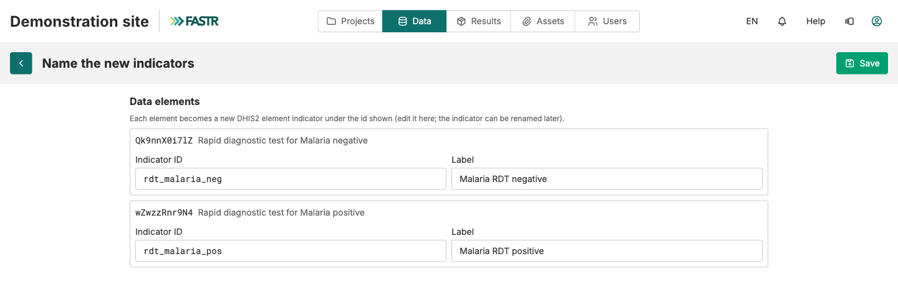

## Passo 2: nomear e guardar

O FASTR propõe um ID e um rótulo para cada elemento a partir do nome no DHIS2. Substitua-os pelos seus:

- **ID do indicador**: só letras minúsculas, dígitos e sublinhados. Para um indicador da lista FASTR, use o ID padrão (`anc1`, `anc4`, `penta1`).
- **Rótulo**: o nome mostrado nos gráficos. Acentos e espaços são permitidos.

Clique em **Guardar**. Repita os passos 1 e 2 até cobrir toda a lista.

**Ponto de controlo:** cada linha nova mostra o selo **Elemento DHIS2**, o código DHIS2 em **Definido por** e um visto em **Incluir**. Ainda não foi descarregado nenhum número.
