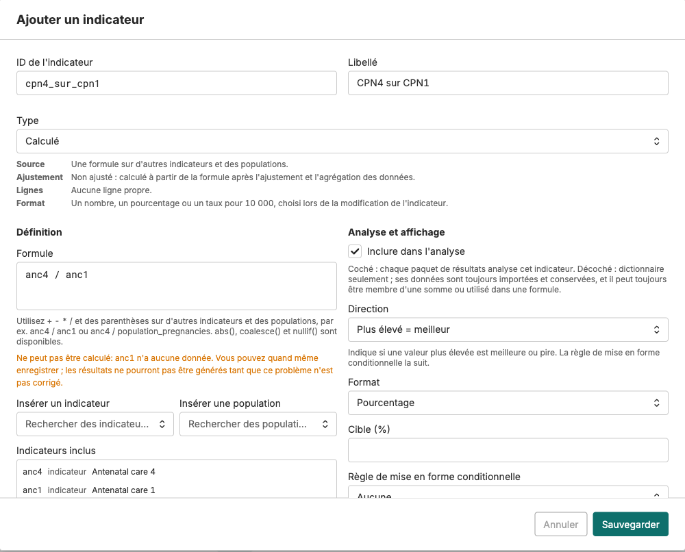

## Indicadores calculados: uma fórmula com regras próprias

Clique em **Adicionar indicador**, escolha o tipo **Calculado** e preencha:

- **Fórmula**: sobre indicadores existentes e números de população, p. ex. `anc4 / anc1` ou `anc1 / population_pregnancies`. **Inserir indicador** e **Inserir população** colam os nomes certos. Os números de população vêm da página **População** da instância.
- **Formato**: número, percentagem ou taxa por 10 000.
- **Direção**: **Mais alto é melhor** ou **Mais baixo é melhor**.
- **Meta** (opcional) e **Regra de formatação condicional**: limiares ascendentes, p. ex. 70 e 80, que definem as faixas vermelha, amarela e verde.

Um indicador calculado não tem valores até o módulo **Valores dos indicadores** correr num pacote de resultados. A regra definida aqui é a que o colore em todos os scorecards.

