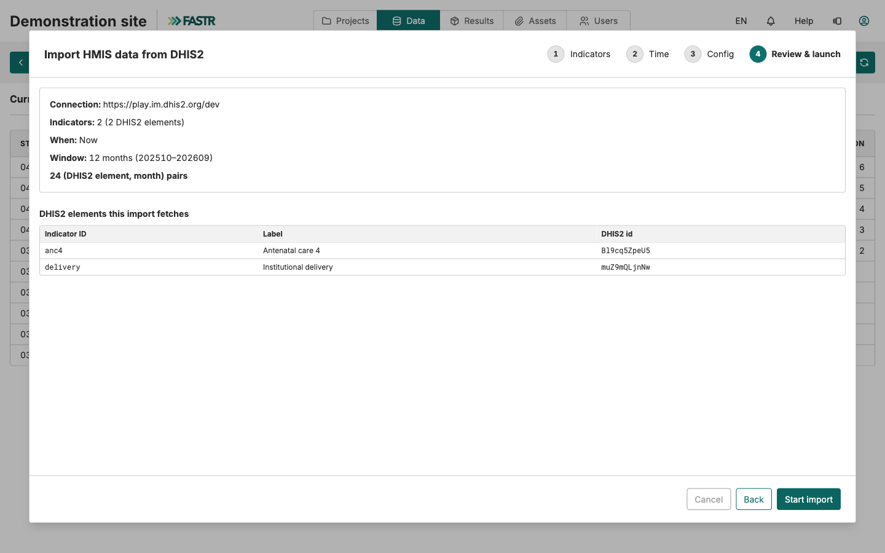

## Passo 3: importar os dados, quatro passos

**Dados → HMIS → Dados → Importações**, depois **Nova importação DHIS2**. O assistente usa a ligação guardada; não há nada para escrever.

| Passo | O que faz |
|---|---|
| **Indicadores** | Assinale os indicadores a obter (a caixa de cima seleciona todos) |
| **Hora** | **Agora**, **Uma vez, a uma hora definida**, ou **Recorrente** |
| **Configuração** | O intervalo de períodos: ano e mês de início, número de meses |
| **Rever e lançar** | Verifique ligação, indicadores, janela e número de pares (elemento, mês), depois **Iniciar importação** |

Desde a versão 1.76, o passo de revisão pergunta primeiro ao DHIS2 sobre a sua seleção. Avisa quando um ID aponta para uma fórmula do DHIS2 em vez de um elemento de dados, ou quando o DHIS2 já não conhece o ID.
