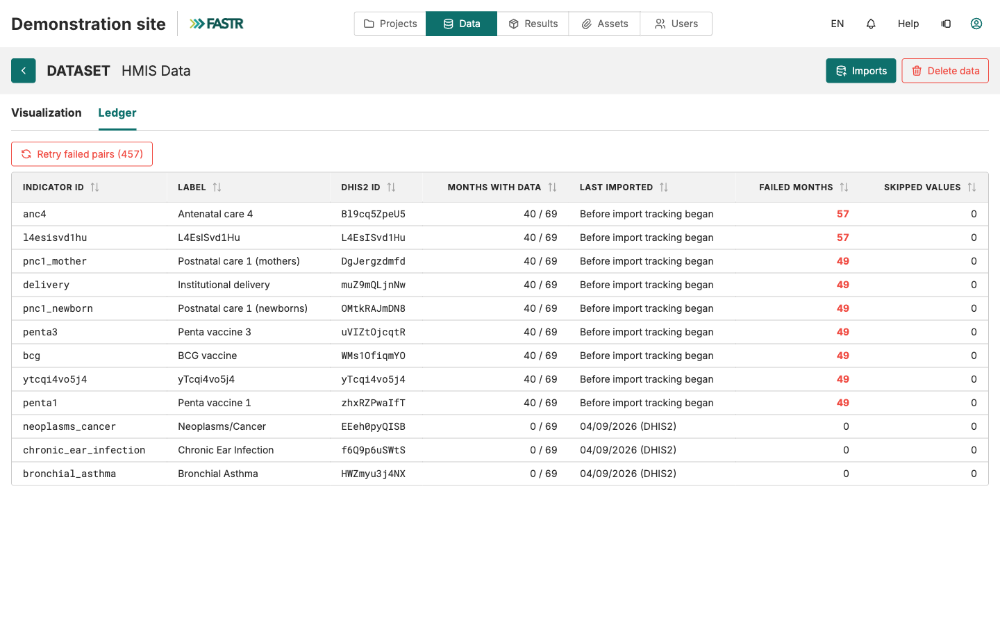

## Depois do lançamento: Atual, Histórico, Registo

A importação corre **no servidor**. Feche o separador, trabalhe noutra coisa, termine sessão: continua a correr.

- Separador **Atual**: progresso da importação em curso
- Separador **Histórico**: quando terminou e quantos pares tiveram sucesso ou falharam
- Separador **Registo** (página de dados HMIS): por indicador, os meses com dados, a última importação e os meses falhados, com repetição só para esses

Uma importação mantém tudo o que teve sucesso; nada é revertido. Poucas falhas normalmente significam que não há dados no DHIS2 para esse mês. Muitas falhas apontam para o mapeamento dos indicadores.

**Depois:** um administrador gera um pacote de resultados para que os projetos usem os novos dados. As importações mudam a instância; os projetos leem pacotes.
