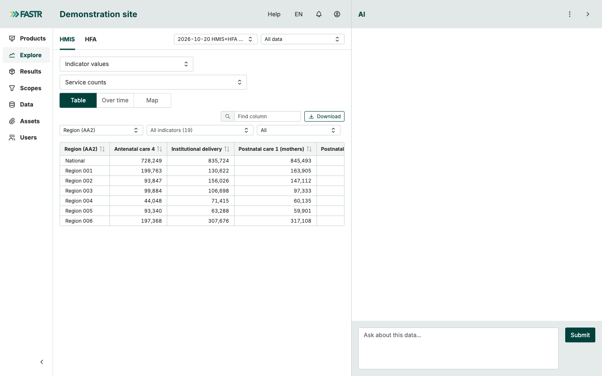

## Explorar: olhar antes de construir

O Explorar mostra todas as análises já calculadas num pacote de resultados, sem criar nada e sem guardar nada.

Quatro controlos no topo:

- **HMIS / HFA**: a família de dados
- **Pacote de resultados** (canto superior direito): o pacote fixado está selecionado
- **Âmbito**: **Todos os dados** é o país inteiro
- **Módulo** e **métrica** (à esquerda): abre em **Indicator values → Service counts**

<!--
PRESENTER NOTES:
- ~3 min. A ideia: antes de alguém construir um gráfico, pode ver o que os dados dizem.
- Nomeie os quatro controlos no ecrã, por esta ordem; a atividade pede aos participantes que os nomeiem de volta.
- Pacote e âmbito são os mesmos dois elementos que cada produto transporta. O Explorar usa os mesmos, por isso os números coincidem.
- Mude um filtro e a página atualiza-se; mais ninguém o vê, nada fica guardado. «Nada se pode estragar» baixa o risco para quem usa pela primeira vez.
-->
