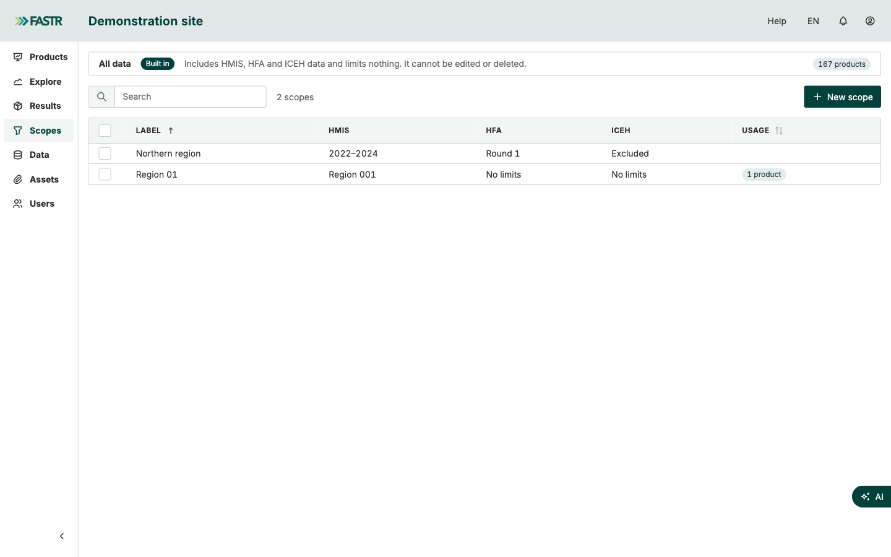

## Um âmbito: uma fatia nomeada dos dados

- Uma **vista nomeada** dos dados: uma região, um intervalo de anos, módulos ou indicadores, por família (HMIS, HFA, ICEH).
- **Todos os dados** é integrado: tudo, sem limites. O defeito dos produtos novos.
- A página **Âmbitos** lista cada âmbito, o que limita e quantos produtos o usam.
- Pacote = *que cálculo*. Âmbito = *que parte se olha*.

<!--
PRESENTER NOTES:
- Todos os utilizadores aprovados veem a lista de âmbitos; só os utilizadores não restritos a alteram (diapositivo seguinte).
- Analogia: o pacote é o prato, o âmbito é a porção servida.
- Os âmbitos substituíram a restrição que um projeto transportava. Um âmbito com o selo «Migrado» foi criado a partir de um projeto antigo.
- Os administradores também podem atribuir um âmbito a um utilizador restrito; ele passa a delimitar tudo o que esse utilizador vê. É um tema da página Utilizadores, não desta sessão.
- O Explorar e cada produto usam a mesma lista de âmbitos: um âmbito é um vocabulário partilhado pela equipa.
-->
