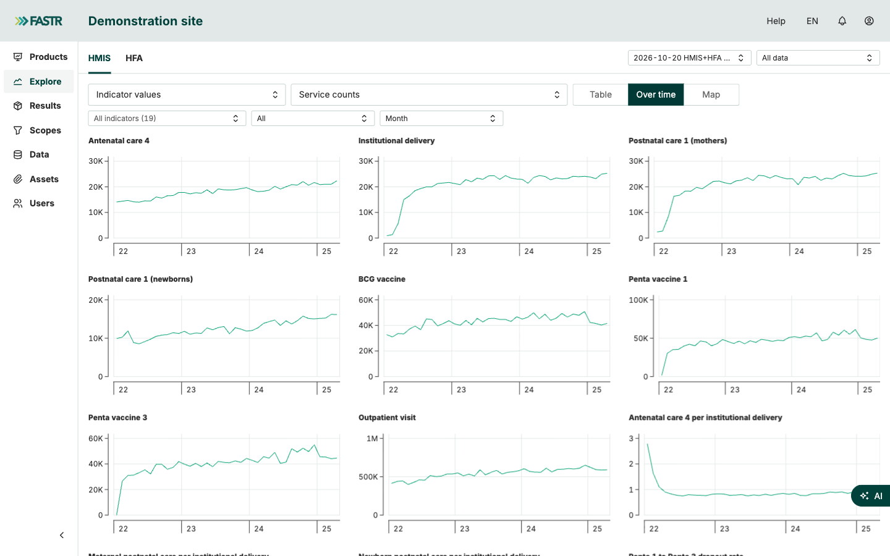

## Três vistas: Tabela, Ao longo do tempo, Mapa

- **Tabela**: uma linha por área, uma coluna por indicador. Filtros para o nível, os indicadores e o período. **Transferir** guarda-a num ficheiro.
- **Ao longo do tempo**: um pequeno gráfico por indicador, por **Mês**, **Trimestre** ou **Ano**, no nível que escolher.
- **Mapa**: um indicador, um nível, um período, colorido por área. Precisa dos ficheiros de limites da sua instância.

<!--
PRESENTER NOTES:
- Alterne Tabela → Ao longo do tempo → Mapa uma vez no ecrã. Três vistas dos mesmos números.
- Períodos: Últimos 12 meses, Último trimestre, Último ano, Tudo. Clique num cabeçalho para ordenar; Localizar coluna salta para um indicador.
- A tabela é a que se transfere para uma reunião. Ao longo do tempo é onde as perturbações aparecem. O mapa precisa de ficheiros de limites GeoJSON; numa instância sem eles a página di-lo. Diga-o antes de alguém reportar um erro.
- Os rótulos de nível são os do país (região, distrito, subdistrito).
-->
