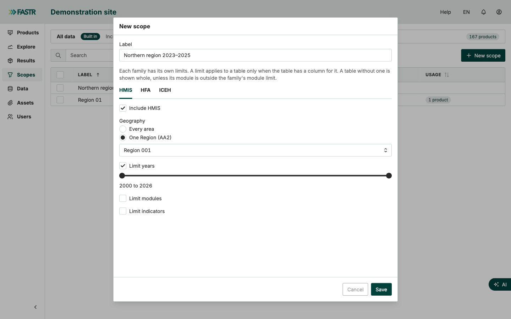

## Criar um âmbito

- **Âmbitos → Novo âmbito**, depois um rótulo que a equipa reconheça.
- Um separador por família (HMIS, HFA, ICEH); desmarque **Incluir** para deixar uma de fora.
- Limites: **Geografia** (uma região), **anos**, **módulos**, **indicadores**.
- **Guardar**. Exige acesso não restrito aos dados; os restantes só veem a lista.

<!--
PRESENTER NOTES:
- O HFA limita também rondas e categorias. Um âmbito usado por um produto não pode ser eliminado.
- Exemplo de rótulo: «Região Norte 2023–2025».
- Mostre ao vivo se a sua conta permitir: Novo âmbito, uma região, limitar os anos, Guardar. Elimine-o depois se for um teste.
- Uma área por âmbito, ao segundo nível administrativo. Para duas regiões, faça dois âmbitos ou um produto por região.
- O rótulo «Todos os dados» está reservado em todas as línguas. Nomeie um âmbito pelo conteúdo, não pelo autor nem pela reunião.
- A eliminação é recusada enquanto um produto usar o âmbito; mova primeiro o produto.
-->
