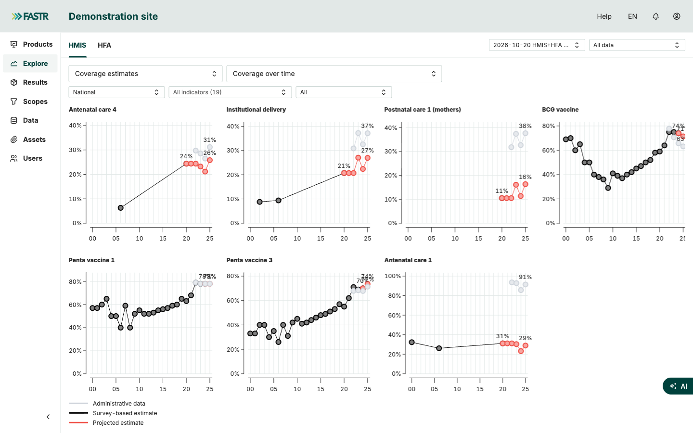

## Cada módulo traz as suas próprias métricas

A lista pendente **módulo** tem dois grupos:

- **Resultados principais**: Indicator values
- **Análises complementares**: Data quality assessment, Data quality adjustments, Disruption detection, Coverage denominators, Coverage estimates

Cada módulo muda a lista de métricas e a vista. **Coverage estimates → Coverage over time** desenha um gráfico por indicador: cinzento a partir dos dados de rotina, preto dos inquéritos, vermelho para a projeção.

<!--
PRESENTER NOTES:
- Abra a lista de módulos no ecrã e leia os dois grupos. Os nomes dos módulos aparecem em inglês na interface: problema de apresentação conhecido.
- As cores do gráfico de cobertura são as mesmas dos diapositivos de metodologia e das visualizações: cinzento HMIS, preto inquérito, vermelho projeção.
- Disruption detection → Observed and expected services mostra a banda esperada e os meses fora dela.
- Não explique os métodos aqui; os módulos de qualidade dos dados, perturbações e cobertura têm cada um a sua sessão.
-->
