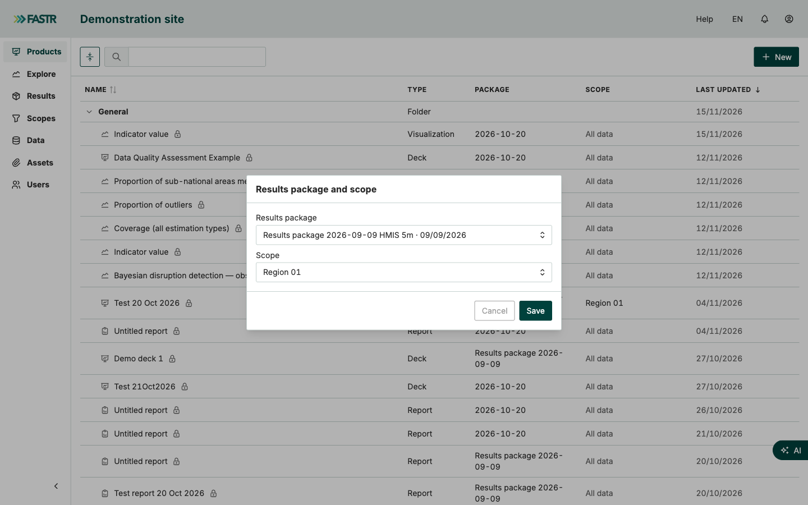

## Um produto transporta um único âmbito

- Cada produto é criado com um pacote e um âmbito, visíveis na sua linha em Produtos.
- Para os mudar: ⋮ → **Pacote de resultados e âmbito…** → **Guardar**. Todas as figuras voltam a filtrar-se.
- O Explorar tem os mesmos dois seletores, no canto superior direito.
- Um âmbito para uma revisão regional ou um período; os filtros do gráfico para um único gráfico.

<!--
PRESENTER NOTES:
- Mudar o âmbito de um produto exige acesso de edição a esse produto. Quem só vê encontra a linha mas não a pode mudar.
- Uma mudança de âmbito muda os números de todas as figuras do produto; títulos e interpretações podem precisar de atualização.
- Filtro ou âmbito: um filtro vive numa visualização; um âmbito aplica-se a todo o produto e a tudo o que dele for copiado.
- O acesso é à parte: um âmbito limita o que um produto mostra, Gerir acesso limita quem o pode abrir.
-->
