<!--
  Deck-scoped design override (does NOT touch the shared fastr-theme.css):
  swap the theme's vertical accent bar beside titles for a modern horizontal
  rule underneath them. Covers/sections/lead keep their own title treatment.
-->

<!-- _class: title-cover -->

  

  
  

# L'analyse de couverture dans FASTR

**Comment la plateforme compte les personnes à servir, et ce que cela change, étape par étape**

---

<!-- _class: pic -->

## La couverture, c'est quoi ?

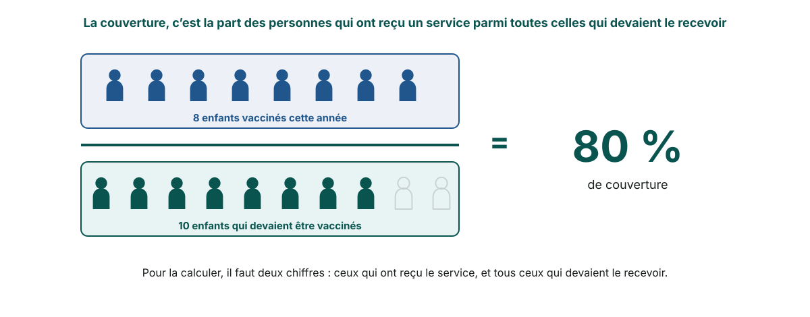

---

<!-- _class: pic -->

## Deux chiffres : un qu'on a, un qu'il faut estimer

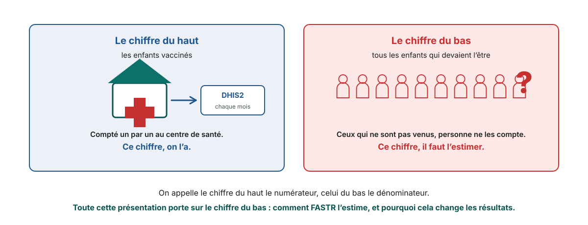

---

<!-- _class: section-cover -->

# Première partie : le problème, avec un exemple

---

<!-- _class: pic -->

## 4 000 enfants vaccinés : quelle couverture ?

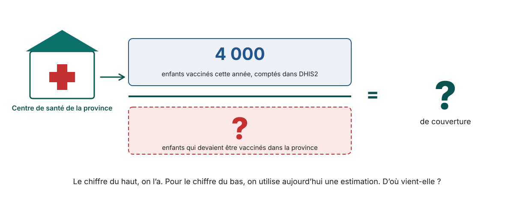

---

<!-- _class: pic -->

## D'où vient le chiffre qu'on utilise aujourd'hui

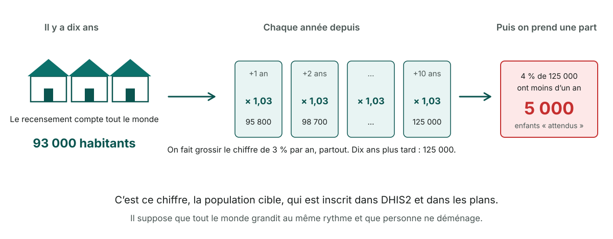

---

<!-- _class: pic -->

## Mais entre deux recensements, les gens bougent

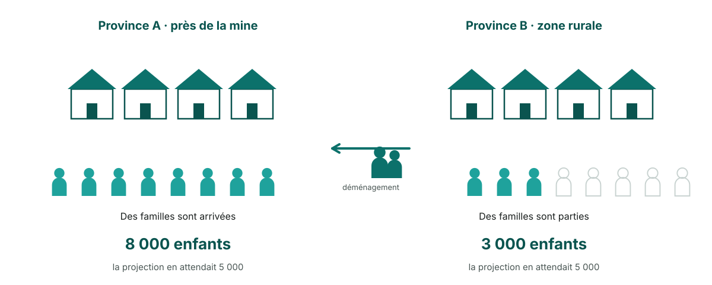

---

<!-- _class: pic -->

## Résultat : le 5 000 trompe tout le monde

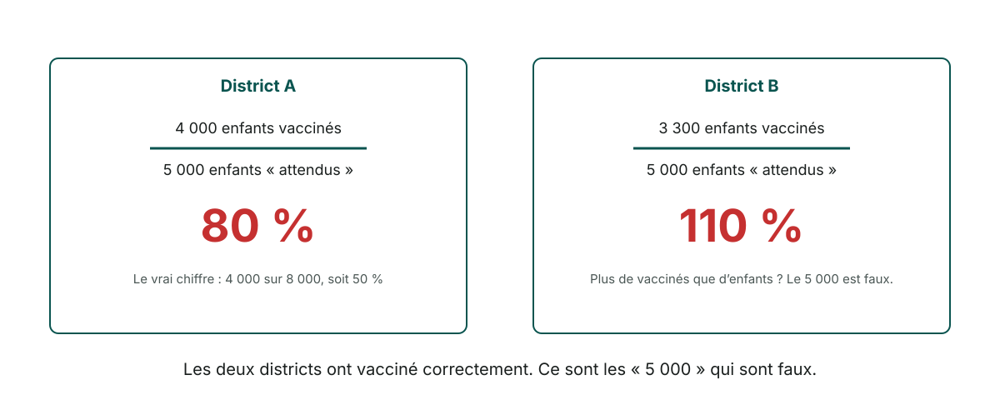

---

<!-- _class: section-cover -->

# Deuxième partie : comment FASTR compte

---

<!-- _class: pic -->

## L'idée de FASTR : combiner l'enquête et DHIS2

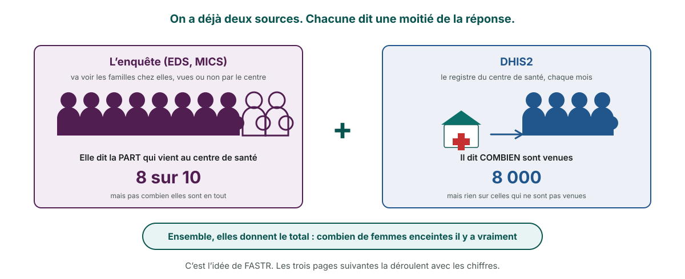

---

<!-- _class: pic -->

## Ce que dit l'enquête : 8 femmes sur 10 viennent

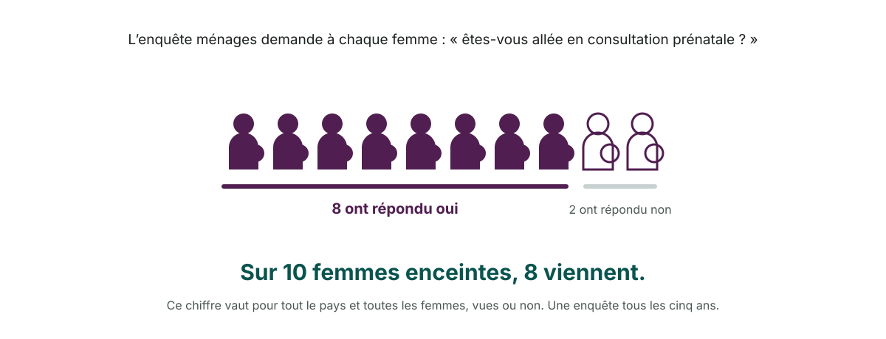

---

<!-- _class: pic -->

## Ce que dit DHIS2 : 8 000 femmes sont venues

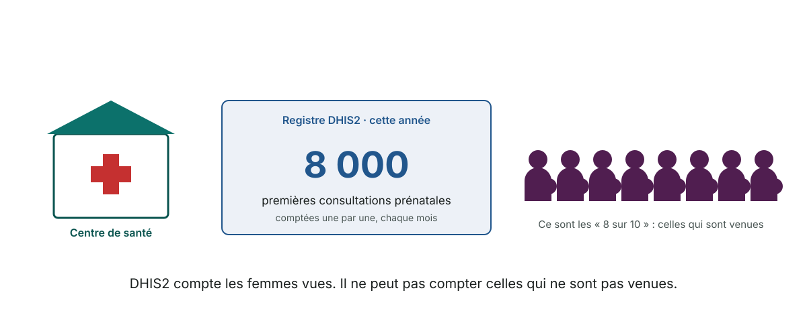

---

<!-- _class: pic -->

## Donc elles étaient 10 000

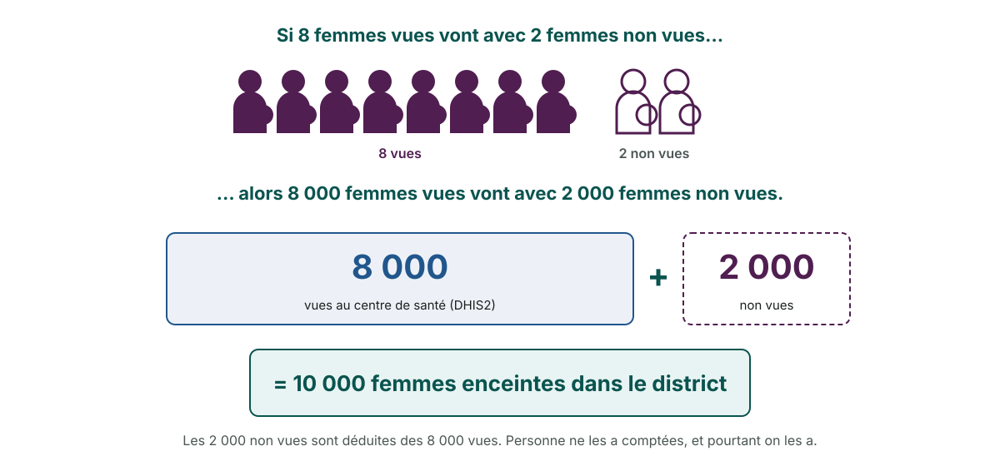

---

<!-- _class: pic -->

## La même idée, écrite en calcul

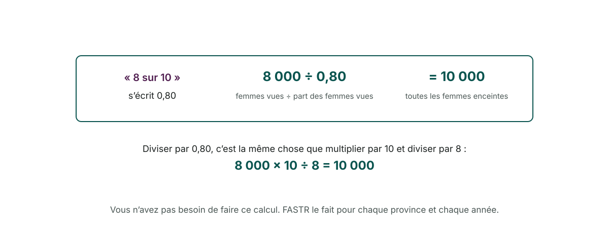

---

<!-- _class: pic -->

## Des grossesses aux enfants à vacciner

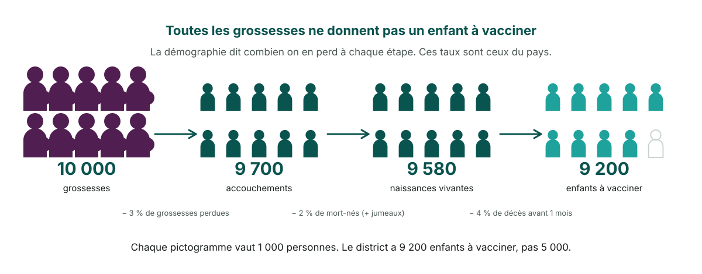

---

<!-- _class: pic -->

## Enfin le chiffre du bas : 43 % de couverture

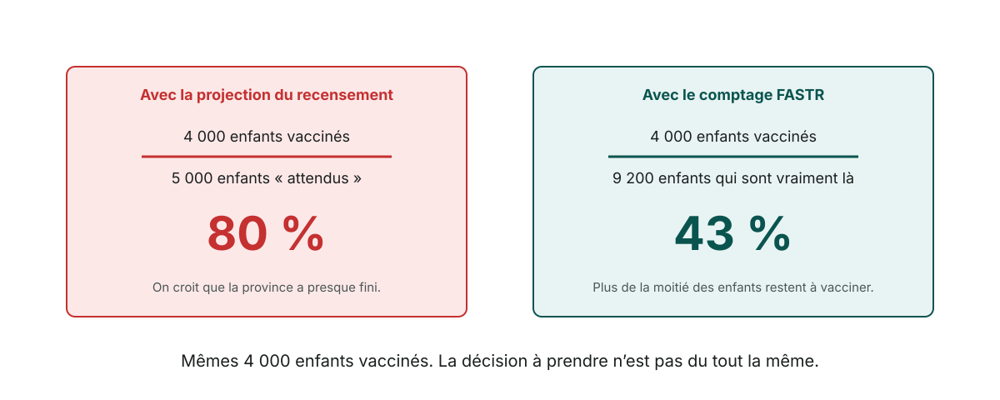

---

<!-- _class: section-cover -->

# Troisième partie : ce que la plateforme fait, dans l'ordre

---
<!-- _class: pic -->

## La plateforme fait cela en quatre étapes

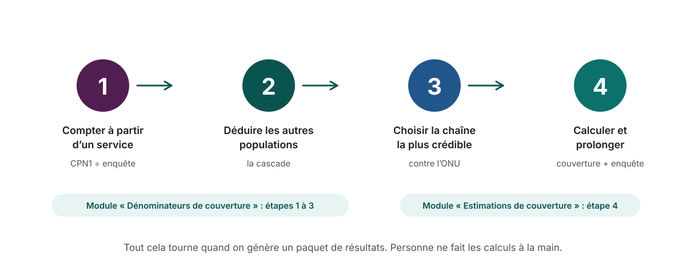

---

<!-- _class: pic -->

## Étape 1 : pourquoi ces quatre services ?

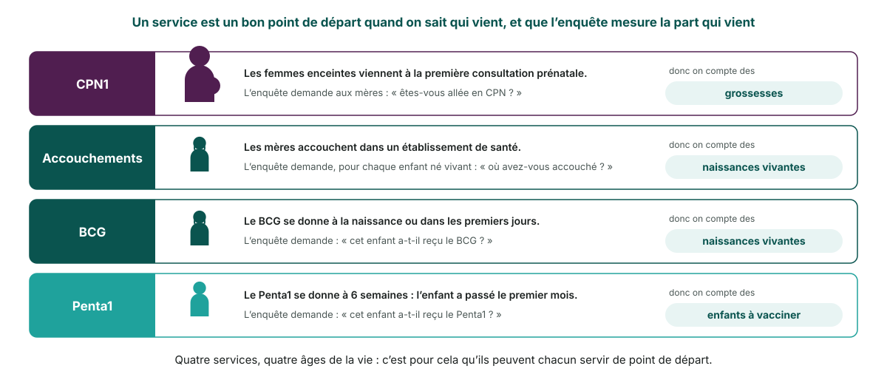

---

<!-- _class: pic -->

## Étape 1 : quatre services, donc quatre chaînes

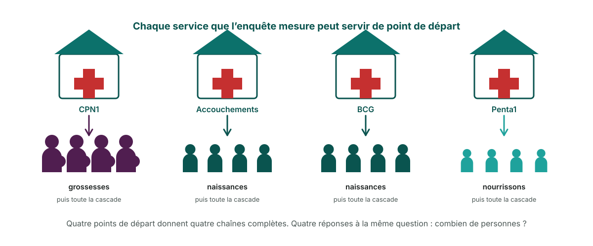

---

<!-- _class: pic -->

## Étape 1 : entre deux enquêtes, on garde la dernière valeur

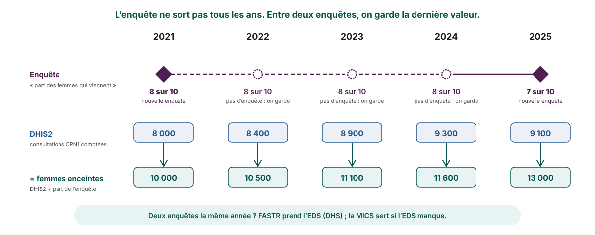

---

<!-- _class: pic -->

## Étape 2 : la cascade, pour descendre ou remonter

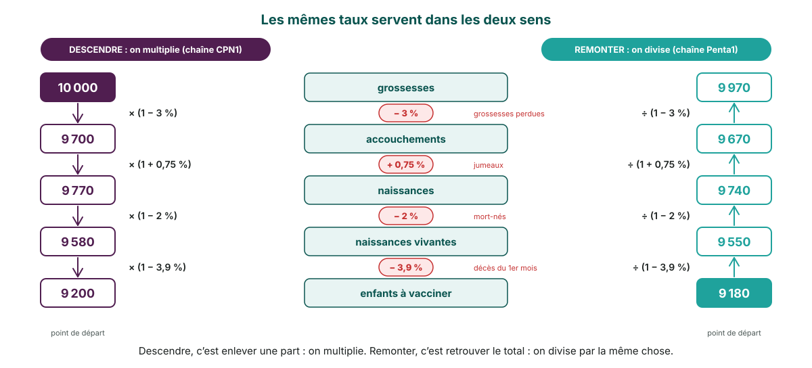

---

<!-- _class: pic -->

## Étape 2, suite : les cinq taux sont ceux de votre pays

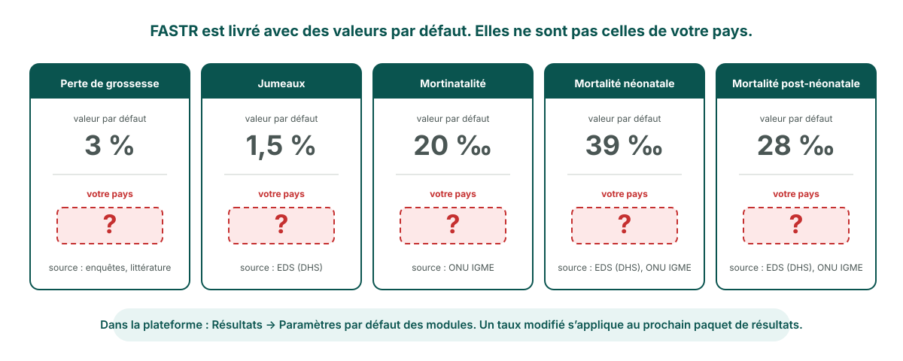

---
<!-- _class: pic -->

## Étape 3 : garder la chaîne la plus proche de l'ONU

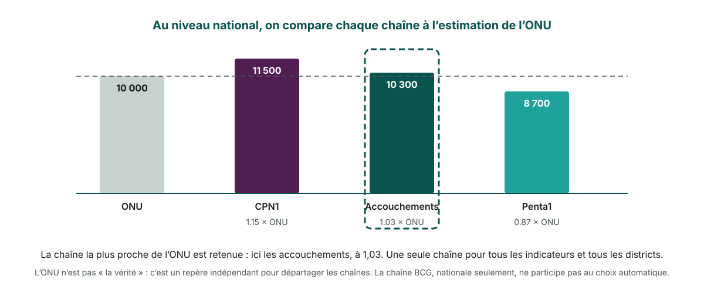

---
<!-- _class: pic -->

## Étape 4 : calculer la couverture

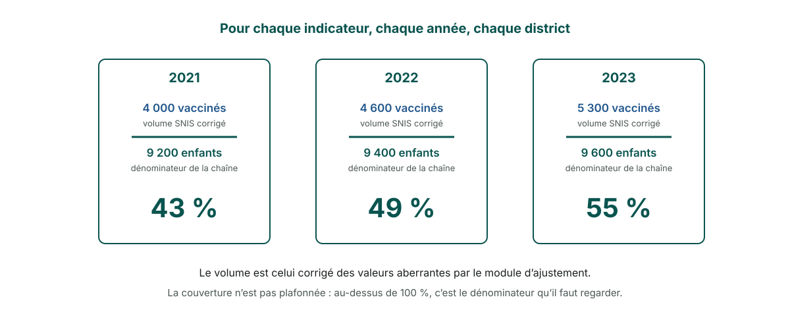

---
<!-- _class: pic -->

## Étape 4, suite : prolonger la dernière enquête

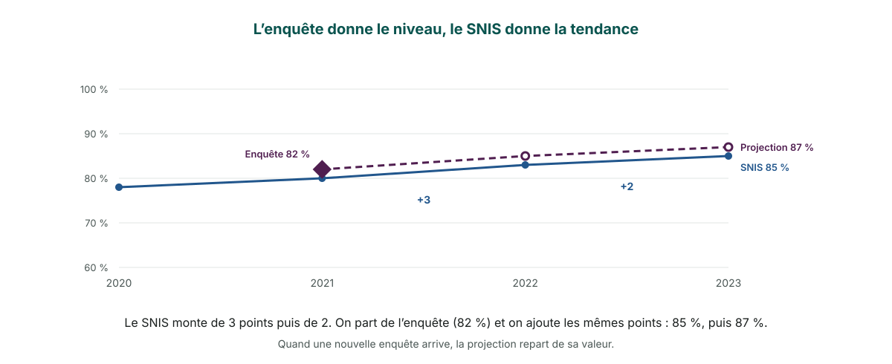

---
<!-- _class: pic -->

## Lire un graphique de couverture

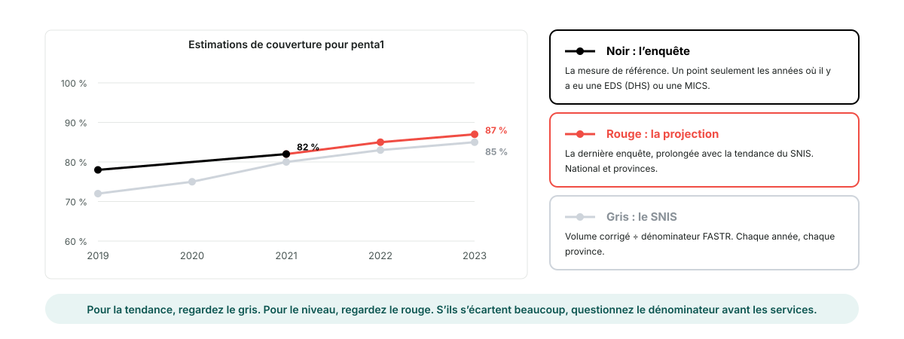

---
<!-- _class: pic -->

## Dans la plateforme : régler, générer, lire

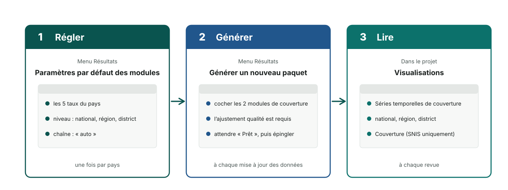

---

<!-- _class: two-panel -->

## Avant de faire confiance au résultat

### Vérifier

- La **dernière enquête** disponible pour le pays est bien celle utilisée
- Les **cinq taux** sont ceux du pays, pas les défauts
- La **chaîne retenue** et sa médiane, dans le journal de génération

### Interpréter avec prudence

- Une couverture **au-dessus de 100 %** : dénominateur à revoir
- Une **petite province** : quelques établissements suffisent à faire bouger la courbe
- Un **changement brusque** la même année dans tous les indicateurs : souvent un problème de rapportage, pas de service

---

<!-- _class: pic -->

## En une page

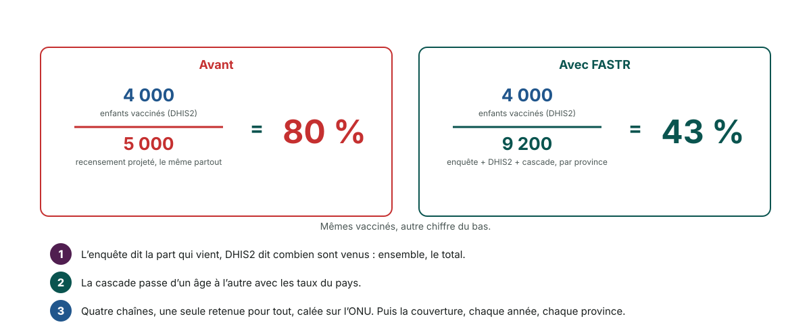

---

<!-- _class: bg-green -->

# FASTR

## Du volume de service à la couverture, chaque année et par province
