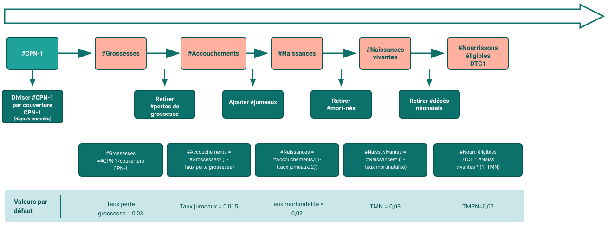

<!--
  Deck-scoped design override (does NOT touch the shared fastr-theme.css):
  swap the theme's vertical accent bar beside titles for a modern horizontal
  rule underneath them. Covers/sections/lead keep their own title treatment.
-->

<!-- _class: title-cover -->

  

  
  

# L'analyse de couverture dans FASTR

**Comment la plateforme compte les personnes à servir, et ce que cela change, étape par étape**

---

<!-- _class: section-cover -->

# Première partie : le problème, avec un exemple

---

<!-- _class: pic -->

## 4 000 enfants vaccinés. Est-ce beaucoup ?

---

<!-- _class: pic -->

## D'où vient le chiffre qu'on utilise aujourd'hui

---

<!-- _class: pic -->

## Mais entre deux recensements, les gens bougent

---

<!-- _class: pic -->

## Résultat : des couvertures qui ne veulent rien dire

---

<!-- _class: section-cover -->

# Deuxième partie : comment FASTR compte

---

<!-- _class: pic -->

## L'idée de FASTR : compter là où les gens passent

---

<!-- _class: pic -->

## Ce que dit l'enquête : 8 femmes sur 10 viennent

---

<!-- _class: pic -->

## Ce que dit DHIS2 : 8 000 femmes sont venues

---

<!-- _class: pic -->

## Donc elles étaient 10 000

---

<!-- _class: pic -->

## La même idée, écrite en calcul

---

<!-- _class: pic -->

## Des grossesses aux enfants à vacciner

---

<!-- _class: pic -->

## La couverture, enfin : 43 %, pas 80 %

---

<!-- _class: spacious -->

## Deux règles pratiques pour l'étape 1

**On garde la valeur de l'enquête jusqu'à la suivante.** L'enquête de 2021 dit « 8 sur 10 ». Il n'y en a pas eu depuis. Pour 2022, 2023 et 2024, FASTR continue d'utiliser « 8 sur 10 », avec le nombre de consultations de chaque année. Quand une nouvelle enquête sort, elle remplace l'ancienne.

**S'il y a deux enquêtes la même année, l'EDS passe avant la MICS.**

Le même raisonnement marche avec d'autres services. Avec les accouchements en établissement et la part de femmes qui accouchent en établissement, on retrouve le nombre de naissances. Avec le premier vaccin Penta et sa couverture d'enquête, on retrouve le nombre de nourrissons.

---

<!-- _class: section-cover -->

# Troisième partie : ce que la plateforme fait, dans l'ordre

---

## Vue d'ensemble : deux modules, quatre étapes

Module « Dénominateurs de couverture »

### Étapes 1 à 3

1. Estimer une population de départ à partir d'un service et de la dernière enquête
2. En déduire les autres populations par la cascade démographique
3. Choisir, parmi les chaînes obtenues, celle qui colle le mieux aux projections de l'ONU

Module « Estimations de couverture »

### Étape 4

4. Diviser chaque volume de service par son dénominateur, puis prolonger la dernière enquête avec la tendance du SNIS

Entrées

### Trois sources

- Les volumes du SNIS, **après correction de la qualité**
- Les enquêtes EDS et MICS, fournies avec la plateforme
- Les projections de population de l'ONU (UN WPP)

---

## Étape 2, en détail : la cascade et ses formules

C'est le même chemin que la page précédente, avec les formules que FASTR applique à chaque étape.

---

<!-- _class: two-panel -->

## Les cinq taux de la cascade

### Valeurs par défaut

| Taux | Défaut |
|------|--------|
| Perte de grossesse | 3 % |
| Jumeaux | 1,5 % |
| Mortinatalité | 20 ‰ |
| Mortalité néonatale | 39 ‰ |
| Mortalité postnéonatale | 28 ‰ |

### Ce qu'il faut en savoir

- Ce sont des valeurs de départ, pas des valeurs du pays. Elles se remplacent par l'EDS ou les estimations UN IGME dans **Résultats → Paramètres par défaut des modules**.
- Un taux changé s'applique à chaque paquet de résultats généré ensuite.
- Au niveau des régions et des districts, ce sont ces taux nationaux qui s'appliquent.

---

<!-- _class: two-panel -->

## Quatre points de départ, donc quatre chaînes

### Les points de départ

| Service | Population estimée d'abord |
|---------|---------------------------|
| CPN1 | Grossesses |
| Accouchements | Naissances vivantes |
| BCG | Naissances vivantes |
| Penta1 | Nourrissons après la période néonatale |

### Pourquoi plusieurs

- La cascade se parcourt dans les deux sens : depuis Penta1, on remonte aux naissances vivantes, puis aux grossesses.
- Chaque point de départ donne donc une estimation complète et indépendante de toutes les populations.
- Quatre chaînes, c'est quatre réponses à la même question. L'étape suivante en retient une.

---

<!-- _class: spacious -->

## Étape 3 : retenir la chaîne la plus crédible

Au niveau national, chaque chaîne est comparée aux projections de l'ONU pour trois populations : grossesses, naissances vivantes, nourrissons éligibles au Penta. Pour chaque chaîne, on calcule le rapport chaîne ÷ ONU, année par année, et on prend la médiane.

La chaîne dont la médiane est la plus proche de 1 est retenue. Une médiane de 1,15 signifie que la chaîne compte 15 % de personnes de plus que l'ONU.

La chaîne BCG ne participe pas à ce choix automatique, car elle n'existe qu'au niveau national. Elle reste disponible en choix manuel.

**Une seule chaîne est retenue**, puis appliquée à tous les indicateurs et à tous les niveaux géographiques, pour que les couvertures restent comparables entre eux.

---

<!-- _class: spacious -->

## Étape 4a : calculer la couverture

Pour chaque indicateur, chaque année et chaque niveau géographique :

couverture = volume de service du SNIS ÷ dénominateur de la chaîne retenue.

Le volume utilisé est celui **corrigé des valeurs aberrantes** par le module d'ajustement, le réglage par défaut. Un indicateur qui n'a aucun volume n'a pas de couverture, plutôt qu'un zéro trompeur.

La couverture n'est pas plafonnée. Une valeur au-dessus de 100 % est un signal : le dénominateur est trop petit, ou le numérateur compte des personnes venues d'ailleurs.

---

## Étape 4b : prolonger la dernière enquête

L'enquête reste la mesure de référence. FASTR part de sa dernière valeur et la fait évoluer comme la couverture SNIS, d'une année à l'autre.

**Exemple.** Enquête 2021 : 82 %. Couverture SNIS : 80 % en 2021, 83 % en 2022, 85 % en 2023.

Le SNIS gagne 3 points puis 2 points. La projection donne 85 % en 2022 et 87 % en 2023.

Le niveau vient de l'enquête, la tendance du SNIS.

| Année | SNIS | Enquête | Projection |
|------:|-----:|--------:|-----------:|
| 2021 | 80 % | 82 % | 82 % |
| 2022 | 83 % | | 85 % |
| 2023 | 85 % | | 87 % |

---

<!-- _class: two-panel -->

## Lire un graphique de couverture

### Trois séries sur le même graphique

- **Couverture SNIS** : volumes corrigés ÷ dénominateur, chaque année
- **Points d'enquête** : les valeurs EDS ou MICS, les années où il y en a
- **Projection** : la dernière enquête prolongée par la tendance du SNIS

### Laquelle regarder

- Pour la **tendance** : la couverture SNIS, disponible chaque année et par district
- Pour le **niveau** : la projection, calée sur l'enquête
- Si les deux s'écartent fortement, c'est le dénominateur qu'il faut questionner avant les services

Par district, seule la couverture SNIS existe. Les enquêtes ne descendent pas à ce niveau.

---

## Dans la plateforme, dans l'ordre

1 · Régler

### Paramètres par défaut des modules

Menu **Résultats**. Carte **Dénominateurs de couverture** : les cinq taux et le niveau de calcul (national, région, district). Carte **Estimations de couverture** : la chaîne, « auto » par défaut.

2 · Générer

### Un paquet de résultats

**Générer un nouveau paquet** avec les deux modules de couverture cochés. L'ajustement de la qualité doit être inclus : il fournit les volumes corrigés.

3 · Lire

### Les visualisations

**Séries temporelles de couverture**, national puis par région et par district, avec les points d'enquête. **Couverture (SNIS uniquement)** pour un tableau de bord opérationnel.

---

<!-- _class: two-panel -->

## Avant de faire confiance au résultat

### Vérifier

- La **dernière enquête** disponible pour le pays est bien celle utilisée
- Les **cinq taux** sont ceux du pays, pas les défauts
- La **chaîne retenue** et sa médiane, dans le journal de génération

### Interpréter avec prudence

- Une couverture **au-dessus de 100 %** : dénominateur à revoir
- Un **petit district** : quelques établissements suffisent à faire bouger la courbe
- Un **changement brusque** la même année dans tous les indicateurs : souvent un problème de rapportage, pas de service

---

<!-- _class: spacious -->

## En une page

1. Un service mesuré par l'enquête donne une population de départ : volume SNIS ÷ couverture d'enquête.
2. La cascade démographique en déduit les autres populations avec cinq taux.
3. Quatre chaînes sont construites ; celle qui colle le mieux aux projections de l'ONU est retenue pour tout.
4. La couverture est le volume corrigé divisé par ce dénominateur ; la dernière enquête est prolongée par la tendance du SNIS.

Le résultat se lit chaque année et par district, là où les enquêtes ne vont pas.

---

<!-- _class: bg-green -->

# FASTR

## Du volume de service à la couverture, chaque année et par district
