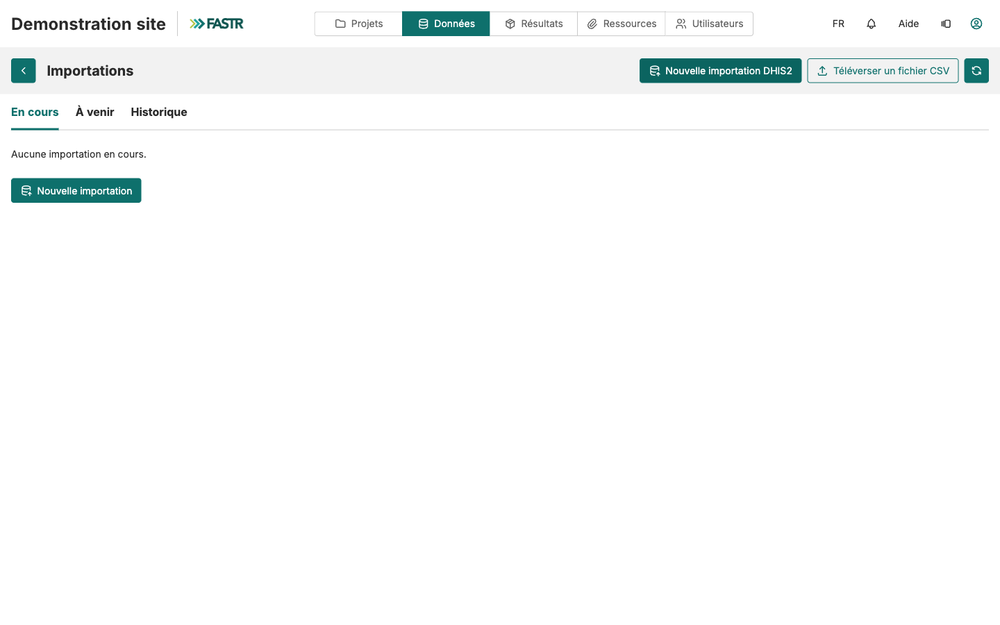

<!-- _class: title-cover -->

  

  
  

# Point d'étape FASTR Madagascar

**Formation · importation automatique · formations sanitaires · paramètres de couverture**

---

<!-- _class: spacious -->

## Quatre points en une heure

1 · Formation

Des sessions pour les administrateurs de la plateforme, maintenant et à la sortie de la v2. À décider : qui, quand, sous quelle forme.

3 · Formations sanitaires

La liste de la plateforme comparée à DHIS2 : 29 nouvelles, 23 retirées. Ce qu'on met à jour.

2 · Importation automatique

Programmer l'importation mensuelle depuis DHIS2. Démonstration sur l'instance.

4 · Paramètres de couverture

Les taux démographiques des dénominateurs sont encore les valeurs par défaut. Les valeurs malgaches sont prêtes à être confirmées.

Les diapositives cadrent chaque point. L'essentiel se passe dans la plateforme.

---

<!-- _class: spacious -->

## 1 · Sessions de formation pour les administrateurs

Configurer

### L'instance

Connexion DHIS2, structure des établissements, liste des indicateurs, utilisateurs et permissions.

Importer

### Les données

Importation DHIS2, planification récurrente, suivi, paquets de résultats.

Produire

### Rapports et présentations

Visualisations, diapositives, rapports, assistant IA.

Chaque session s'appuie sur un guide pas à pas en français, mis à jour sur la version actuelle de la plateforme, que les participants gardent.

À décider ensemble : qui sont les administrateurs à former, et combien ? À distance en trois sessions courtes ou une journée sur place ? Une première session maintenant, puis une mise à niveau à la sortie de la v2 ?

---

## 2 · Importation automatique des données DHIS2

Les données SNIS sur l'instance s'arrêtent à **mai 2026**.

**Nouvelle importation DHIS2** → étape **Heure** → **Récurrente** : chaque mois, un jour choisi, fuseau horaire d'Antananarivo. La planification s'affiche dans l'onglet **À venir**, chaque exécution dans **Historique**.

Après l'importation, deux gestes restent à faire à la main : **générer** un paquet de résultats et l'**épingler**. Les projets qui suivent l'épingle se mettent à jour.

Données → Données SNIS → Importations : onglets En cours, À venir, Historique.

À fixer : la date du mois où les données DHIS2 sont validées, le nombre de mois à réimporter, et qui vérifie, génère et épingle.

---

<!-- _class: spacious -->

## 3 · Formations sanitaires : plateforme et DHIS2

4 590<small>identifiants communs à la plateforme (4 613) et à DHIS2 (4 619)</small>

29<small>nouvelles dans DHIS2, absentes de la plateforme : surtout des structures privées à Fenoarivobe et Ambatolampy</small>

23<small>sur la plateforme, rangées sous MG_DEL dans DHIS2 : presque toutes en Anosy, 13 avec des données</small>

Aucune formation sanitaire n'a changé de région, de district ou de commune. Les listes nominatives sont dans le classeur d'audit.

Proposition : réimporter depuis DHIS2 au niveau Formations Sanitaires avec « Ajouter les nouveaux établissements et mettre à jour les existants ». Les 29 arrivent, les 23 gardent leur historique. Puis générer et épingler un nouveau paquet.

---

## 4 · Paramètres du module de couverture

Pour estimer une couverture, il faut un dénominateur : les grossesses ou les naissances attendues. FASTR les dérive des naissances vivantes déclarées, avec sept taux démographiques. Aujourd'hui, ce sont les **valeurs par défaut du module**, pas celles de Madagascar.

<table class="rates">
<tr><th>Taux</th><th>Défaut</th><th>EDS 2021</th><th>UN IGME 2024</th></tr>
<tr><td>Mortalité néonatale</td><td>39 ‰</td><td><strong>26 ‰</strong></td><td>23,1 ‰</td></tr>
<tr><td>Mortalité postnéonatale</td><td>28 ‰</td><td><strong>21 ‰</strong></td><td>19,9 ‰</td></tr>
<tr><td>Mortalité infantile</td><td>67 ‰</td><td><strong>47 ‰</strong></td><td>43,0 ‰</td></tr>
<tr><td>Mortalité des moins de 5 ans</td><td>103 ‰</td><td><strong>75 ‰</strong></td><td>62,4 ‰</td></tr>
<tr><td>Mortinatalité</td><td>20 ‰</td><td>—</td><td>18,4 ‰</td></tr>
<tr><td>Jumeaux · perte de grossesse</td><td>1,5 % · 3 %</td><td colspan="2">≈ 1,1 % (DHS groupées) · pas d'estimation nationale</td></tr>
</table>

À décider : adopter l'EDS 2021 ou UN IGME 2024, sans mélanger les deux. Où : Résultats → Paramètres par défaut des modules. Même écran pour passer les dénominateurs au niveau district.

---

<!-- _class: bg-green -->

## Ce qu'on retient de l'appel

Décidé aujourd'hui

- Formation : participants, dates, format
- Importation récurrente : jour, fenêtre, responsable
- Établissements : réimportation faite ou planifiée

Équipe pays

- Confirmer les taux de couverture
- Confirmer la date de validation mensuelle DHIS2
- Créer les comptes des participants

Équipe FASTR

- Envoyer les guides et le calendrier
- Vérifier la première importation planifiée
- Générer et épingler le paquet à jour

