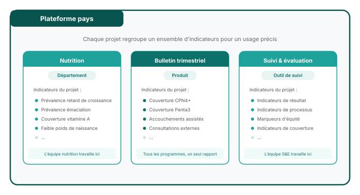
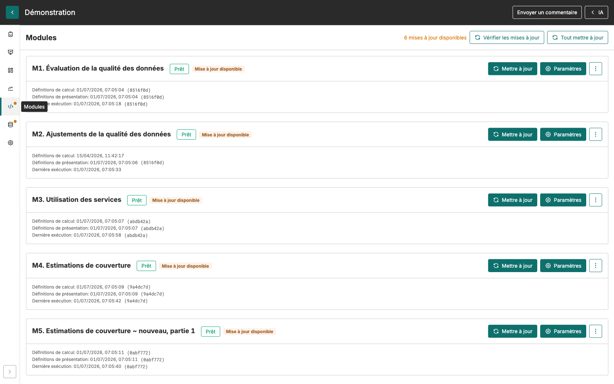
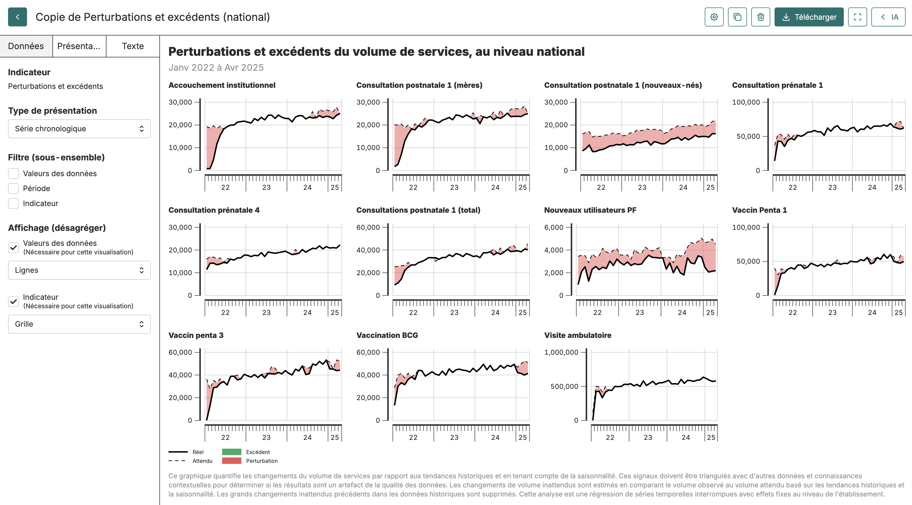

<!--
  Deck-scoped design override (does NOT touch the shared fastr-theme.css):
  swap the theme's vertical accent bar beside titles for a modern horizontal
  rule underneath them. Covers/sections/lead keep their own title treatment.
-->

<!-- _class: title-cover -->

  

  
  

# La plateforme d'analyse FASTR

**Les problèmes qu'elle résout, et comment elle les résout**

---

<!-- _class: centered -->

## Les données de santé existent. Elles n'arrivent pas à temps à ceux qui décident.

Chaque mois, les établissements déclarent leurs activités dans DHIS2. Pourtant, entre deux enquêtes nationales, la plupart des décisions de programme se prennent sans analyse récente de ces données.

---

## Trois obstacles, dans tous les pays

Obstacle 1

### Des données dispersées

Les données de routine, les enquêtes auprès des formations sanitaires et les enquêtes ménages vivent dans des systèmes et des fichiers séparés. Les recouper demande des semaines.

Obstacle 2

### Une qualité non traitée

Rapports manquants, valeurs aberrantes, incohérences : chacun le sait, et cela sert d'argument pour ne pas utiliser les données du tout.

Obstacle 3

### Une analyse artisanale

Les analyses dépendent de quelques personnes et de leurs feuilles de calcul. Quand elles partent, la méthode part avec elles. Chaque trimestre, le travail recommence.

Le résultat se voit en réunion : des chiffres contradictoires, des analyses périmées, et des décisions prises sans elles.

---

<!-- _class: section-cover -->

# Ce que la plateforme change

---

## Une seule source pour tout le pays

L'**instance** du pays contient une seule fois la structure sanitaire, les indicateurs et toutes les sources : DHIS2, enquêtes auprès des formations sanitaires, enquêtes ménages.

DHIS2 est relié directement. L'importation se programme et se répète seule, chaque semaine ou chaque mois. Personne ne ressaisit.

Les **projets** prennent un extrait de cette base pour répondre à une question précise. Toutes les équipes partent des mêmes chiffres.

Une correction faite à la source profite à toutes les analyses, pas à une copie isolée.

---

<!-- _class: output -->

## La qualité est évaluée et corrigée avant l'analyse

Deux modules passent avant tous les autres. Le premier **évalue** la qualité de chaque indicateur, établissement par établissement : complétude, valeurs aberrantes, cohérence. Le second **ajuste** les séries pour que les tendances reflètent les services rendus, et non les retards de rapportage.

Les résultats montrent ce qui a été corrigé et pourquoi. La qualité cesse d'être une raison de ne pas utiliser les données. Elle devient un résultat que l'on suit.

---

<!-- _class: two-panel -->

## La méthode est dans l'outil, pas dans une personne

### Ce que les modules calculent

- La **qualité** des données et son **ajustement**
- L'**utilisation des services** et les **ruptures** par rapport à l'attendu
- Les **dénominateurs** et les estimations de **couverture**
- Les indicateurs **calculés** propres au pays

### Pourquoi les résultats sont fiables

- Les méthodes sont **les mêmes** dans tous les pays, documentées publiquement
- Chaque résultat porte la **version** du calcul qui l'a produit
- Les résultats se **recalculent** à chaque mise à jour des données
- L'utilisateur **n'écrit aucun code**

Une analyse faite à Dakar et une analyse faite à Lusaka reposent sur la même méthode. Elles se comparent.

---

<!-- _class: output -->

## Un signal, pas un tableau de chiffres

Pour chaque indicateur, la plateforme compare le volume observé au volume attendu et signale les mois qui s'en écartent, au niveau national comme par district.

Un décideur voit en une page où les services ont décroché, depuis quand, et de combien. Le pourquoi reste une question pour le terrain. La plateforme dit où regarder.

---

<!-- _class: section-cover -->

# De l'analyse à la décision

---

## Un même jeu de données, trois formats de restitution

Pour suivre

### Tableaux de bord

Toujours à jour, partageables par un lien, lisibles sans compte. Pour une revue mensuelle ou un comité de pilotage.

Pour présenter

### Présentations

Assemblées dans la plateforme, exportées en PowerPoint ou PDF. Pour une revue trimestrielle ou une réunion de partenaires.

Pour documenter

### Rapports

Texte et figures en direct, exportés en Word ou PDF. Pour un rapport de performance ou une note de plaidoyer.

Les figures restent reliées aux données. Quand les données changent, le tableau de bord, la présentation et le rapport changent avec elles.

---

<!-- _class: spacious -->

## Un assistant qui lit les données, sans les inventer

L'assistant intégré répond à des questions posées en langage courant : « que montre la tendance de la CPN1 ? », « quelles régions ont la couverture la plus basse ? ».

Il répond à partir des **résultats calculés par les modules** du projet. Il ne produit aucun chiffre lui-même et il ne voit que le projet dans lequel on l'utilise.

Il aide ensuite à rédiger : résumé d'un graphique, premier jet d'une section de rapport, que l'équipe relit et signe.

---

<!-- _class: section-cover -->

# Ce qu'un décideur demande avant de s'engager

---

<!-- _class: two-panel -->

## Sécurité et souveraineté des données

### Ce que contient la plateforme

- Des **totaux agrégés** par établissement et par mois, les mêmes que dans DHIS2
- **Aucun dossier patient** et aucune donnée nominative

### Comment elle est protégée

- Une **installation isolée par pays** : application, base et stockage séparés, aucun accès entre pays
- Des **accès par rôle** et un **journal** de chaque action
- Des **sauvegardes** en couches et l'**export intégral** des données à tout moment

Les données restent celles du pays. Le détail figure dans le dossier « Sécurité, coûts et appropriation ».

---

<!-- _class: spacious -->

## Coût et appropriation

Le logiciel est **open source** : ni licence, ni frais par utilisateur. Le fonctionnement tient en trois lignes : un hébergement fixe pour le serveur du pays, l'usage de l'IA au compteur, et la maintenance partagée de la plateforme. L'ordre de grandeur est de **12 000 USD par an et par pays**, estimation de planification.

Les administrateurs des pays gèrent déjà eux-mêmes les utilisateurs et les importations. L'objectif proposé est un **hébergement par le ministère de la Santé d'ici 2030**, par une migration structurée qui transfère mises à jour et maintenance avec le serveur.

---

<!-- _class: spacious -->

## Où en est le déploiement

Vingt-neuf pays partenaires du GFF disposent aujourd'hui de leur instance FASTR, en anglais, en français ou en portugais. Plusieurs d'entre eux ont commencé par le suivi de la continuité des services après des changements de financement extérieur, avant d'élargir l'usage.

Les équipes pays sont formées sur leurs propres données, dans leur instance, à partir d'un programme commun : configuration, importation, analyse, restitution.

---

<!-- _class: spacious -->

## Ce qui change pour un ministère

Avant, les données de routine étaient dispersées, retravaillées à la main et vite périmées. Les décisions entre deux enquêtes se prenaient sans elles.

Avec la plateforme, le ministère dispose d'une base commune, à jour, dont la qualité est connue, analysée par une méthode partagée et restituée dans le format de chaque public.

Le cycle se boucle chaque trimestre : analyser, apprendre, renforcer, agir, puis vérifier dans les données du trimestre suivant que la décision a produit son effet.

---

<!-- _class: bg-green -->

# FASTR

## Des données de routine aux décisions, chaque trimestre
