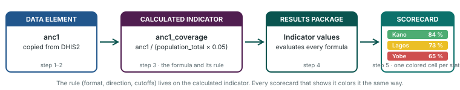
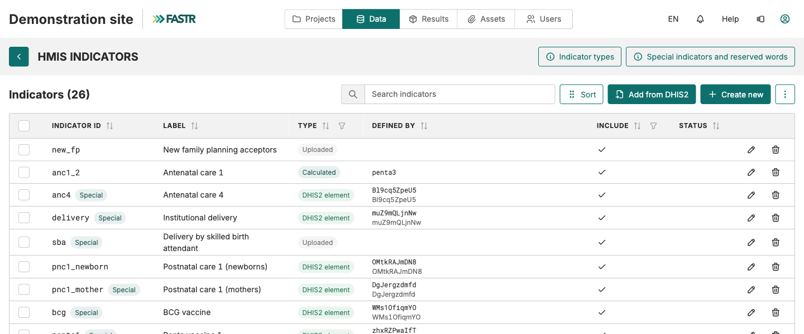
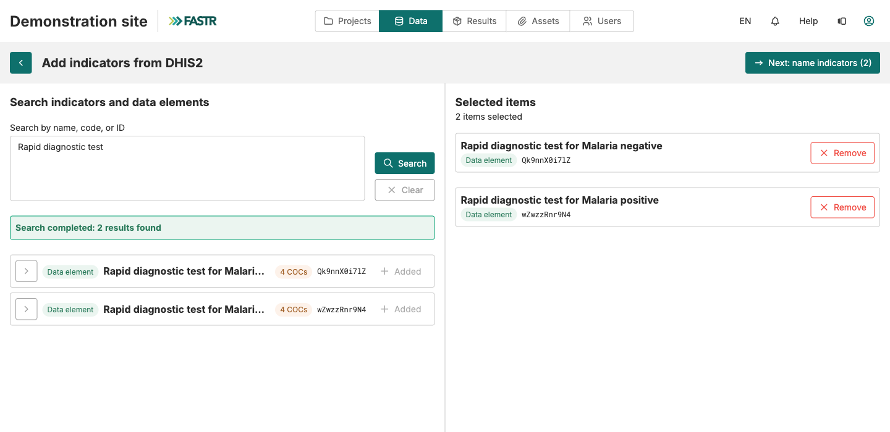
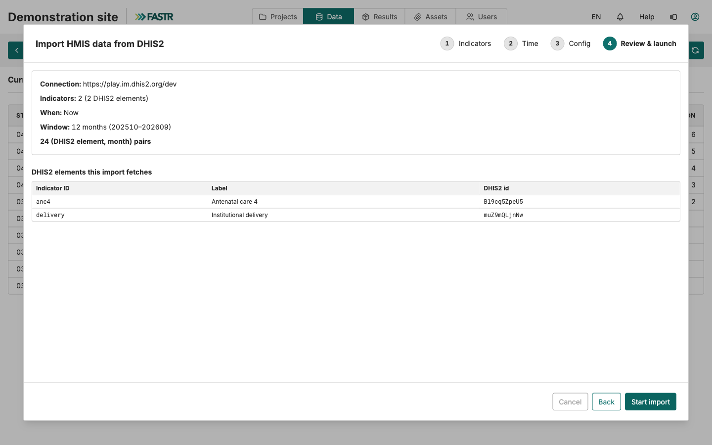
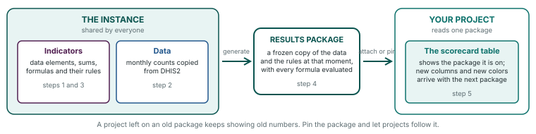
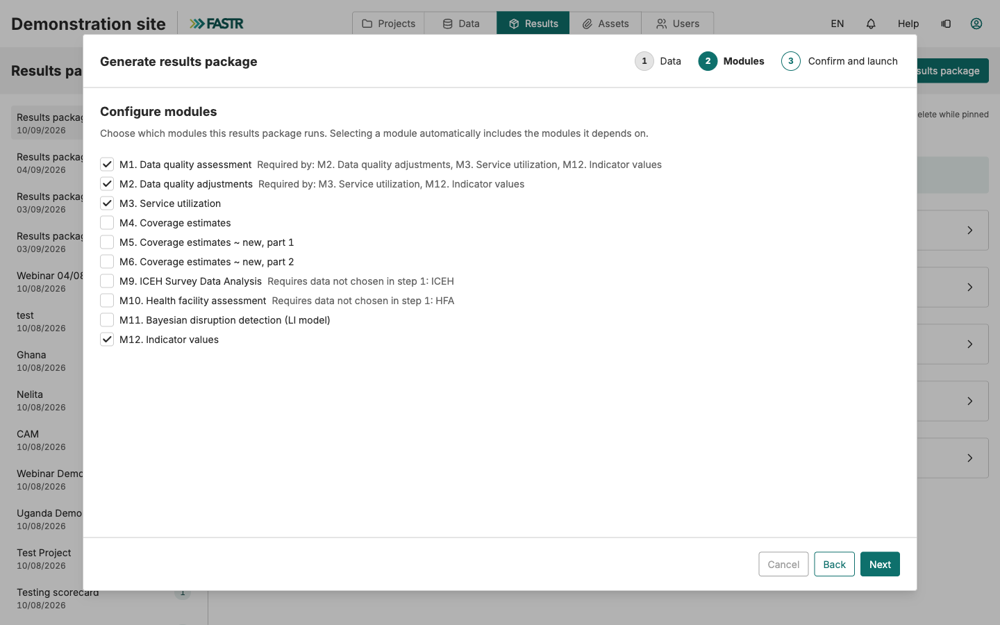

# Adding an indicator to the scorecard

<strong>Step-by-step guide</strong> · <strong>~30 min</strong>

<aside class="p1-sidebar">

Before you start

- ☐ You are logged into FASTR with an admin account that can edit the instance's data
- ☐ You have the **DHIS2 ID** of each indicator, or its exact DHIS2 name
- ☐ You know the **target** and the **cutoffs** the program wants for the colors

</aside>

## What a scorecard column is

FASTR does not collect data itself. It **copies the data from DHIS2** over a direct connection and stores it under the name you give it. Everything on the scorecard is built from those copies.

All indicators live in **one list**: **Data → HMIS → Indicators**. Each row has a **type**:

- A **Data element** is a monthly count copied from DHIS2, like `anc1`.
- A **Sum** adds other indicators together, like two age bands into one.
- A **Calculated** indicator is a **formula**: one thing divided by another, shown as a percent or a rate, with the rule that colors it green, yellow or red.

**Every column on the scorecard is a calculated indicator.** To add a column, you make sure the counts it needs exist, write the formula, set its colors, and generate a results package. This guide walks through it.

> **A real example from the Nigeria platform.** `sba` is a data element: deliveries by a skilled birth attendant each month, copied from DHIS2. `delivery` is another: all reported deliveries. `skilled_birth_attendance` is a calculated indicator with the formula `sba / delivery`, shown as a percent, green from 100 %, yellow from 95 %, red below. The scorecard shows it as one colored cell per state.

---

## The five steps

| # | What you do | Where |
|---|---|---|
| 1 | Make sure the counts exist in FASTR | Instance → **Data** → **HMIS** → **Indicators** |
| 2 | Copy their numbers over from DHIS2 | Instance → **Data** → **HMIS** → **Data** → **Imports** |
| 3 | Create the calculated indicator, with its colors | Same indicator list, **Create new** → **Calculated** |
| 4 | Generate a results package and attach it | Instance → **Results** → **Generate new results package** |
| 5 | Put the scorecard table in the project | Project → **Products** → **New** → **New visualization** |

Some steps are already done. If the counts are in FASTR with data, start at step 3. If the project already has a scorecard table, stop after step 4: the new column appears in it on its own.

**The example used in this guide.** We follow one request from start to finish: the Safe Motherhood Coordinator wants **ANC1 coverage** on the scorecard. Out of all pregnant women, how many came for their first antenatal visit? Look for **Our example** on each page.

> **Steps 1 to 3 happen in the shared part of FASTR.** Your project only sees them after a **new results package** is generated and the project switches to it (step 4). Created something and it is not showing? Changed a color cutoff and nothing moved? Do step 4.

---

<h2 class="step-h">1Make sure the counts exist in FASTR</h2>

1. Click **Data** in the side navigation, then **HMIS**, then **Indicators**. One list, one row per indicator, with its **Indicator ID**, its label, its **type**, and **Defined by** (the DHIS2 code and its DHIS2 name).
2. Search the list for the counts your formula needs. If they are there, go to step 2. If not, continue.

   

3. Click **Add from DHIS2**. Paste the **DHIS2 ID** in the search box, or type the DHIS2 name. Click **Search**.
4. Click **Add** next to each element you want. It moves to the selected items. Search again for the next one; the selection is kept.
5. Click **Next: name indicators**. FASTR proposes an ID and a label for each. Replace them with yours (next page). Click **Save**.

   

> **Tip:** a broad word like `delivery` finds the whole family in one search. Rows greyed as "Cannot be added" are not monthly counts.

**Our example:** `anc1` already exists in the Nigeria list, with data. We go straight to step 3. The rest of this page is for a count that is missing.

---

## The ID and the label: same indicator, two audiences

- **The ID is for the machine.** It is used in formulas and data files, so the rules are strict: small letters, numbers and underscore ( _ ) only. No capitals, no spaces, no dashes, no accents. `ipd_discharges` ✓ · `IPD-Discharges` ✗ · `ipd discharges` ✗. An ID **cannot be changed after saving**; a typo means delete and start over. Start the ID with the program area (`anc1_visits`, `nut_stunting_u5`) so related indicators sort together.
- **The label is for people.** It appears in menus, tables and chart legends. Accents, spaces and capitals are fine. Make it short and clear enough that a colleague from another program understands it. "ANC1 women 15–17 years" works. "ANC1 g2" does not. On a chart a long label gets cut off: aim for a handful of words.

## When you need a subgroup (an age band, a sex, a facility type)

In DHIS2 one element is often split into subgroups. These are called **COCs**. In the search results:

1. Look at the result row. A badge saying **"N COCs"** means it has subgroups.
2. Click the **chevron** on the left of the row. The subgroups unfold, each with a two-part ID: `N70qtdTZ21W.idn6U8HSREb`. Before the dot: the element. After the dot: the subgroup.
3. Click **Add** on the **subgroup line**, not on the main line.

The main line gives you everything added together. The subgroup line gives you just the slice you want. If someone hands you an ID with a dot in it, search for the part **before** the dot, then unfold.

## Two codes that belong together: make a Sum

Two age bands to add up, or an old DHIS2 code and its replacement joined into one series? Add both as data elements, then click **Create new**, choose the type **Sum**, and pick them as **Members**. The sum has no rows of its own; it is read from its members.

---

<h2 class="step-h">2Copy the numbers over from DHIS2</h2>

A new data element is an empty name until its numbers are copied. Skip this step if every count in your formula already has data (the HMIS Data page's **Ledger** tab shows the months each indicator holds).

1. Click **Data**, then **HMIS**, then the **Data** card. Click **Imports**, then **New DHIS2 import**. The wizard uses the instance's saved DHIS2 connection; there is nothing to type.
2. **Indicators**: tick the indicators to copy, including the new ones. Calculated indicators and sums are not fetched, and the wizard says so.
3. **Time**: choose **Now**. **Config**: set the period range. **Review & launch**: check the summary, then **Start import**.

   

The import runs on the server. You can close the tab; the **History** tab on the Imports page tells you when it is done, and the **Ledger** tab shows any failed months.

> **Set the period to match your old data.** Your other indicators go back years. If you only copy this year for the new ones, every chart that looks back further has a hole in it. Copy the same period as the rest.

**Our example:** `anc1` has data back to 2020, so nothing to copy.

---

<h2 class="step-h">3Create the calculated indicator</h2>

1. On the indicator list, click **Create new** and choose the type **Calculated**.
2. Fill in **Indicator ID** (same strict rules as before, cannot be changed later) and the **label**, which becomes the column title. Keep it short.
3. **Formula**: write the calculation. Click **Insert indicator** to paste an indicator's ID and **Insert population** to paste a population term. You can use `+ - * /`, brackets and numbers.
4. Under **Analysis and display**, set **Format**, **Direction**, **Target** and the **Conditional formatting rule**. The next two pages explain them.
5. Click **Save**.

Screenshot: Create new → Calculated form, with Formula and the Analysis and display section (EN) → resources/screenshots/scorecard_en/04_calculated_form.png

> **The formula is the indicator.** A calculated indicator is the calculation, shown as a percent or a rate. There is no separate numerator and denominator box: you write the division yourself, and FASTR evaluates it for every area and month when it generates a results package.

**Our example:** ID `anc1_coverage`, label "ANC1 coverage (%)", formula `anc1 / (population_total * 0.05)`. Why `* 0.05` is on the next page.

---

## The denominator: what are you dividing by?

| You want | Write | Example from Nigeria |
|---|---|---|
| A count, no division | the indicator alone | `maternal_deaths` |
| A share of another count | `a / b` | `sba / delivery` |
| A share of the people in the area | `a / population_type` | `hypertension_new / population_total` |
| A share of a group inside the population | `a / (population_type * share)` | `penta3 / (population_total * 0.04)` |

**Population terms** come from the instance's **Population** page (**Data → HMIS → Population**). It holds people per area and per year, by population type, and FASTR converts the yearly figures to monthly on its own. **In Nigeria only `population_total` is loaded**, for every zone, state and LGA. To divide by a smaller group, multiply the total by that group's share:

| Group | Share | Used today by |
|---|---|---|
| Women of reproductive age | `* 0.22` | `new_fp_acceptors_rate` |
| Infants under one year | `* 0.04` | `penta3_coverage`, `fully_immunized_coverage` |
| Expected pregnancies | `* 0.05` | the planning figure; confirm it with the M&E team |

> **No population data for an area and year?** FASTR leaves that cell empty rather than guessing. If a column is empty for a whole state, check the Population page before anything else.

**Our example:** ANC1 coverage divides visits by expected pregnancies: `anc1 / (population_total * 0.05)`.

---

## Format, direction, target and colors

These four settings belong to the indicator, under **Analysis and display**. Every scorecard, chart or table that shows the indicator uses the same ones.

- **Format**: **Percent**, **Number**, or **Rate per 10,000**. A division of two counts is a percent. A count divided by a population is a rate.
- **Direction**: **Higher is better** for things you want more of (visits, vaccinations). **Lower is better** for things you want fewer of (deaths, stillbirths). Get this wrong and the colors read backwards.
- **Target**: optional. The number the program aims for, in the same unit as the format.
- **Conditional formatting rule**: the cutoffs that color the cells. Type them as **ascending numbers**, in the unit shown. For a percent, `70` and `80` mean 70 % and 80 %.

What the colors mean on the scorecard, for a "higher is better" indicator with cutoffs 70 and 80:

| Value | Color | Label on the scorecard |
|---|---|---|
| 80 and above | green | **On track** |
| 70 to just under 80 | yellow | **Progress needed** |
| below 70 | red | **Not on track** |

For "lower is better" the bands flip: below the first cutoff is green.

> **The cutoffs are a program decision.** What is the national target? What counts as close enough? Ask the program officer and write the answer in the form at the end of this guide. Write down where the numbers come from.

**Our example:** the national ANC1 target is 80 %. Format **Percent**, direction **Higher is better**, target `80`, cutoffs `70` and `80`. A state at 84 % shows green, at 73 % yellow, at 65 % red.

## Column order

The scorecard shows columns in the order of the indicator list. Click **Sort** on the list and drag the rows into place. Keep indicators from the same program together.

---

<h2 class="step-h">4Generate a results package and attach it</h2>

The indicator and its rule are saved, but no number has been computed. Projects do not read the indicator list directly. They read a **results package**: a prepared set of results, generated from the data and the rules as they stand at that moment.

1. Click **Results** in the side navigation. The **Results packages** page lists the existing packages, each with its date and the projects using it.
2. Click **Generate new results package**. Three steps.
3. **Data**: tick **HMIS**. **Modules**: tick **Indicator values**. This is the module that evaluates every formula; without it the calculated indicators stay empty. FASTR adds the modules it depends on by itself.
4. **Confirm and launch**: keep the suggested label or name the package clearly. Under **Attach to projects**, tick the project with the scorecard. Click **Launch generation**.

   

Generation runs in the background; progress shows on the Results packages page. When it is **Ready**, the ticked projects switch to it, and every scorecard in them shows the new column with its colors.

> **Forgot a project?** Open that project, go to its **Results package** tab, pick the new package and click **Use this package**. A project left on an old package keeps showing old numbers without warning anyone. The setting that simplifies this: on the Results page, **Pin** the reference package, and in each project tick **Always use the instance's pinned package**. From then on the routine is import, generate, pin, and the projects follow.

**Our example:** we tick **Indicator values** and the training project, launch, and wait for **Ready**.

---

<h2 class="step-h">5Put the scorecard table in the project</h2>

Skip this step if the project already has a scorecard table: the new column is in it after step 4. Otherwise, build one. A scorecard is an ordinary table visualization with one setting switched on.

1. Open the project. On the **Products** tab, click **New**, then **New visualization**. Give it a name, choose a folder, and select the results package. Click **Next**.
2. **Metric**: choose **Indicator values** → **Indicator value**.
3. **Presets**: choose **Scorecard table**. It lists indicators by area for the chosen period. Click **Configure** if you want to change the period or the geographic level now, then create it.
4. In the visualization's style panel, set **Conditional formatting** to **Indicator**. Each value is now colored by its own indicator's rule, and the legend shows the bands.
5. Save.

Screenshot: New visualization → Indicator values → Scorecard table preset, then the style panel with Conditional formatting set to Indicator (EN) → resources/screenshots/scorecard_en/07_scorecard_table.png

Things you can change on the table: the **rows** (zones, states or LGAs, and a filter to one state), the **period** (months or quarters, how many), and which **columns** to show for this audience. Two things are **not** set here: the **colors** come from each indicator's rule (step 3), and the **column order** from **Sort** on the indicator list.

The finished scorecard behaves like any other visualization. You can put it in dashboards, reports and slide decks.

**Our example:** the training project's scorecard now has an "ANC1 coverage (%)" column, green, yellow and red by state.

---

## If something is not working

- **My new column is not on the scorecard.** No results package has been generated since you created the indicator, or the project is still on an old one. Generate a new package (step 4), or open the project's **Results package** tab and switch it.
- **I changed a cutoff and the colors did not move.** Same cause. The change reaches the scorecard through a new results package.
- **The table has numbers but no colors.** Conditional formatting is not set to **Indicator** on the table (step 5), or the indicator has no rule (step 3).
- **The formula is refused.** An ID in it does not exist, is misspelled, or breaks the ID rules. Use **Insert indicator** rather than typing IDs by hand. The list shows **Cannot be computed** next to an indicator whose formula does not resolve.
- **A population column is empty.** The Population page has no figure for that area and year, or the formula names a population type that is not loaded. In Nigeria use `population_total` with a share.
- **Package generation fails and names the indicator.** One of the counts in the formula has no data. Copy its data over (step 2), wait for the import to finish, then generate again.
- **FASTR will not let me delete an indicator.** A formula or a sum still uses it. The message says which one. Change or delete that one first.
- **I made a typo in an ID.** IDs cannot be changed. Delete the indicator and make it again. Everything else (label, formula, format, direction, cutoffs) can be changed at any time, and takes effect with the next package.

## Who can do what

Creating and editing indicators needs an instance admin role. Most training participants will not have it. They can view and use the scorecard; the changes are made by you. The form on the next page is how you collect what they want.

---

# The request form: one per indicator

<strong>For the training</strong> · fill one with each program officer · enter it in FASTR later

This form matches the FASTR screen, field by field. A filled form can be entered directly.

| Question | How to answer | Example |
|---|---|---|
| Who is asking? | Program and officer | Safe Motherhood Coordinator |
| Indicator ID | Small letters, numbers, _ only. Can never change. | `anc1_coverage` |
| Label | The column title. Short. | ANC1 coverage (%) |
| Top of the division | Which count. New? Write its DHIS2 ID too. | `anc1`, already in FASTR |
| Bottom of the division | Another count, or a population share | `population_total * 0.05` |
| Formula, written out | As it will be typed | `anc1 / (population_total * 0.05)` |
| Format | Percent, Number, or Rate per 10,000 | Percent |
| Direction | Higher is better, or lower is better? | Higher is better |
| Target | The number the program aims for | 80 |
| Cutoffs | Yellow from, green from | 70, 80 |
| Where do the cutoffs come from? | National target, WHO benchmark, last year's median | National RMNCAH plan |

**Before leaving the table, check the two things that block everything:**

- ☐ Every count in the formula exists in DHIS2, with its name and ID written down. Subgroup? Write the full two-part ID.
- ☐ Dividing by population? The group's share of the total population is agreed and written down.

---

## Quick list: one line per request

One line per request. Fill the full form later for the ones that go ahead.

| Program | Indicator wanted | Count what? (DHIS2 name or ID) | Divide by what? | Format | Yellow from / Green from |
|---|---|---|---|---|---|
| | | | | | |
| | | | | | |
| | | | | | |
| | | | | | |
| | | | | | |
| | | | | | |

---

## Recap: the whole chain on one page

1. **The counts** — *Indicators → Add from DHIS2*. Each count your formula needs is a data element in the list, with a proper ID and label. FASTR knows what to copy and under which name.
2. **The numbers** — *Data → Imports → New DHIS2 import*, ticking the new elements and matching the old data's period. Now the names hold monthly counts, in the instance.
3. **The formula and its rule** — *Indicators → Create new → Calculated*. The division, written out; a format; a direction; a target; two cutoffs. That is the scorecard column. Write or change it any time; it reaches the scorecard with the next package.
4. **The package** — *Results → Generate new results package*, ticking **Indicator values** and the project. FASTR evaluates every formula for every area and month and the project switches to the result. Before this, the project sees nothing of the above.
5. **The table** — *Products → New → New visualization → Indicator values → Scorecard table*, with **Conditional formatting: Indicator**. Once per project; after that, new columns appear on their own.

**And the population:** dividing by people uses the instance's **Population** page. In Nigeria it holds the total population of every zone, state and LGA; multiply by the group's share in the formula (`* 0.22` for women of reproductive age, `* 0.04` for infants, `* 0.05` for pregnancies).

Something missing at the end? Walk backwards: did you generate and attach a package (4)? Does the formula resolve (3)? Do the counts have data (2)? Are they in the list at all (1)?

**Between day 1 and day 2 of the training:** collect the forms, add any missing data elements and start the copy from DHIS2 before you leave (steps 1 and 2), so it has time to finish. In the morning, create the calculated indicators (step 3), generate a results package and attach it to the training project (step 4).
