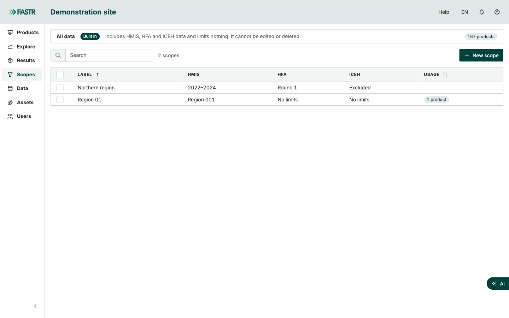
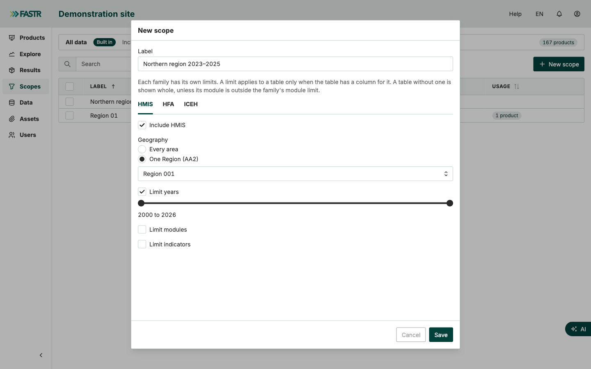
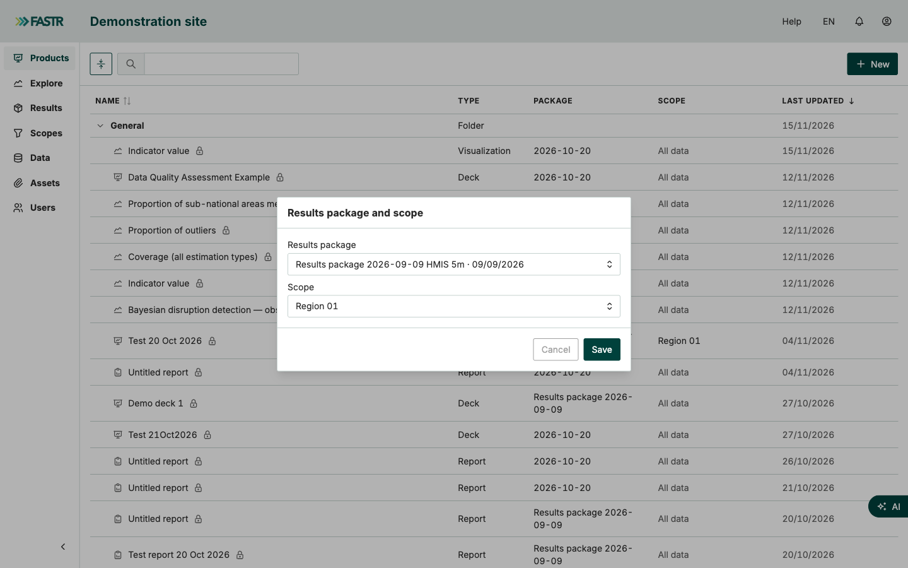

Facility structure → Indicators → Data → Verify → Scopes

# Make a scope and attach it to a product

<strong>Instance Setup</strong> · <strong>~15 min</strong>

<aside class="p1-sidebar">

Before you start

- ☐ A results package exists (Results page)
- ☐ Your account has unrestricted data access: administrator, or a user holding all scopes. Without it the **New scope** button is not shown

Why it matters

A project used to carry its own restriction: one region, a few years. That restriction is now a **scope**, a named view in one shared list. Every deck, report and visualization reads one scope, and Explore uses the same list. Make the scopes once, name them well, and the whole team filters the same way.

</aside>

## What you'll do

Create one scope for a region and a range of years, read it back in the Scopes table, attach it to a product, and check it in Explore.

<h2 class="step-h">1Open the Scopes page</h2>

Click **Scopes** in the side navigation. At the top, the built-in **All data** scope: it includes HMIS, HFA and ICEH, limits nothing, and cannot be edited or deleted. Its badge counts the products that use it. Below, a table with one row per scope and one column per data family, plus **Usage**.

---

<h2 class="step-h">2Create a scope</h2>

1. Click **New scope** (top right).
2. **Label**: name it by what it contains, for example `Northern region 2023–2025`. "All data" is reserved and a label already in use is refused.
3. One tab per family: **HMIS**, **HFA**, **ICEH**. Leave **Include** ticked for the families the scope should cover; untick it to leave a family out entirely.
4. On the HMIS tab, under **Geography** choose **One Region (AA2)** and pick the region. Tick **Limit years** and drag the range. **Limit modules** and **Limit indicators** narrow further; leave them off for now.
5. Click **Save**.

<h2 class="step-h">3Read it back in the table</h2>

Your scope has its own row. Each family column says **Excluded**, **No limits**, or the limit in a few words (the region, the years). **Usage** stays empty until a product carries the scope. Click the row to reopen it; tick rows and use **Delete** to remove scopes nobody uses.

---

<h2 class="step-h">4Attach it to a product</h2>

1. Go to **Products** and find a deck, report or visualization you can edit (a test one is best).
2. Hover its row, click **⋮**, then **Results package and scope…**.
3. Leave the **Results package** as it is, set **Scope** to your new scope, and click **Save**.

The row now shows the scope. Open the product: every figure has refiltered to the region and the years. Titles written for the whole country may need an update.

<h2 class="step-h">5Check it in Explore</h2>

Open **Explore**. The **scope** selector sits top right, next to the package. Pick your scope: the table and the charts show only the region and the years you set. The numbers match what the product shows, because both read the same package through the same scope.

<h2 class="step-h">6Clean up</h2>

If the product was a test, put it back on **All data** the same way. A scope that a product still carries cannot be deleted; move the product first.

---

## Checkpoint

You should now have:

- ✓ One scope with a clear label, limited to a region and a range of years
- ✓ A product whose row shows that scope, with its figures refiltered
- ✓ The same view in Explore under the scope selector

## Scope, filter or access?

- **Scope**: what a whole product shows. One per product, from the shared list. Also the selector in Explore.
- **Filter**: what one visualization shows. Set in its **Data** tab, lives in that chart only.
- **Access**: who can open a product or a folder. **Manage access** in the ⋮ menu. A scope hides data, access hides the product.

An administrator can also grant a scope to a restricted user on the **Users** page; it then bounds everything that user sees on the platform.

## What could go wrong

- **No New scope button.** Your account is restricted. Ask an administrator for unrestricted data access, or to create the scope.
- **The label is refused.** It is "All data" in some language, or another scope already has it. Pick another.
- **Delete is refused.** A product still carries the scope. Change that product's scope first.
- **A colleague's numbers differ.** Their product or Explore is on another scope or another package. Compare the two selectors.
- **A scope has a "Migrated" badge.** It was created from a retired project. Keep it or rename it; it works like any other.

## What's next

Setup complete. Move on to **Getting Started** for the participant view of Products, Explore and scopes.
