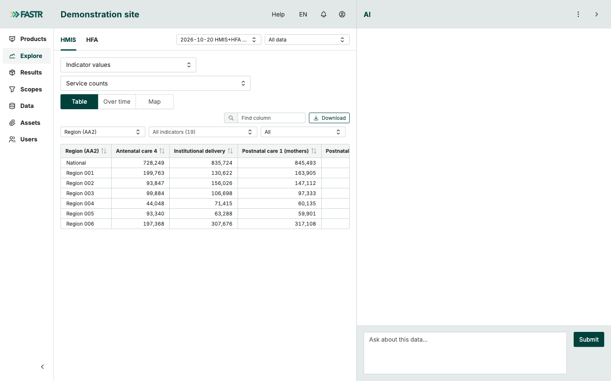
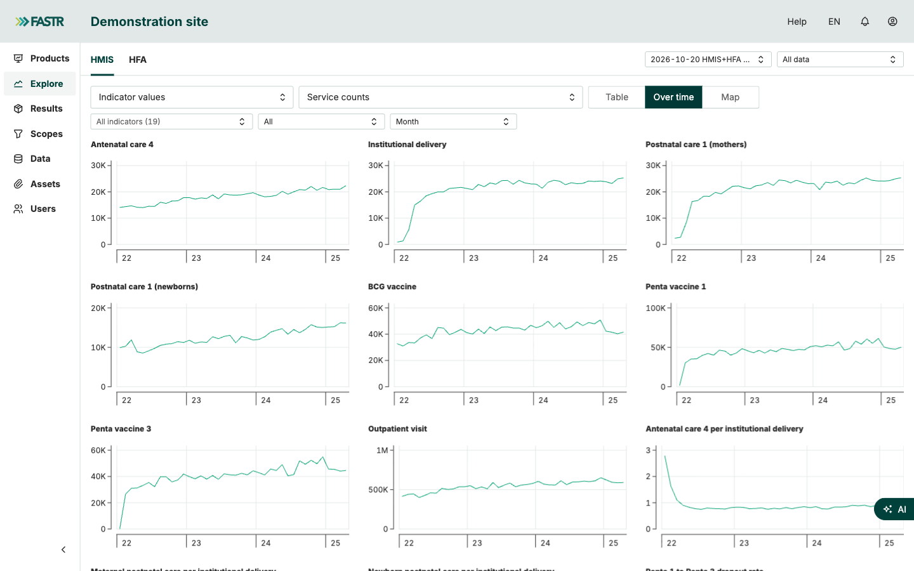
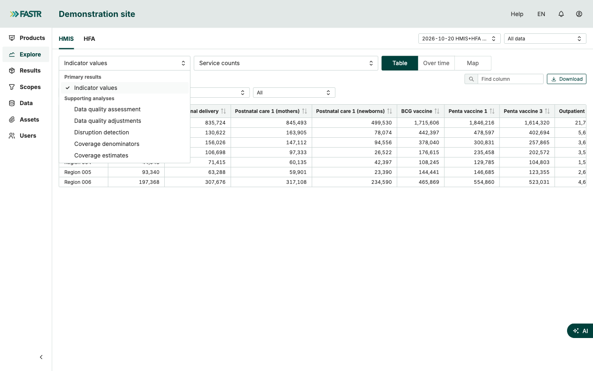
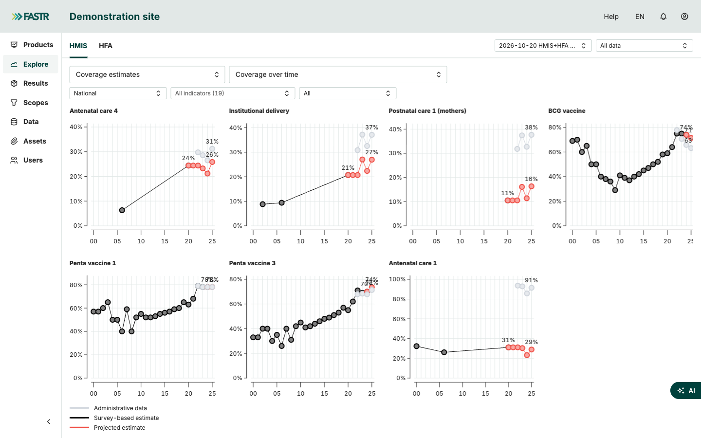

Log in → Your folder → Explore

# Take a first look with Explore

<strong>Activity</strong> · <strong>Getting Started</strong> · <strong>~15 min</strong>

<aside class="p1-sidebar">

Before you start

- ☐ You completed **Log in to the platform**
- ☐ The side navigation is expanded (arrow at the bottom of the rail)

Why it matters

Explore shows every analysis the platform has already computed, as a table, a set of charts or a map, with nothing to create and nothing to break. It is the fastest way to see what the data says before you build anything.

</aside>

## What you'll do

Open Explore, read one service in a table, watch it over time, switch to another analysis module, and write down three numbers to bring back to the room.

<h2 class="step-h">1Open Explore</h2>

Click **Explore** in the side navigation. Four controls sit at the top:

- **HMIS / HFA**: which data family. Stay on HMIS.
- The **results package**, top right. The pinned one is selected; leave it.
- The **scope**, next to it. **All data** means the whole country.
- The **module** and its **metric**, on the left. It opens on **Indicator values → Service counts**: the monthly volume of every indicator.

---

<h2 class="step-h">2Read the table</h2>

The **Table** view shows one row per area and one column per indicator. Three filters above it:

- **Level**: Region, District or Sub-district (the labels are your country's).
- **Indicators**: all of them, or a selection.
- **Period**: **Last 12 months**, **Last quarter**, **Last year**, or **All**.

Set the level to the one below national and the period to **Last 12 months**. Click a column header to sort it. **Find column** jumps to an indicator when there are many. **Download** saves the table as a file.

**Write down:** the national total of **Antenatal care 1** for the last 12 months, and the area with the lowest value.

<h2 class="step-h">3Watch it over time</h2>

Click **Over time**. Each indicator gets a small chart of its monthly volume. The filters change to indicator, level and the time step (**Month**, **Quarter**, **Year**). Pick **Antenatal care 1** only, at the national level.

**Write down:** the month with the highest value in the last two years.

---

<h2 class="step-h">4Try the map</h2>

Click **Map**. One indicator, one level, one period, coloured by area. If your instance has no boundary files yet, the page says so instead of drawing a map; that is a setup item for your administrator, not an error on your side.

<h2 class="step-h">5Switch module</h2>

Open the **module** dropdown on the left. **Primary results** holds Indicator values. **Supporting analyses** lists the other modules: Data quality assessment, Data quality adjustments, Disruption detection, Coverage denominators, Coverage estimates. Each module brings its own metrics and its own view.

Pick **Coverage estimates**. The view becomes **Coverage over time**: one chart per indicator, with grey points for the coverage computed from routine data, black for the survey estimates, red for the projection that carries the last survey forward.

**Write down:** the latest projected coverage of **Penta 3**.

---

<h2 class="step-h">6Share your three numbers</h2>

Compare with your neighbour: same package, same filters, same numbers? If not, find which filter differs. Then keep the question that interests you most: it is the one you will build a chart for in the next module.

## Checkpoint

You can:

- Open Explore and name its four top controls (data family, package, scope, module and metric)
- Switch between **Table**, **Over time** and **Map**
- Change the level and the period of a table
- Find a module under **Supporting analyses**

## Explore or a visualization?

Explore is for **looking**: quick, complete, nothing saved. A **visualization** is for **keeping and sharing**: you choose the metric, the filters and the shape, it has a row on the Products page, and you can copy it into a deck or a report. When a view in Explore answers your question, build it as a visualization next.

## What could go wrong

- **The table is empty.** The package has no data for the period chosen. Set the period to **All**.
- **Numbers differ from a colleague's.** Check the package (top right), the scope, the level and the period. Four filters, four ways to differ.
- **No map.** No boundary files uploaded for that level. Use the table or the charts.

## What's next

Setup complete. The next module, **Visualizations**, starts by building the chart you just looked at, and saving it in your folder.
