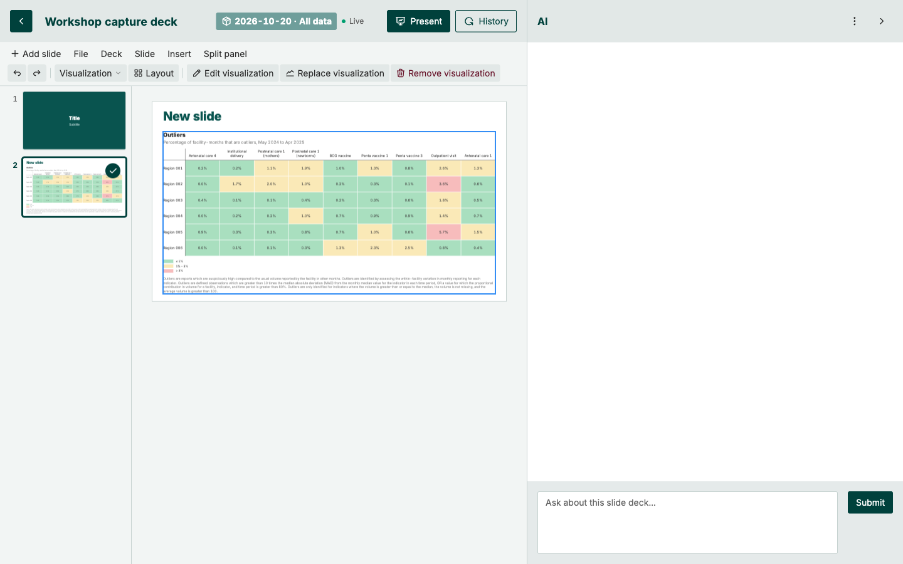
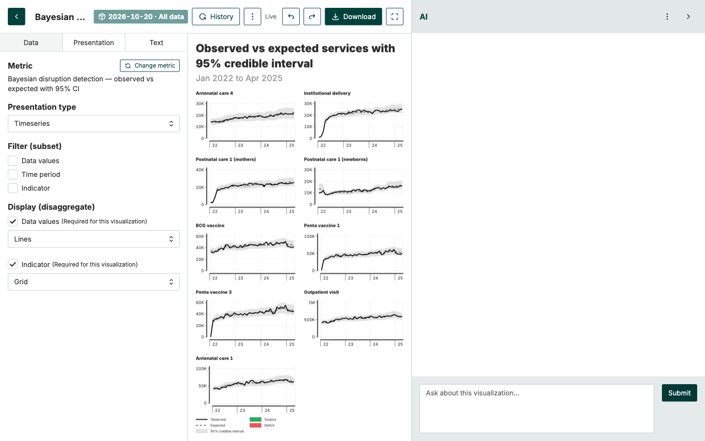

# Facilitator guide — Getting Started

<strong>Facilitator guide</strong> · <strong>Getting Started</strong> · <strong>3 activities · ~30 min + demo</strong>

## Purpose

Getting Started puts every participant onto the platform and set up to keep their work organized. It is short, one facilitator-led demo and three quick activities, but it is a gate: a participant who is not signed in, with a folder of their own, will be stuck for the rest of the workshop. The obstacles here are accounts and access, not skills.

By the end, every participant should be signed in, have one folder with their name on the Products page, and have read a table and a chart in Explore.

## Session at a glance

| # | Activity | Time | Format |
|---|----------|------|--------|
| — | FASTR platform demo | ~10 min | Facilitator-led (appendix) |
| 1 | Log in to the platform | ~10 min | Hands-on, individual |
| 2 | Make a folder for your work | ~5 min | Hands-on, individual |
| 3 | Take a first look with Explore | ~15 min | Hands-on, pairs |

---

## Running the session

**Preparation.** Resolve accounts *before* the session if at all possible. The recurring time sink is verification emails and un-approved accounts, which a participant cannot fix and which stall the room. Approve every account on the **Users** page the day before. Decide whether participants' folders go inside a country folder; if so, create it first. Have the platform demo loaded (appendix) and the *Log in* handout ready.

**How to demonstrate.** Start with the platform demo: a short tour of the home screen before anyone touches a keyboard. Keep it high level; setup is a later session. Then let participants sign in and make their folder from the handouts.

**Grouping.** Activities 1 and 2 are individual; pair participants for help if someone is stuck on access. Activity 3 is done in pairs so that the three numbers get compared.

**Pacing.** Do not declare the module finished early. Check that every participant has cleared the gate (signed in, folder made) before Explore, and use Explore to absorb the time while slow accounts are fixed. An unresolved access problem only gets more expensive later.

**The message to carry through.** One list for the whole country, folders to keep it readable, one folder per person. That habit is what keeps a shared Products page navigable after a week of work.

> **If participants used FASTR before.** Say it plainly: projects are gone. Everything is on one Products page, organized in folders; each deck, report or visualization is tied to a results package and a scope, shown in its row. Dashboards no longer exist; the Explore page and saved visualizations replace them.

---

## The activities

### 1. Log in to the platform · ~10 min · hands-on

**What happens.** Participants open the country URL, sign up or sign in, verify their email if new, and look around the home screen: the Products list, the side navigation, the AI button.

**Demonstrate.** Covered by the platform demo. After it, hand out *Log in to the platform* and let them work.

**Say something like.** *"If your verification email has not arrived in two minutes, check spam. If you sign in and see an empty list, tell me: your account needs approving, which is my job, not yours."*

**What a good result looks like.** Each participant on the Products page, side navigation expanded, able to open a product and come back.

**Watch for.**
- Verification emails in spam.
- "Account not approved" or an empty list: approve the account on the **Users** page.
- The collapsed side navigation confusing people: show the arrow at the bottom of the rail.

### 2. Make a folder for your work · ~5 min · hands-on

**What happens.** Each participant creates one folder with their name: **New → New folder**, name, colour, Save.

**Demonstrate.** Create a folder on screen. Show the ⋮ menu on its row (Move into, Rename, Set access, Delete), and the **Folder** field in the New deck dialog so they see why the folder matters.

**Say something like.** *"Use your own name. Everyone's 'test' folder collides, and you will never find your work again. When you create a deck or a chart, the dialog asks which folder: pick yours."*

**What a good result looks like.** One folder per participant, named after them, empty, where you agreed it should be.

**Watch for.**
- **New folder** missing from the menu: the account lacks the data access needed to manage folders. Fix the role on the Users page.
- Folders created at the top level when you wanted them inside a country folder: use **Move into**.

---

### 3. Take a first look with Explore · ~15 min · hands-on, pairs

**What happens.** Participants open **Explore**, read Antenatal care 1 in the **Table** (level below national, last 12 months), watch it **Over time**, try the **Map**, switch the module to **Coverage estimates**, and write down three numbers to compare with a neighbour.

**Demonstrate.** Name the four top controls on screen (HMIS/HFA, package, scope, module and metric), switch Table → Over time → Map once, and open the module dropdown to show **Supporting analyses**.

**Say something like.** *"Nothing here is saved and nothing can be broken. Explore is for looking. When a view answers your question, that is the chart you will build tomorrow."*

**What a good result looks like.** Pairs agreeing on the same three numbers, or able to say which filter made them differ.

**Watch for.**
- Numbers that differ between neighbours: package, scope, level or period. Make them find which.
- "The map is broken": no boundary files on the instance. Say so up front.
- Module names in English in the French interface: a known display issue.

## Wrapping up

Every participant should leave signed in, with their own folder, and with one question from Explore they want to answer with a chart. Anyone who is not will be blocked for the rest of the workshop. Check before moving on.

---

## Appendix — FASTR platform demo script

A short orientation of the FASTR Analytics Platform, enough that participants recognize the screen when they sign in. This is **before** they touch their own keyboards. Keep it high level; the hands-on activities bring the detail.

### Setup checklist

- ☐ Browser signed in to your country instance, in the participants' language, Explore opened once so it loads fast
- ☐ A folder with a finished deck and a saved visualization in it, ready to open
- ☐ Side navigation expanded (click the arrow at the bottom of the rail)
- ☐ Screen-share working if remote
- ☐ The *Log in* handout ready to distribute after the demo

### Step 1: The home screen

- **Do:** Show the **Products** page as it opens after sign-in. Expand a folder, point at the Type, Package and Scope columns.
- **Say:** *"This is your country's instance of FASTR. Everything is on this one page: every deck, report and chart the team has made, in folders. Nothing to install."*

- **Watch for:** "Is this the same as DHIS2?" Answer: *"No. FASTR reads from DHIS2 and adds the analysis, the charts and the reporting on top."*

### Step 2: The side navigation

- **Do:** Click each entry once. **Explore**: a ready-made chart for a module. **Results**: the packages list, point at the pinned one. **Scopes**: the list of named views. Stop at **Data**: say it is administration.
- **Say:** *"Products is where you work. Explore is for a quick look without creating anything. Results and Scopes explain where the numbers come from; we come back to that. Data, Assets and Users are for administrators."*

---

### Step 3: Open a deck

- **Do:** Open the prepared deck. Click a content slide with a chart. Show the **Present** button, the **File** menu, and the **Live** indicator next to the package name.
- **Say:** *"This is what you will build for decision-makers: slides with a chart and an interpretation. Everything saves by itself and the whole team sees changes live. The chart stays linked to the data."*

### Step 4: Open a saved visualization

- **Do:** Go back and open the saved visualization. Show the **Data** tab on the left: metric, presentation type, Filter, Display.
- **Say:** *"A chart is a product too. You build it once, save it in your folder, and put copies in decks and reports."*

### Step 5: The AI button

- **Do:** Inside the visualization, point at the AI panel on the right and type nothing.
- **Say:** *"There is an AI assistant on every product. It reads the data of the product you have open, so it can build and change charts and draft text. There is a whole session on it later."*

- **Watch for:** Do not run a prompt here. Keep curiosity for the AI session.

---

### Common questions

> **Q: Do I need a DHIS2 password to sign in?**
> A: No. FASTR has its own accounts. DHIS2 credentials are used once, by an administrator, to connect the instance.

> **Q: Is my work private?**
> A: Anything on the Products page is visible to the team by default. Access can be restricted per product or per folder with **Manage access**; your facilitator decides the rule for the workshop.

> **Q: Can I use it on my phone?**
> A: It works, but it is designed for a laptop: the charts need the space.

### Backup plan

> If the platform is unavailable during your demo, use the screenshots in the *Log in* handout to walk through the home screen, then move to the participant activity as soon as it is back.
