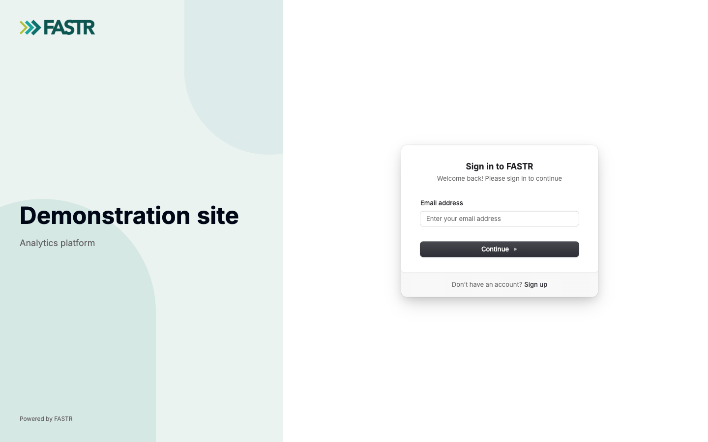

Log in → Your folder → Explore

# Log in to the platform

<strong>Activity</strong> · <strong>Getting Started</strong> · <strong>~10 min</strong>

<aside class="p1-sidebar">

Before you start

- ☐ You watched the facilitator's platform demo
- ☐ You have your **country platform URL** (your facilitator will share it)
- ☐ You have a working email address you can check during the activity

</aside>

## What you'll do

Create a FASTR account if you are new, sign in, and find your way around the home screen. No data work yet.

<h2 class="step-h">1Open the platform URL</h2>

Go to your country's platform URL in a browser (the format is usually `https://<country>.fastr-analytics.org`). You land on the sign-in screen.

---

<h2 class="step-h">2Sign up or sign in</h2>

- **First time:** click **Sign up** under the form, enter your email and a password, and create the account. Check your inbox for a verification email and click its link. If nothing arrives within two minutes, look in your spam folder.
- **Already have an account:** type your email and password and click **Continue**.

<h2 class="step-h">3Look around the home screen</h2>

After signing in you land on **Products**: one list of everything people on this instance have made, organized in **folders**. Each row is a **Deck**, a **Report** or a **Visualization**, with the results package and the scope it reads from, and the date it was last updated.

---

The **side navigation** on the left is the same everywhere. Click the small arrow at the bottom to show the labels:

| Entry | What it is for |
|---|---|
| **Products** | Your decks, reports and visualizations, in folders. Where you will spend most of your time. |
| **Explore** | Ready-made tables, charts and maps for every analysis module, with no product to create. Good for a quick look. |
| **Results** | The results packages: the computed analyses that products read from. |
| **Scopes** | Named views of the data (an area, a period) that products and users can be limited to. |
| **Data**, **Assets**, **Users** | Administration: imports, indicators, shared files, accounts. You may not see all of them. |

The top bar has **Help** (guided tours, documentation, feedback), the language switch, notifications and **Your account**. The **AI** button sits at the bottom right of every screen.

<h2 class="step-h">4Open something</h2>

Click a folder to expand it, then click any product in it. It opens in its own editor; the back arrow at the top left returns you to the list. Open **Explore** once too, to see what is there.

> **There are no projects anymore.** If you used FASTR before, this is the main change: everything for the country lives in one list, and folders replace projects. A deck or report is tied to one results package and one scope, shown in its row.

## Checkpoint

You should be able to:

- See the **Products** list with at least one folder in it
- Name the entries of the side navigation
- Open a product and come back to the list

If yes, move on to the next activity.

---

## What could go wrong

- **"Account not approved"** or an empty Products list. Your account has to be approved by an instance administrator before you see anything. Ask your facilitator.
- **The verification email never arrives.** Check spam. After five minutes, ask your facilitator to re-trigger it.
- **"Invalid email or password" after signing up.** Check the email you typed. Typos are common. Use the password reset link.
- **The side navigation shows only icons.** That is the collapsed state. Click the arrow at the bottom of the rail to expand it, or hover an icon to read its label.
- **The interface is in the wrong language.** Click the language button in the top bar (EN or FR) and choose.

## What's next

Move on to **Make a folder for your work**: one folder with your name on the Products page, so the team can find what you build.
