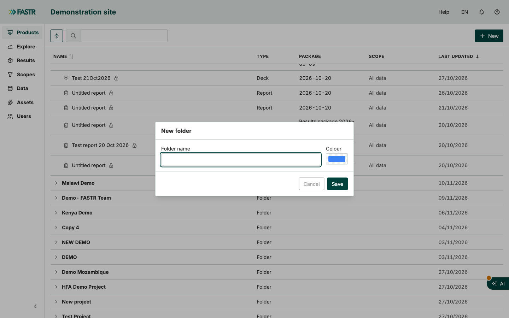
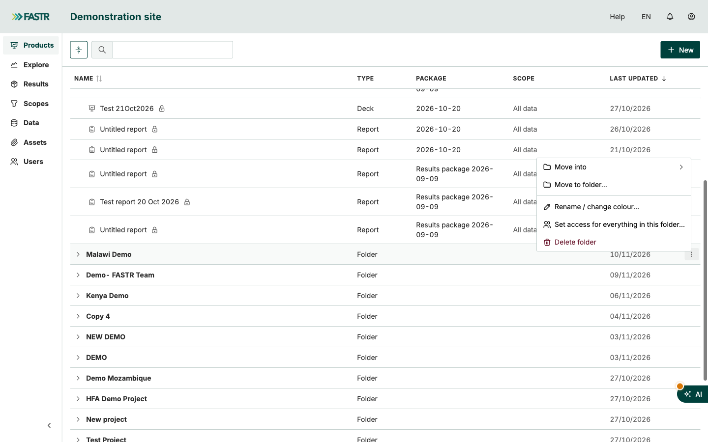

Log in → Your folder → Explore

# Make a folder for your work

<strong>Activity</strong> · <strong>Getting Started</strong> · <strong>~5 min</strong>

<aside class="p1-sidebar">

Before you start

- ☐ You completed **Log in to the platform**
- ☐ You are on the **Products** page

Why it matters

The whole country team works in the same Products list. A dozen people saving charts and decks without a system means nobody finds anything later. **One folder per person** is the simplest rule that works.

</aside>

## What you'll do

Create one folder with your name on the Products page. Every deck, report or visualization you make during the workshop goes in it.

<h2 class="step-h">1Create the folder</h2>

1. On the **Products** page, click **New** (top right), then **New folder**.
2. Type your name as the **Folder name** (for example `Aïcha N.` or `John S.`). Pick a **Colour** if you like.
3. Click **Save**.

---

<h2 class="step-h">2Find it in the list</h2>

Your folder appears in the list with the type **Folder**. Click it to expand it: it is empty for now. Use the search box at the top of the list if the list is long.

<h2 class="step-h">3Know the folder menu</h2>

Hover your folder's row and click the **⋮** menu at its right end. You will use these later:

- **Move into** / **Move to folder…**: folders can sit inside other folders, for example a country folder with one sub-folder per person.
- **Rename / change colour…**
- **Set access for everything in this folder…**: who can view or edit all the products in it.
- **Delete folder**

> **When you create a product,** the dialog asks for its **Folder**. Pick yours. A product in the wrong folder is moved with **Move to folder…** in its own ⋮ menu.

## Checkpoint

You should now have one folder with your name on the Products page, empty. The next activities fill it.

---

## Naming conventions

- Use your name, not "my folder" or "test". Teammates create folders too, and "test" will collide.
- Accents and spaces are fine in folder names.
- If the team already has a country folder, make yours inside it: create it, then **Move into** the country folder.

## What could go wrong

- **No "New folder" entry in the New menu.** Creating folders needs broader data access than viewing. Ask your facilitator to check your role.
- **The folder does not save.** The network may have dropped. Refresh the page; if the folder already exists with your name, it is in the list.
- **You see everyone's folders.** That is expected. The whole team shares one list; yours is one row in it.

## What's next

Move on to **Take a first look with Explore**: the computed analyses, as tables and charts, with nothing to create yet.
