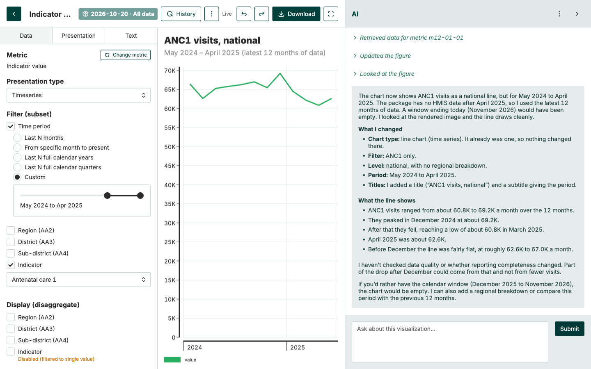

Reading a viz → Build manually → Build with AI → Write interpretation → AI interpretation → Spot disruption

# Build a visualization with the AI assistant

<strong>Activity</strong> · <strong>Visualizations & Interpretation</strong> · <strong>~15 min</strong>

<aside class="p1-sidebar">

Before you start

- ☐ You built at least one chart by hand (previous handout)
- ☐ You are signed in, on the **Products** page
- ☐ You know which indicator you want (ANC1, Penta3, …)

One rule

The AI works **inside a product**. On the Products page it can only tell you what exists; open a visualization, a deck or a report and it can read the data and draw.

</aside>

## What you'll do

Get the AI assistant to build the same kind of chart you just built by hand, by typing a request in plain language. Same result, different path.

<h2 class="step-h">1Start from a blank visualization</h2>

On the **Products** page click **New → New visualization**, keep the pinned package and **All data**, click **Next**. Pick any metric and preset to get an editor open (for example **Indicator values → Indicator value → Scorecard table → Insert**). What you pick does not matter: the AI will change it.

Rename it right away (click the title) so you recognize it in the list: *AI test, ANC1*.

---

<h2 class="step-h">2Ask</h2>

The AI panel is on the right of the editor, with the box **Ask about this visualization…**. Type a short request and click **Submit**:

> *"Change this to a line chart of ANC1 only, national, for the last 12 months of data."*

The AI reads the figure editor, looks up the metrics, fetches the data, updates the figure, looks at the result, and writes back what it changed and what the line shows. The chart on the left updates as it works; the steps it took are listed above its answer.

> **The AI edits the visualization you have open, and edits save live.** That is why you start from a blank one. If you ask it to change a colleague's chart, you change the colleague's chart. Use **⋮ → Duplicate** on the Products page first when you want to keep the original.

<h2 class="step-h">3Check what it did</h2>

Read its answer against what you asked:

- Right indicator? Right level? Right period? The AI will say when it adjusted the window, for example because the package has no data for recent months.
- Line chart for a trend, or something else?
- Which **data values** did it use? The metric exposes unadjusted, outlier-adjusted, completeness-adjusted and both. If the answer does not say, ask.

Open the **Data** tab on the left: the filters and display settings it set are there, exactly as if you had clicked them.

---

<h2 class="step-h">4Iterate</h2>

The first answer rarely lands the chart you want. Refine in short turns, in the same conversation:

- *"Break it down by region."*
- *"Add Penta1 on the same chart."*
- *"Use the unadjusted counts instead."*
- *"Give it a title that states the finding."*

Each instruction is one small step. The AI also offers next steps at the end of each reply; use them or ignore them.

<h2 class="step-h">5Keep it</h2>

Nothing to save: the visualization is already updated and sits in the Products list. Click the back arrow and check it is in your folder (**⋮ → Move to folder…** if not). If you changed your mind, **History** at the top of the editor lists every version, with **Restore**.

## Try it with three indicators

Run the same flow for three indicators from different programs (antenatal care, immunization, deliveries). You will get a feel for how the AI reads short requests, and for what you have to spell out.

---

## Manual vs AI: when to use which

- **Manual** when you know exactly what you want and clicking is faster than typing.
- **AI** when you want to explore (*"show me something useful about ANC"*), when you do not remember the names of the filters, or when you want a first draft of the title and subtitle.

> The AI is an accelerator, not a replacement. You decide whether the chart answers the question. And since it edits live, you also decide which chart it is allowed to touch.

## What could go wrong

- **"No results package is open here."** You asked from the Products page. Open a visualization, deck or report first.
- **The chart went blank.** The window you asked for has no data (the package ends earlier). Ask for *"the last 12 months of data"* rather than calendar dates.
- **It changed the wrong thing.** Say so in the chat, or open **History** and restore the previous version.

## What's next

The next handout is about **writing the interpretation**: the text that goes next to your chart on a slide. Use the six-step framework from the *Reading a viz* reference.
