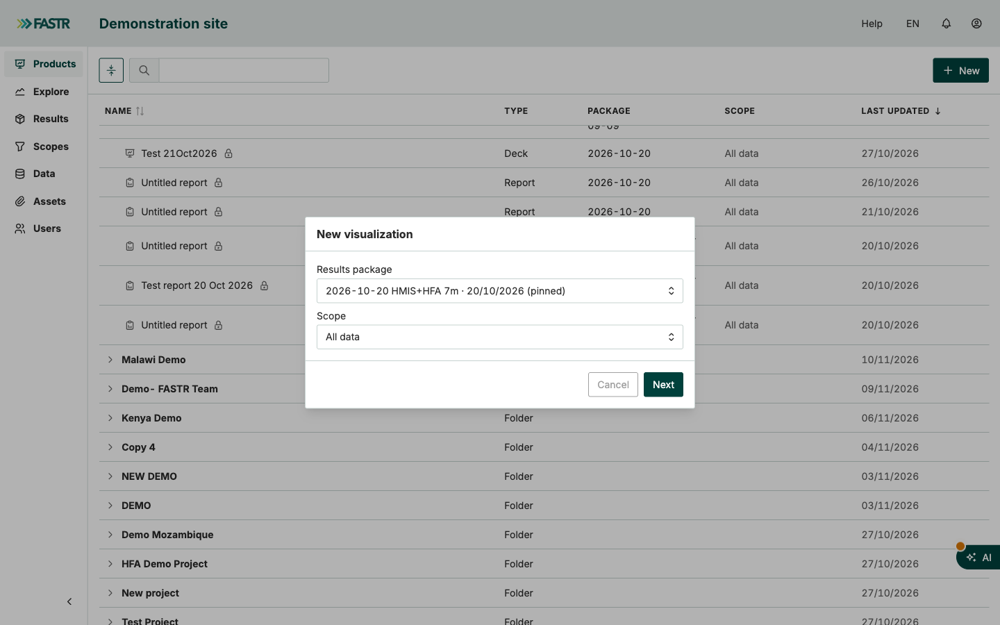
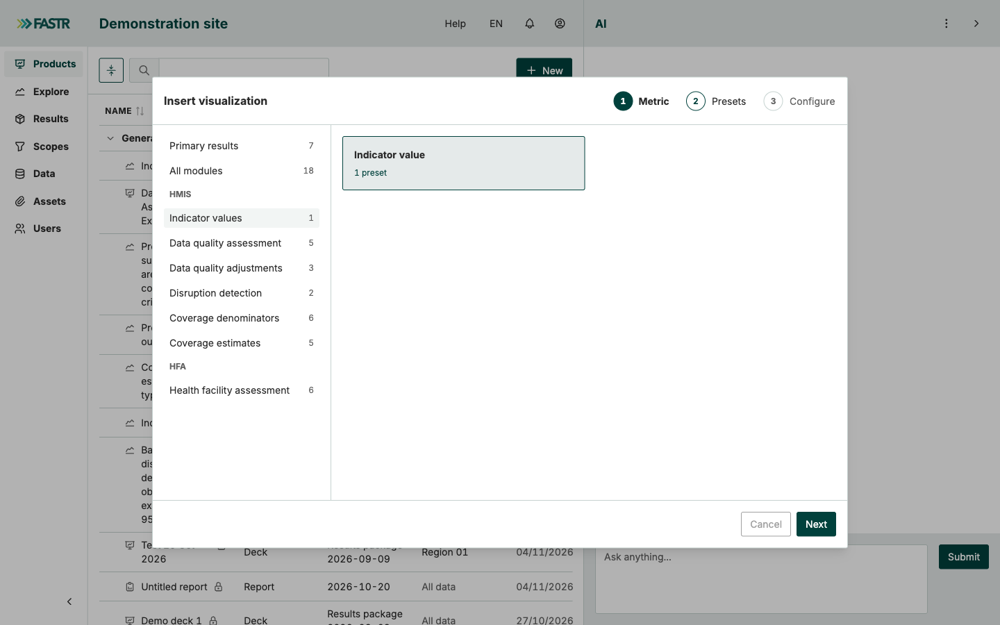
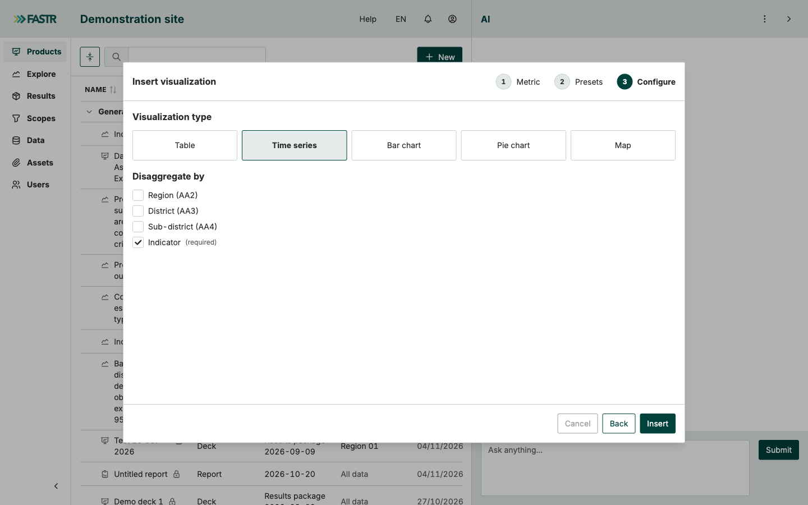
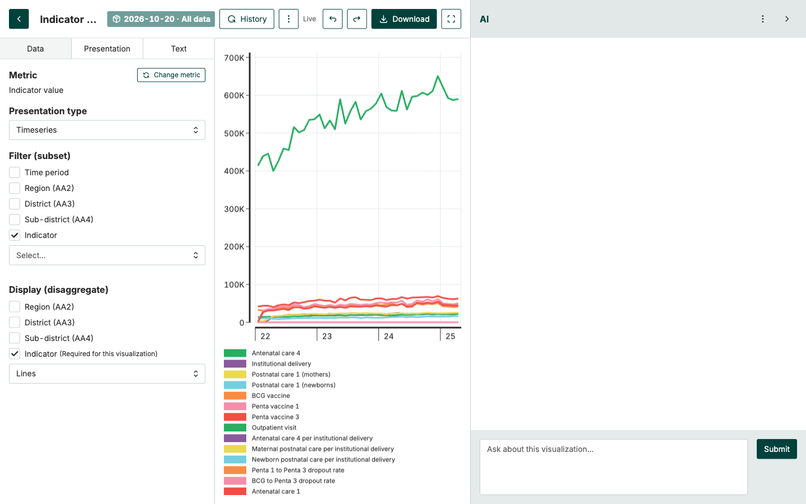
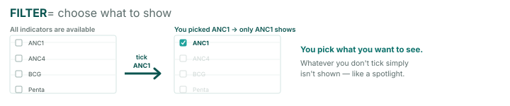
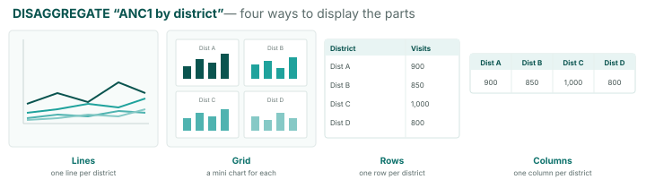

Reading a viz → Build manually → Build with AI → Write interpretation → AI interpretation → Spot disruption

# Create your first visualization

<strong>Activity</strong> · <strong>Visualizations & Interpretation</strong> · <strong>~15 min</strong>

<aside class="p1-sidebar">

Before you start

- ☐ You are signed in and on the **Products** page
- ☐ You have a folder of your own (see *Make a folder for your work*)

</aside>

## What you'll do

Build three line charts, each saved as a visualization in your folder: first **ANC1**, then **BCG**, then **one indicator of your choice**. The next activity does the same task with the AI assistant.

A visualization is a product, like a deck or a report. It has its own row on the Products page, saves by itself, and can be copied into any deck or report later.

<h2 class="step-h">1Start a new visualization</h2>

On the **Products** page click **New**, then **New visualization**. The first dialog asks for the **Results package** and the **Scope**. Keep the pinned package and **All data**, and click **Next**.

---

<h2 class="step-h">2Pick the metric</h2>

The **Insert visualization** dialog has three steps: **Metric**, **Presets**, **Configure**. The left column lists the analysis modules by name. Click **Indicator values**, then the metric card **Indicator value**, and choose the geographic level **National** on the card. Click **Next**.

> A **metric** is *what is measured*. The Indicator value metric holds the monthly count of every indicator in the instance. A **preset** is one ready-made way to draw a metric. Each module groups the metrics it produces; **Primary results** shows the most used ones across modules.

<h2 class="step-h">3Choose how to draw it</h2>

The Indicator value metric offers one preset, **Scorecard table**, which is not what you want here. Click **Custom**, then **Next**. On the **Configure** step choose **Time series** and click **Insert**.

The chart opens in the editor, with every indicator drawn over the full period.

---

<h2 class="step-h">4Filter to ANC1, last 12 months</h2>

The editor has a **Data** tab on the left and the chart on the right. In **Filter (subset)**:

- Tick **Indicator**. A row of chips appears (ANC1, ANC4, BCG, …). Click **ANC1**. Only the chips you select are drawn.
- Tick **Time period**. The default is *last 12 months*; adjust the slider if you want a different window.

The chart redraws after each change.

> **Data values.** The metric also offers four data value chips: unadjusted, adjusted for outliers, adjusted for completeness, both. The default is the fully adjusted count, the cleaner version of your country's data. Leave it unless you specifically want another adjustment.

<h2 class="step-h">5Name it and check the folder</h2>

There is no Save button: changes are saved automatically and shared live (the **Live** label next to the package name). Click the title at the top of the editor to rename it, for example *ANC1, monthly, last 12 months*. Click the back arrow to return to the Products page and check the chart sits in your folder; if not, use **⋮ → Move to folder…** on its row.

## Now do it twice more

Repeat the five steps for **BCG**, then for **an indicator of your choice** (Penta1, ANC4, OPD…). You should end up with **three visualizations in your folder**.

---

## Filter vs disaggregate: what's the difference?

These two words come up a lot. They are not the same:

- **Filter = pick what to show.** Choose the indicators, places or months you want; only those appear. *Show ANC1 only*, or *Northern region only*. Like a spotlight: you point it at what you want to see.
- **Disaggregate = break it down.** Split one total into its parts so you can compare them: *one line per indicator*, or *one bar per district*. Nothing is hidden; the total is shown as its pieces.

> **Example.** Start with *total ANC1 visits, nationally*. **Filter** to "Northern region": now you see only Northern's ANC1. **Disaggregate** "by district": the same total split into one line per district.

---

## Where you do this in the editor

The **Data** tab of the editor has the two sections, one under the other:

- **Filter (subset)**: tick **Time period**, **Indicator**, or an admin level, then pick the items to keep.
- **Display (disaggregate)**: tick the dimension to split by, then choose how to show the parts: **Lines** (all on one chart), **Grid** (one small chart per part), **Rows** or **Columns** (a table), **Different charts** (one full-size chart per part).

Two other tabs sit next to Data: **Presentation** (colours, axes, labels) and **Text** (title, subtitle, footnote).

> **The trap when you use both.** You split a chart by district to compare districts, then filter it to one district. Now you are looking at one district alone, with nothing to compare. Use filter to choose the data, disaggregate to split it, and do not filter down to one of the things you wanted to compare.

---

## Exercise: split your ANC1 chart by region

Your ANC1 chart shows one national line. Turn it into one line per region.

<h2 class="step-h">1Duplicate first</h2>

On the Products page, open the **⋮** menu of your ANC1 visualization and click **Duplicate**. Rename the copy *ANC1, monthly, by region*. Edits save by themselves, so duplicating first is how you keep the national chart intact.

<h2 class="step-h">2Disaggregate</h2>

Open the copy. In **Display (disaggregate)**, tick the admin level you want to compare. In FASTR the levels are labelled generically: **Admin area 2** is usually the region, **Admin area 3** the district. Leave the display on **Lines**: one line per region.

<h2 class="step-h">3Try the other display styles</h2>

Same data, different shape. **Grid** when there are many regions and the lines overlap. **Rows** or **Columns** when you want the exact values. **Different charts** when each region deserves a full read. Pick whichever reads best.

### Now do it for BCG

Duplicate your BCG chart and split it the same way. You should end up with two regional charts in your folder.

---

## Try a few more options

Once your charts are saved, start another **New visualization** and look at other modules in the Metric step:

- **Coverage estimates**: a coverage curve rather than a volume trend.
- **Disruption detection**: observed against expected, with the credible band (the last activity of this series uses it).
- **Explore**, in the side navigation, shows a ready-made chart for every module without creating anything. Useful to see what a module produces before you build with it.

> **Tip:** a time series is best for a trend. A bar chart compares periods or places. The reference handout *How to read a FASTR visualization* goes deeper.

## Check yourself

You should now have:

- **Three visualizations in your folder**: ANC1, BCG, and one of your choice, plus two regional copies.
- The path memorized: **New → New visualization → package and scope → module → metric → preset or Custom → Insert**, then **Filter** and **Display** in the Data tab.
- The habit of **duplicating before you change** a chart you want to keep.

## What's next

The next activity does the same thing with the AI assistant, from inside the visualization: typing the request instead of clicking. Same result, different path.
