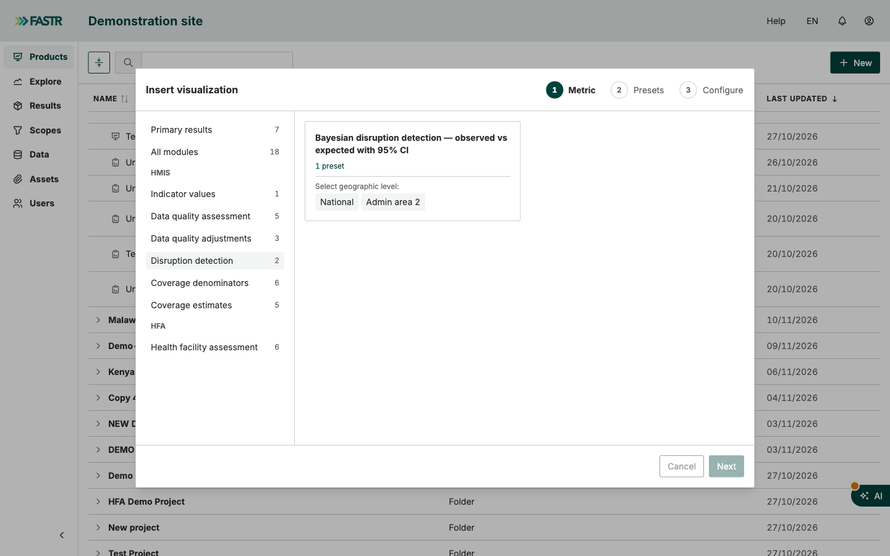
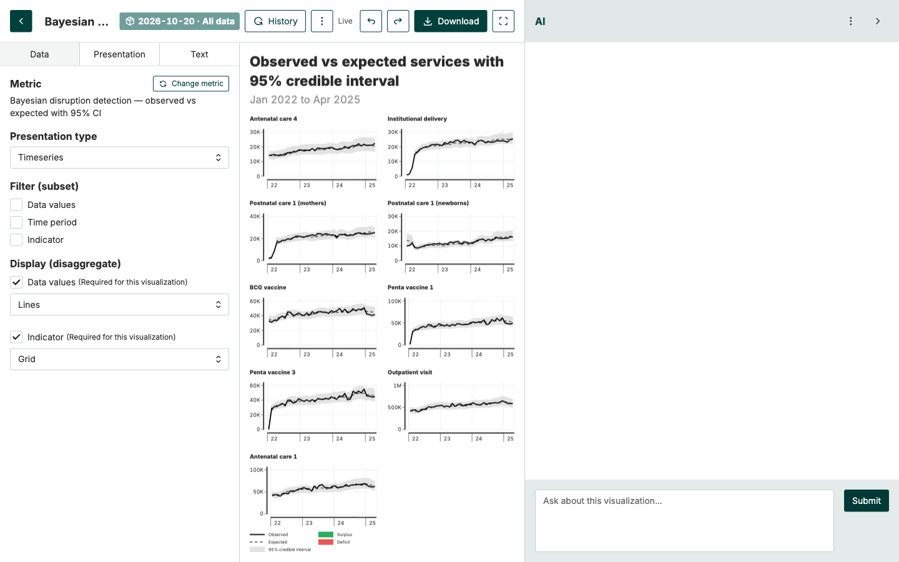

Reading a viz → Build manually → Build with AI → Write interpretation → AI interpretation → Spot disruption

# Apply — spot a disruption

<strong>Activity</strong> · <strong>Visualizations & Interpretation</strong> · <strong>~25 min</strong>

<aside class="p1-sidebar">

Before you start

- ☐ You have completed the previous 5 handouts
- ☐ You are signed in and on the **Products** page
- ☐ You have a folder of your own

Why it matters

The first five handouts taught the technique. This is where you use it: open a real disruption chart for your country, work the six-step framework on it, and produce a finding statement that a decision-maker would actually act on.

</aside>

## What you'll do

Create the national disruption chart from the Disruption detection module, narrow it to one indicator and a time window of interest, work through the six-step framework, then write a three-part finding to share with the room.

---

<h2 class="step-h">1Create the disruption chart</h2>

On the **Products** page click **New → New visualization**, keep the pinned package and **All data**, and click **Next**. In the Metric step click the module **Disruption detection**, then the card **Bayesian disruption detection — observed vs expected with 95% CI**, choose the level **National**, and click **Next**. Pick the preset **Disruptions chart with 95% credible band** and click **Insert**.

> Already built by a colleague? The Products page may hold one. Open it, then **⋮ → Duplicate** so your filters do not change theirs: edits save live.

<h2 class="step-h">2Read the default view</h2>

The chart opens with every core indicator as a small chart in a grid. Two black lines run across each: a **solid** line for the **observed** monthly volume, and a **dashed** line for the **expected** volume, modelled from the facilities that reported that month. A **grey band** around the expected line is the 95% credible interval. Where the observed line drops **below the band** the gap is filled **red** (a deficit); where it rises **above** it is filled **green** (a surplus). Inside the band is normal variation.

---

<h2 class="step-h">3Filter to one indicator</h2>

In the **Data** tab on the left, under **Filter (subset)**, tick **Indicator**. A list of indicator chips appears (ANC1, ANC4, BCG, delivery, Penta1…). Click one chip to keep only that indicator; click more to add others.

When a single indicator is selected, the grid collapses to one full-size chart. Tick **Time period** to narrow the window further.

---

<h2 class="step-h">4Work the six steps</h2>

On your filtered chart, walk the six-step framework from *Reading a viz*:

| Step | For this chart |
|------|----------------|
| 1. What indicator? | The one you filtered to |
| 2. What level & period? | National. The period you chose. |
| 3. What is being compared? | Observed monthly volume (solid line) vs **expected** (dashed line, modelled from the same facilities that reported), with the grey 95% band |
| 4. Read the values | Where does the gap fill red (observed below the band)? By how much? |
| 5. What stands out? | A sustained drop, three months or more? A single spike? A pattern? |
| 6. So what? | What action would this prompt? |

---

<h2 class="step-h">5Add context the chart cannot show</h2>

The chart shows the *what*. Your country team brings the *why*. Once you have a pattern, layer in what you know:

- Was there a **financing or staffing change** in that period?
- Are there known **supply or workforce gaps** (drugs, equipment, staffing)?
- Even if the **numbers look fine**, has the quality of care slipped?

<h2 class="step-h">6Write your finding</h2>

Use the three-part structure from the *Write an interpretation* handout:

1. **Title** — the message in one sentence
2. **What you see** — facts visible in the chart
3. **What it means** — the so-what, tied to a concrete next step

<h2 class="step-h">7Share with the room</h2>

When each country team is done, one person shares the finding. Listen for:

- Is the finding **specific**? One indicator, one period, one action.
- Is the so-what **tied to a real decision-maker**?
- Did the team **bring local context** the chart alone could not?

## What to watch out for

- **A one-month dip is usually noise.** Look for a sustained drop, three months or more.
- **A green fill is not "good", a red fill is not "bad".** They show direction: green = observed above the band, red = observed below it. Inside the band nothing is coloured, and that is the normal case. A sustained red over several months is what to investigate.
- **Reporting gaps are already handled.** The expected line is built from the facilities that reported that month, so a facility going silent does not show as a disruption. A red stretch is a real change among reporting facilities.

## What's next

This is the end of the *Visualizations & Interpretation* series. The next module covers building reports — putting your charts, interpretations, and findings into a shareable document.
