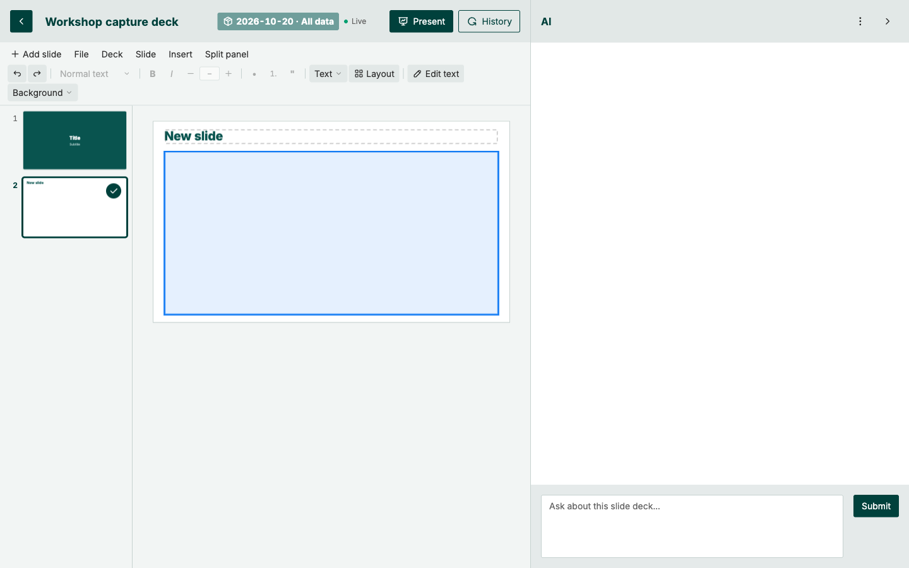
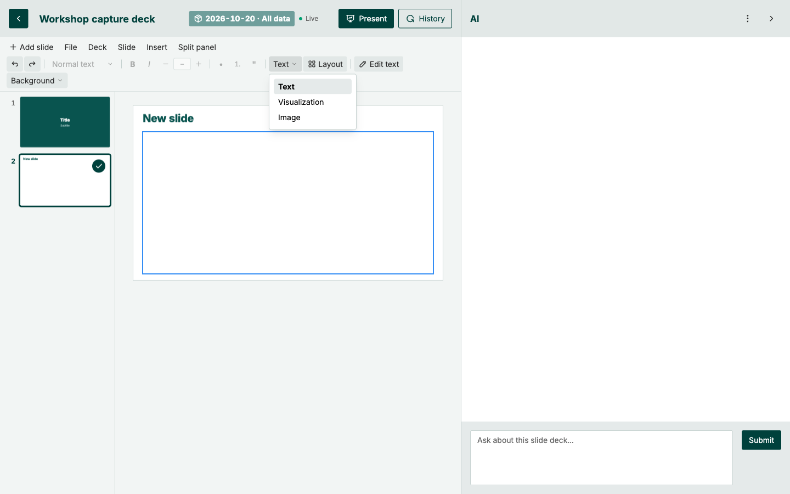
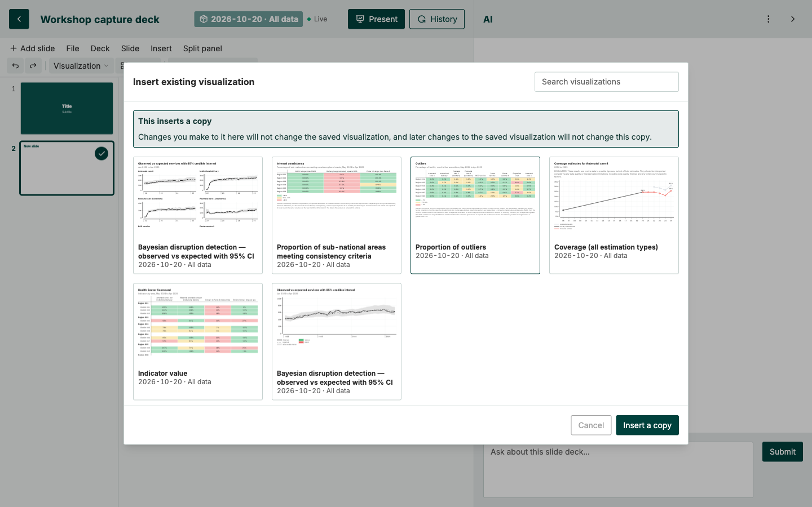

Create deck → Add manually → Add with AI → Edit & finalize

# Add a visualization (manually)

<strong>Activity</strong> · <strong>Slide Decks</strong> · <strong>~15 min</strong>

<aside class="p1-sidebar">

Before you start

- ☐ You created your deck with one content slide (see *Create your first slide deck*)
- ☐ You have a saved visualization you want to include
- ☐ The deck is open on the content slide

</aside>

## What you'll do

Put a copy of a saved visualization on the content slide, then split the slide so the chart has text next to it. Three moves the first time; fast after that.

<h2 class="step-h">1Select the block</h2>

Click the content slide in the list on the left, then click the empty block in the middle of the slide. A blue outline appears around it and a block toolbar appears above the slide: a **Text** dropdown, **Layout**, **Edit text**, **Background**.

---

<h2 class="step-h">2Make it a visualization block</h2>

Open the **Text** dropdown and choose **Visualization**. The block is now a visualization block and the toolbar offers **Insert visualization**.

<h2 class="step-h">3Insert the saved chart</h2>

Click **Insert visualization**, then **Existing visualization…**. A picker lists the saved visualizations of the instance with a thumbnail each; the search box filters by name. Click yours, then **Insert a copy**. The chart appears on the slide.

> **It is a copy.** Changes you make to the chart on the slide do not change the saved visualization, and later changes to the saved one do not reach the slide. To update the slide after you improved the original, select the block and use **Replace visualization → Replace with existing visualization**.

---

<h2 class="step-h">4Give the chart a text block beside it</h2>

With the chart block selected, click **Layout**, then **Add**, then a column to the right. A new empty block appears next to the chart; its type is **Text**. Click into it and type a one-line takeaway. Drag the divider between the two blocks to give the chart more room.

<h2 class="step-h">5Title the slide</h2>

Click the slide header ("New slide") and type a title that states the finding. Nothing to save: the deck saves live.

## Checkpoint

Your content slide should show one of your saved charts, with a short text beside it and a title that says what the chart shows.

---

## Tips

> **Reuse, don't recreate.** If you already built the chart, insert the existing one. **New visualization…** in the same menu opens the metric and preset dialog to build one from scratch, on the slide.

- Can't find your chart in the picker: it is not a saved visualization yet, or it sits in a folder you cannot see. Type part of its name in the picker's search box.
- The chart looks cramped: expected at this stage. *Edit and finalize* covers resizing and simplifying.
- A block can also hold an **Image** (the same dropdown) for a logo or a photo.
- **Split panel**, in the top bar, adds a side panel to the slide: a second area for text or a second chart.

## What's next

Move on to **Add a visualization (with the AI assistant)**: the same task, as one request in the AI panel.
