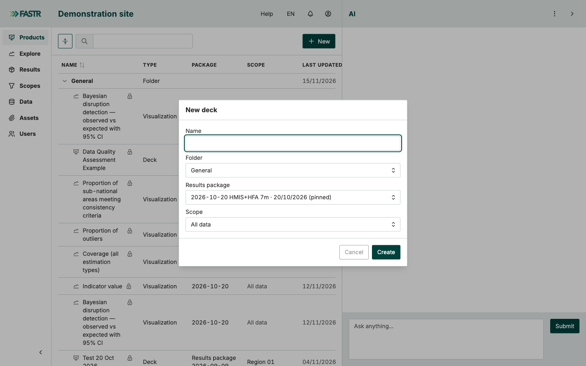
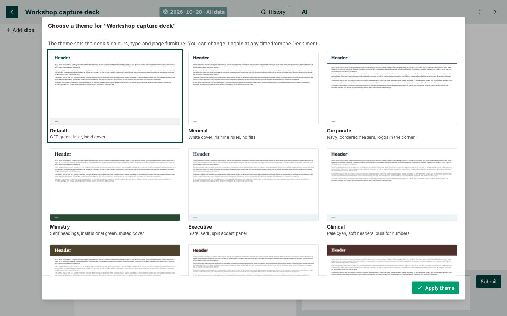
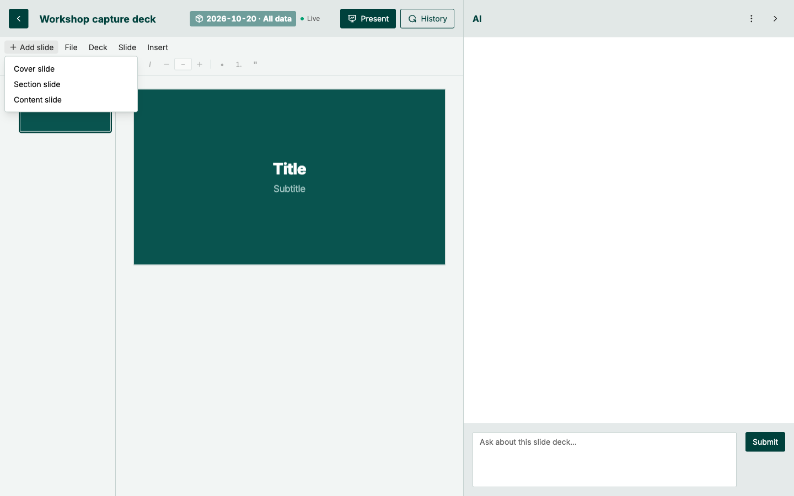

Create deck → Add manually → Add with AI → Edit & finalize

# Create your first slide deck

<strong>Activity</strong> · <strong>Slide Decks</strong> · <strong>~10 min</strong>

<aside class="p1-sidebar">

Before you start

- ☐ You are signed in, on the **Products** page
- ☐ You have a folder of your own (see *Make a folder for your work*)
- ☐ You have at least one saved visualization you would like to use

</aside>

## What you'll do

Create a deck, choose its look, and add a content slide. This is the container; the next activities fill it with charts and interpretation.

<h2 class="step-h">1Create the deck</h2>

On the **Products** page click **New**, then **New deck**. The dialog asks for a **Name** and a **Folder**: name it (for example *Q1 2026 review*, or your topic), pick your folder, and click **Next**. The second step asks for the **Results package** and the **Scope**; keep the pinned package and **All data**, and click **Create**.

---

<h2 class="step-h">2Choose a theme</h2>

A new deck opens on a theme picker: the theme sets the colours, the type and the page furniture of every slide. Keep **Default** (GFF green) for the workshop and click **Apply theme**. You can change it later from the **Deck** menu.

<h2 class="step-h">3Look at the editor</h2>

The deck opens with a cover slide already there. The slide list is on the left, the current slide in the middle, the AI panel on the right. Above the slide: **Add slide**, and the menus **File**, **Deck**, **Slide**, **Insert**. The title at the top left renames the deck when you click it. Next to the package name, **Live** means changes are saved automatically and shared with anyone else who has the deck open.

---

<h2 class="step-h">4Add a content slide</h2>

Click **Add slide**. Three slide types appear:

- **Cover slide**: the title page (deck name, date, your name). One per deck, already there.
- **Section slide**: a divider between parts of the deck. Use sparingly.
- **Content slide**: where a chart and its interpretation live. Most of your deck.

Pick **Content slide**. A second slide appears with a header and one empty block.

## Checkpoint

You should have:

- A deck with a clear name, in your folder (check its row on the Products page)
- A cover slide and one empty content slide

## What's next

Your facilitator will demo how to put a chart on the slide and split it into chart and text. Then you repeat it in **Add a visualization (manually)**.
