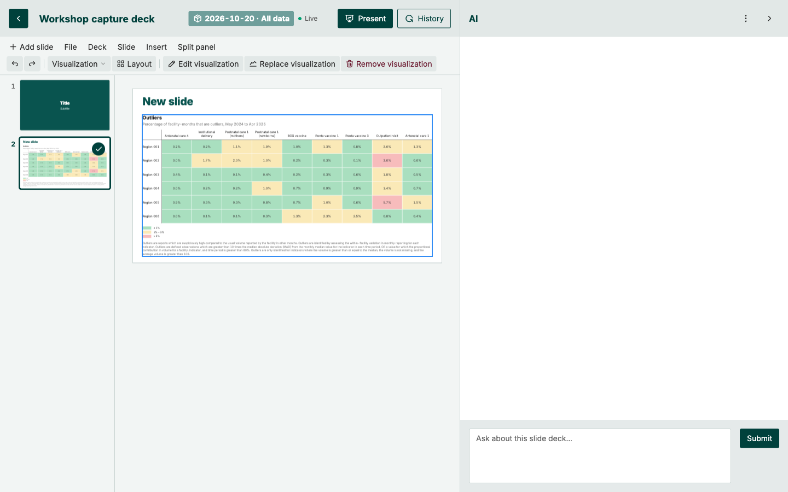

Create deck → Add manually → Add with AI → Edit & finalize

# Edit and finalize your slides

<strong>Activity</strong> · <strong>Slide Decks</strong> · <strong>~20 min</strong>

<aside class="p1-sidebar">

Before you start

- ☐ Your deck has at least one content slide with a chart and some text
- ☐ Your facilitator has shown the editor demo on screen

Why it matters

The AI generates content. The layout almost always needs adjusting: text squeezed, a chart needing more room, a slide cluttered with too many blocks. The editor is where you do that, one slide at a time.

</aside>

## The three places you edit

A slide is a header plus **blocks**. Everything you change happens in one of three places:

- **The block toolbar**, which appears above the slide when you click a block: its type (**Text**, **Visualization**, **Image**), **Layout**, and the actions for that type (**Edit text**; **Edit**, **Replace** or **Remove visualization**).
- **The Slide menu** in the top bar: the slide type (Cover, Section, Content) and the cover logos.
- **The Insert menu**: new slides, and the text elements of the current slide (header, sub header, date, footer).

---

## Layout: split, add, move, remove

Select a block and click **Layout**. For a visualization block the menu is:

| Action | What it does |
|--------|-------------|
| **Edit visualization** | Open the chart in the visualization editor, on the slide. |
| **Replace with new visualization** | Build another chart from the metric and preset dialog, in this block. |
| **Replace with existing visualization** | Swap in a copy of another saved chart. |
| **Remove visualization** | Empty the block, keep the block. |
| **Split ▸** | Divide this block into two, side by side or one above the other. |
| **Add ▸** | Add a new block next to this one: left, right, above, below. |

A text block has the same **Split** and **Add**, with **Edit text** instead of the visualization actions.

Two blocks side by side, chart and text, is the FASTR pattern. If you need more, that is another slide.

---

## The four passes per slide

<h2 class="step-h">1Check accuracy</h2>

Read the slide as if you had not seen it before. Does the title match what the chart shows? Is the text right? Mark anything that needs a rewrite, by you or by the AI panel on the right.

<h2 class="step-h">2Resize and reflow</h2>

Drag the divider between two blocks to give the chart more room or the text more room. The other block follows. Use the text size buttons in the toolbar (**–** and **+**) before you cut words.

<h2 class="step-h">3Restructure if needed</h2>

Too cramped: **Layout → Add** a block, or move the extra content to a new slide (**Add slide → Content slide**). A block that does not earn its place: **Remove visualization**, or delete its text. A chart that is too detailed: **Edit visualization** and simplify it there.

<h2 class="step-h">4Finish the header and footer</h2>

**Insert** lists the slide's text elements: header, sub header, date, footer. Add the ones you want and click them on the slide to edit. The deck-wide footer and page numbers live in the **Deck** menu (see *Deck settings*).

---

## Checkpoint

Every slide should:

- Have a clear title that matches the chart
- Show the chart at a readable size, aligned with its text
- Have text that is fully visible and edited
- Carry the header elements you want

## What could go wrong

- **No block toolbar.** You have not selected a block. Click inside the block on the slide, not on the thumbnail.
- **Divider not visible.** It appears once a block is selected; the cursor changes when you hover the line between two blocks.
- **Chart still cramped after resizing.** The chart itself is too detailed. **Layout → Edit visualization** and simplify (fewer indicators, Grid display, shorter period).
- **Undo.** The arrows at the left of the toolbar, or Ctrl/Cmd+Z. Edits save live, so **History** at the top is the way back to an earlier version of the whole deck.
- **Slide order.** Drag the thumbnails in the list on the left.

## What's next

The next handout covers deck-wide settings: theme, logos, footer and page numbers, before the deck is shared.
