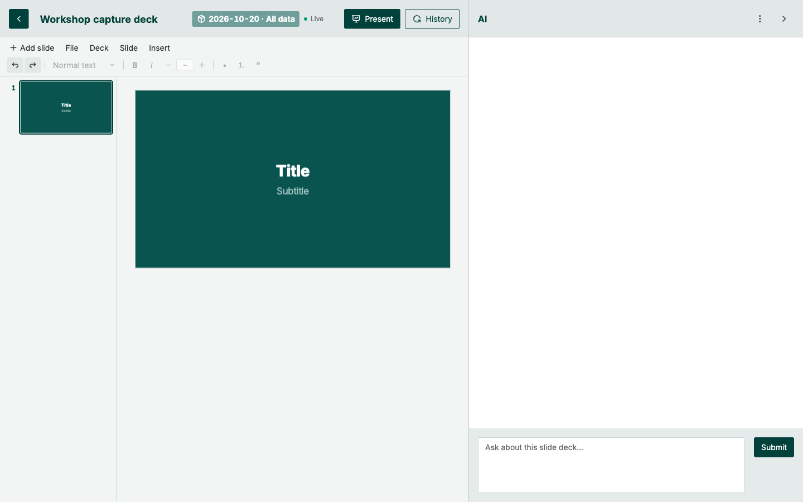
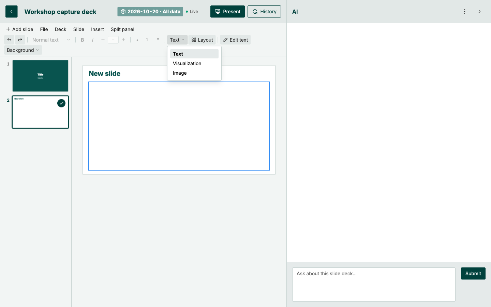
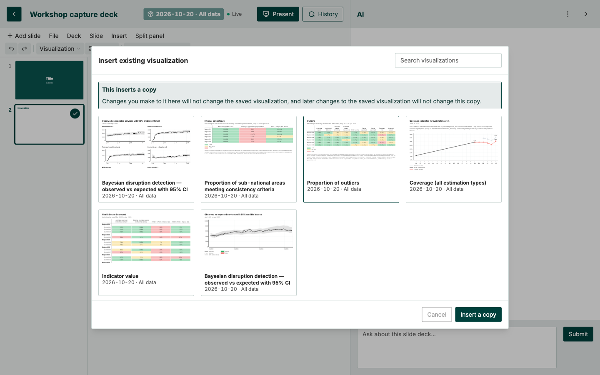

# Facilitator guide — Slide Decks

<strong>Facilitator guide</strong> · <strong>Slide Decks</strong> · <strong>4 activities · ~60 min + demo</strong>

## Purpose

Slide Decks teaches participants to assemble what they have already built, charts and interpretations, into a presentation. It follows a build-then-polish arc: create the deck, watch the editor demonstrated, add charts two ways (by hand and with the AI), then finalize. The output is what participants will show decision-makers, so the standard is presentation-ready, not merely complete.

By the end, each participant should have a polished two-slide deck, built from their own charts, that they would show to a Director.

## Session at a glance

| # | Activity | Time | Format |
|---|----------|------|--------|
| — | Editor walkthrough demo | ~5 min | Facilitator-led (appendix) |
| 1 | Create your first slide deck | ~10 min | Hands-on, individual |
| 2 | Add a visualization (manually) | ~15 min | Hands-on, individual |
| 3 | Add a visualization (with the AI) | ~15 min | Hands-on, individual |
| 4 | Edit and finalize your slides | ~20 min | Hands-on, individual |

---

## Running the session

**Preparation.** Have a deck with one empty content slide and at least one saved visualization ready in a demo folder, so the editor demo runs without a hitch. Set browser zoom to about 100% so the interface is legible on the shared screen. Remember that decks save live and are shared: demonstrate on your own deck, not on a participant's.

**How to demonstrate.** The sequence is **container → demo → do (manual) → do (AI) → polish.** Activity 1 creates the deck; you then run the editor walkthrough (appendix) live *before* participants touch the editor. That demo gates activities 2 and 3: without it, participants will not find the block toolbar. Run the appendix as written; the handouts re-explain what you showed, they are not self-teaching.

**Grouping.** All four activities are individual. Pair participants only for help when someone is stuck.

**Pacing.** Protect the demo and activity 4. If time runs short, let activity 3 (the AI route to the same result as activity 2) be the one that slips.

**The message to carry through.** Reuse, don't recreate: charts are built once as visualizations on the Products page and inserted as copies into slides. The slide editor is for assembly and polish.

---

## The activities

### 1. Create your first slide deck · ~10 min · hands-on

**What happens.** Participants create the deck from the Products page (**New → New deck**: name, folder, then package and scope), apply the Default theme in the picker that opens, and add a **Content slide** with **Add slide**.

**Demonstrate.** Show the **Folder** field in the dialog and the theme picker, and the three slide types in **Add slide**, calling out that only **Content** holds a chart and text.

**Say something like.** *"Put the deck in your own folder, keep the Default theme, and pick Content: a Cover or Section slide has nowhere to put your chart."*

**What a good result looks like.** A named deck in the participant's folder, a cover slide, and one empty content slide.

**Watch for.**
- The deck created in the wrong folder (fix with **File → Name and folder…**).
- The theme picker treated as an obstacle: say it is one click.

> **Run the editor walkthrough demo now**, before activity 2.

### 2. Add a visualization (manually) · ~15 min · hands-on

**What happens.** Participants select the empty block, switch its type from **Text** to **Visualization**, click **Insert visualization → Existing visualization…**, pick their chart and **Insert a copy**, then **Layout → Add** a text block beside it.

**Demonstrate.** Covered in the appendix (steps 2 and 3). Point participants back to what they saw.

**Say something like.** *"You are not building a chart here. You are picking one you already saved, and the slide gets a copy of it."*

**What a good result looks like.** A content slide with one of the participant's own charts and a line of text beside it.

**Watch for.**
- Clicking the thumbnail instead of the block: the toolbar appears only when a block on the slide is selected.
- A chart missing from the picker: it was not saved as a visualization, or sits in a folder they cannot see.
- Expecting the saved chart to update the slide later: it is a copy; **Replace with existing visualization** refreshes it.

---

### 3. Add a visualization (with the AI) · ~15 min · hands-on

**What happens.** The same task by a different route: with the deck open, participants ask the AI panel to add a slide with a named chart, check the slide, and correct it in the chat.

**Demonstrate.** One request live, so participants see the AI list its steps and the slide appear. Show **History** once as the way back.

**Say something like.** *"The AI works on the deck you have open, and what it does is saved as it goes. Name the chart, check the slide, and correct it in the chat if needed."*

**What a good result looks like.** A two-slide deck, the second slide added through the AI.

**Watch for.**
- Asking from the Products page: the AI answers that it cannot edit from there.
- A vague request returning a close-but-wrong chart: name it.

### 4. Edit and finalize your slides · ~20 min · hands-on

**What happens.** A polishing pass: four reviews per slide (accuracy, resize, restructure, header and footer), using the block toolbar and the **Layout** menu.

**Demonstrate.** Show the divider between two blocks and one **Layout → Add**; then one small text edit versus a rewrite handed to the AI panel.

**Say something like.** *"Small fixes you make here; structural rewrites go to the AI. The bar is: could you show this slide to a Director without an apology?"*

**What a good result looks like.** Every slide reviewed, charts and text sized to fit, a title that states the finding.

**Watch for.**
- A chart still cramped after resizing: simplify it with **Layout → Edit visualization**, not by shrinking the text.
- Participants looking for a Save button: there is none. **History** is the safety net.

## Closing the session

By the end, every participant has a polished two-slide deck built from their own charts. Hold them to one bar: each slide could be shown to a Director without an apology.

---

## Appendix — Editor walkthrough demo script

A five-minute live tour of the deck editor. Participants have just created an empty content slide; this shows them how to put a chart and text on it before they repeat it in activity 2. Keep momentum.

### Setup checklist

- ☐ Your own deck open on an **empty content slide**
- ☐ At least one saved visualization in a demo folder
- ☐ Browser zoom at about 100%
- ☐ Screen-share working if remote

### Step 1: the editor

- **Do:** Point at the slide list (left), the slide (middle), the AI panel (right), and the top bar: **Add slide**, **File**, **Deck**, **Slide**, **Insert**, **Present**, **History**, and the **Live** label.
- **Say:** *"Everything saves as you work; Live means your teammates see it too. There is no Save button; History brings back earlier versions."*

### Step 2: the block

- **Do:** Click inside the empty block. Show the toolbar that appears: the **Text** dropdown, **Layout**, **Edit text**. Open the dropdown and choose **Visualization**.
- **Say:** *"A slide is made of blocks. Click one and its toolbar appears. This dropdown says what the block holds: text, a visualization, or an image."*

---

### Step 3: insert a saved chart

- **Do:** **Insert visualization → Existing visualization…**, pick a chart, **Insert a copy**.
- **Say:** *"This is how a saved chart gets onto a slide, as a copy. You built it once on the Products page; here you place it."*

### Step 4: chart and text side by side

- **Do:** With the chart block selected, **Layout → Add → right**. Click the new text block, type a one-line takeaway. Drag the divider.
- **Say:** *"Two blocks, chart and takeaway, is the FASTR pattern. More than that goes on the next slide."*

### Step 5: title and done

- **Do:** Click the slide header and type a title that states the finding. Open **Insert** to show the optional sub header, date and footer.
- **Say:** *"The title is the message. And you are done: nothing to save."*

---

### Common questions

> **Q: Can I undo?**
> A: Yes: the arrows at the left of the toolbar, or Ctrl/Cmd+Z. **History** at the top restores a whole earlier version.

> **Q: Where is Save?**
> A: There is none. Changes are saved as you make them and shared live.

> **Q: Can I reorder slides?**
> A: Drag the thumbnails in the list on the left.

### Backup plan

> If the platform is down, walk through the screenshots in this appendix and describe the pattern: select the block, set it to Visualization, insert an existing chart, add a text block beside it.
