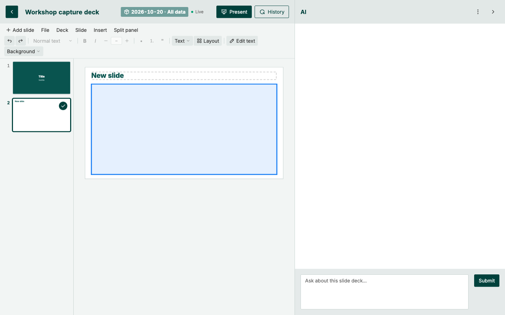

Create deck → Add manually → Add with AI → Edit & finalize → Format text

# Format your slide text

<strong>Activity</strong> · <strong>Slide Decks</strong> · <strong>~10 min</strong>

<aside class="p1-sidebar">

Before you start

- ☐ A slide with an interpretation text block, open in the editor
- ☐ The text has at least three sentences (a title line, what you see, what it means)

Why it matters

Plain paragraphs hide the message. A heading, a few bullets and one bolded phrase pull the reader through the slide in the order you want. The editor's toolbar does all of it with clicks; there are no symbols to type.

</aside>

## What you'll do

Give one slide's text a heading, one bold phrase and a bullet list, using the toolbar.

<h2 class="step-h">1Open the text editor</h2>

Click into the text block of your slide. The toolbar appears above the slide: a style menu (**Normal text**), **B** and **I**, bullet and numbered lists, a quote button, and the undo arrows. Nothing to save: the deck is **Live**.

---

<h2 class="step-h">2Heading and emphasis</h2>

1. Put the cursor on the first line, the one that states the finding, and choose a heading from the **style menu**.
2. Select the one phrase that carries the message and click **B**. One phrase per slide; a second bold phrase cancels the first.
3. If a sentence quotes a report or a guideline word for word, select it and click the **quote** button.

<h2 class="step-h">3Lists and spacing</h2>

1. Where a paragraph holds several facts, put each on its own line, select them and click the **bullet list** button. Use the **numbered list** for steps that happen in order.
2. Read the slide from two metres away, or use **Present**. If the eye does not land on the heading, the bold phrase and then the list, change one thing at a time with the undo arrows to compare.

## Checkpoint

Your slide should now have:

- A heading that names the finding, not the topic
- Bullets where there is a list, instead of a single paragraph
- One bold phrase, two at most

## What could go wrong

- **Typed symbols show on the slide** (a `#` or a `-` at the start of a line). The editor does not read symbols; delete them and use the toolbar.
- **Everything is bold.** Select only the phrase, not the paragraph, before clicking B.
- **The list has one giant bullet.** Each item needs its own line before you apply the list.
- **A change you regret.** Undo arrows for the last steps; **History** on the top bar to restore a whole earlier version.

## What's next

The next activity covers deck settings: theme, logos, footer and sharing.
