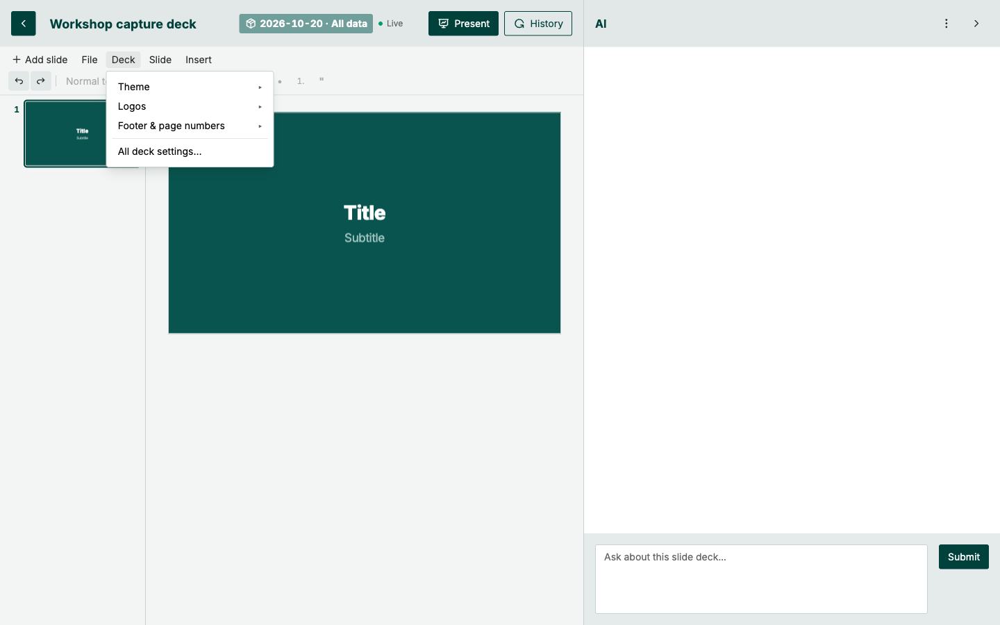
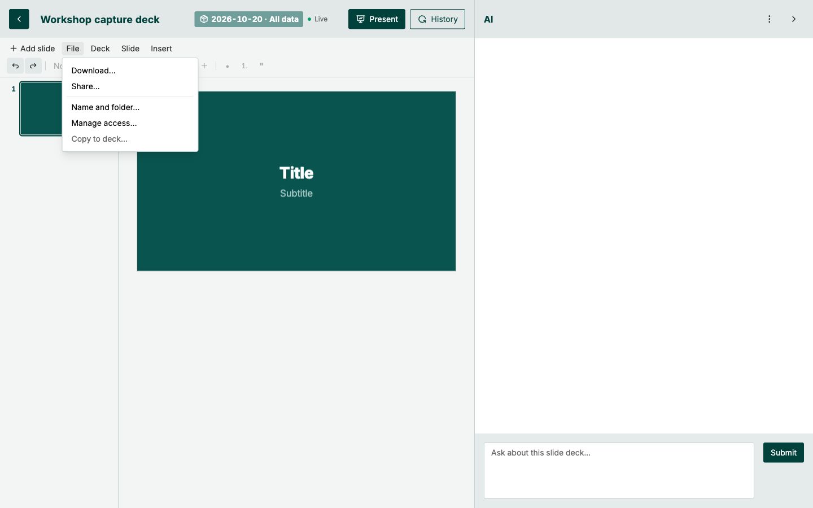

Create deck → Add manually → Add with AI → Edit & finalize → Format text → Deck settings

# Deck settings: theme, logos, footer, sharing

<strong>Activity</strong> · <strong>Slide Decks</strong> · <strong>~10 min</strong>

<aside class="p1-sidebar">

Before you start

- ☐ Your deck has at least one finished content slide
- ☐ Any custom logo you want is already in **Assets** (see Pre-step)

Why it matters

These settings turn a working draft into something shareable: one consistent look, the right logos, a footer and page numbers on every content slide, a name people can find, and the right people able to open it.

</aside>

## Pre-step: custom logos live in Assets

Custom logos are not uploaded inside a deck. They live in **Assets**, a library at the instance level that every deck and report can use.

> **Uploading to Assets is for administrators.** If you are not one, ask your facilitator to upload your logo files (PNG or JPEG) before you start. Once they are in Assets they appear in the deck's logo picker.

Administrators reach it from the side navigation: **Assets → Upload assets**. Assets also holds other shared files (GeoJSON map files, CSV uploads).

---

## Two menus do all of this

With the deck open, the **Deck** menu holds the look; the **File** menu holds the name, the folder, access and export.

<h2 class="step-h">1Deck → Theme</h2>

The theme sets colours, type and page furniture for every slide: Default (GFF green), Minimal, Corporate, Ministry, Executive, and others. It is the same picker you saw when the deck was created. Pick one and keep it for the whole deck.

<h2 class="step-h">2Deck → Logos</h2>

Three slots, each independent: the **cover**, the **content header**, the **content footer**. Each offers the built-in FASTR logos (coloured and white) and the custom logos uploaded to Assets. Per slide, the **Slide** menu can show or hide the cover logos.

<h2 class="step-h">3Deck → Footer & page numbers</h2>

A short footer line (country, period, author) shown on every content slide, and a switch for page numbers. Cover and section slides ignore both.

**Deck → All deck settings…** opens the full settings panel if you want everything on one screen.

---

<h2 class="step-h">4File → Name and folder…</h2>

Rename the deck and move it to another folder. Clicking the deck title at the top left also renames it. Use the convention your team agreed on (country, period, topic, your name).

<h2 class="step-h">5File → Manage access…</h2>

Who can open and edit this deck: **Owner**, **Editor** or **Viewer** per person. A deck is visible to the team by default; the row on the Products page shows **Restricted** when access has been limited. To set access for a whole folder at once, use the folder's **⋮ → Set access for everything in this folder…** on the Products page.

<h2 class="step-h">6File → Download… and Share…</h2>

**Download…** exports the deck (PDF, or PPTX with the charts as images). **Share…** gives a link. **Copy to deck…** copies selected slides into another deck.

Nothing to save: every setting applies immediately and is stored live.

---

## Checkpoint

Your deck should:

- Use one theme across all slides
- Show the logos you intend in each slot
- Carry the footer and page numbers on content slides
- Have a name your team can find, in your folder
- Be open to the people who need it, and only them

## What could go wrong

- **Custom logo missing from the picker.** The file is not in Assets yet. Ask an administrator to upload it, then reopen the logo picker.
- **Footer on the cover.** It should not be there; cover and section slides ignore the footer. If it appears, check the slide's type in the **Slide** menu.
- **A colleague cannot open the deck.** They are not in **Manage access**, or the folder is restricted. Add them, or ask the folder owner.
- **The deck shows old numbers.** It is attached to an older results package. On the Products page, **⋮ → Results package and scope…** moves it to the pinned one.

## What's next

The deck is ready to share. Download it, or send the link.
