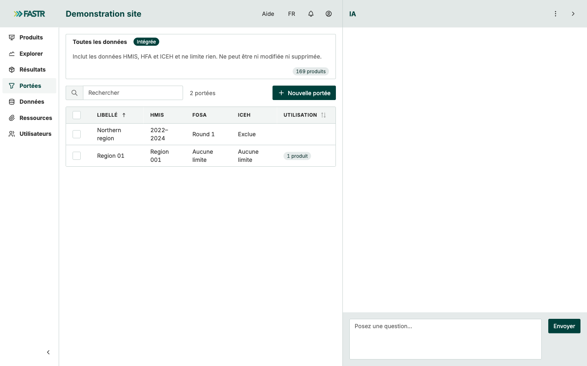
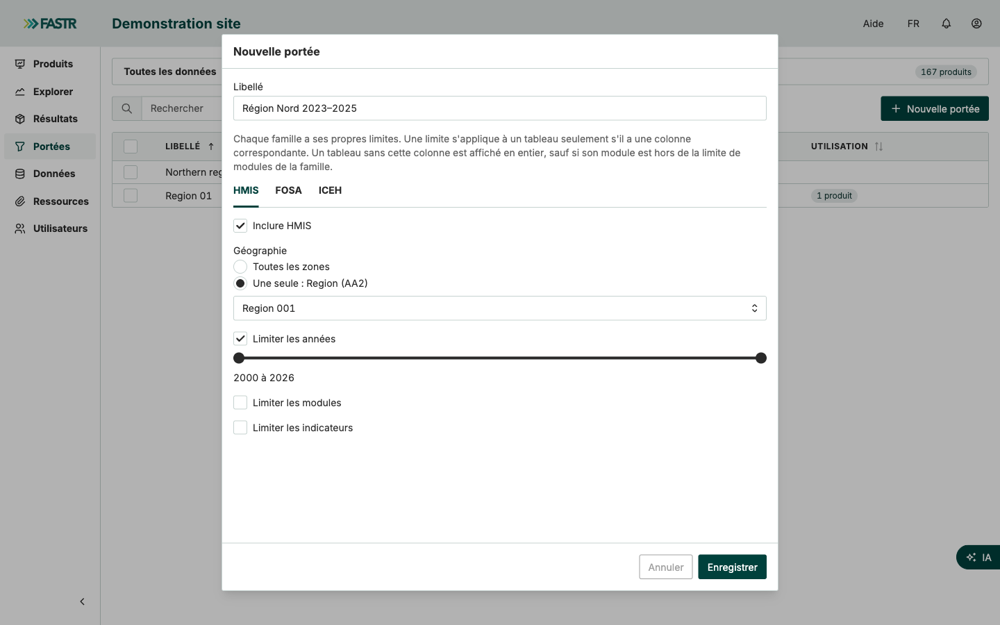
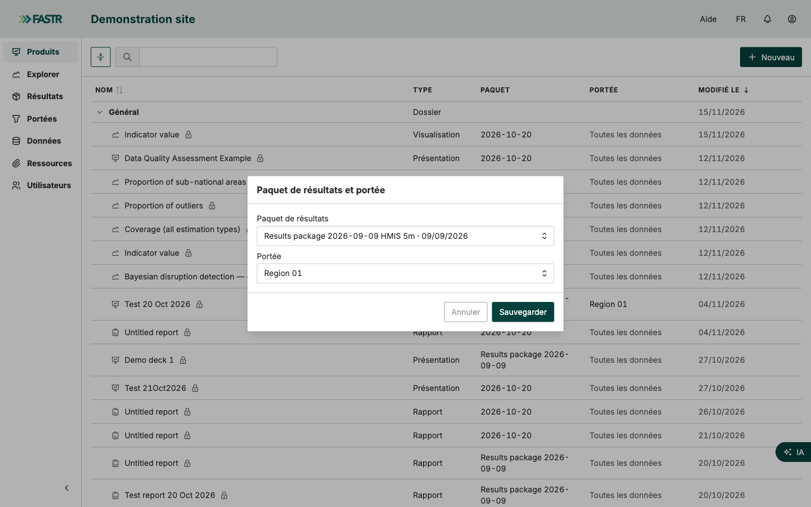

Structure des formations → Indicateurs → Données → Vérifier → Portées

# Créer une portée et la rattacher à un produit

<strong>Configuration de l'instance</strong> · <strong>~15 min</strong>

<aside class="p1-sidebar">

Avant de commencer

- ☐ Un paquet de résultats existe (page Résultats)
- ☐ Votre compte a un accès non restreint aux données : administrateur, ou utilisateur ayant toutes les portées. Sans cela, le bouton **Nouvelle portée** n'apparaît pas

Pourquoi c'est important

Un projet portait autrefois sa propre restriction : une région, quelques années. Cette restriction est maintenant une **portée**, une vue nommée dans une seule liste partagée. Chaque présentation, rapport et visualisation lit une portée, et Explorer utilise la même liste. Créez les portées une fois, nommez-les bien, et toute l'équipe filtre de la même façon.

</aside>

## Ce que vous allez faire

Créer une portée pour une région et une plage d'années, la relire dans le tableau des portées, la rattacher à un produit, et la vérifier dans Explorer.

<h2 class="step-h">1Ouvrir la page Portées</h2>

Cliquez sur **Portées** dans la navigation latérale. En haut, la portée intégrée **Toutes les données** : elle inclut HMIS, FOSA et ICEH, ne limite rien, et ne peut être ni modifiée ni supprimée. Son badge compte les produits qui l'utilisent. En dessous, un tableau avec une ligne par portée et une colonne par famille de données, plus **Utilisation**.

---

<h2 class="step-h">2Créer une portée</h2>

1. Cliquez sur **Nouvelle portée** (en haut à droite).
2. **Libellé** : nommez-la par son contenu, par exemple `Région Nord 2023–2025`. « Toutes les données » est réservé et un libellé déjà utilisé est refusé.
3. Un onglet par famille : **HMIS**, **FOSA**, **ICEH**. Laissez **Inclure** coché pour les familles que la portée doit couvrir ; décochez-le pour écarter une famille entièrement.
4. Sur l'onglet HMIS, sous **Géographie**, choisissez **Une seule : Region (AA2)** et sélectionnez la région. Cochez **Limiter les années** et réglez la plage. **Limiter les modules** et **Limiter les indicateurs** resserrent encore ; laissez-les décochés pour l'instant.
5. Cliquez sur **Enregistrer**.

<h2 class="step-h">3La relire dans le tableau</h2>

Votre portée a sa propre ligne. Chaque colonne de famille indique **Exclue**, **Aucune limite**, ou la limite en quelques mots (la région, les années). **Utilisation** reste vide tant qu'aucun produit ne porte la portée. Cliquez sur la ligne pour la rouvrir ; cochez des lignes et utilisez **Supprimer** pour retirer les portées que personne n'utilise.

---

<h2 class="step-h">4La rattacher à un produit</h2>

1. Allez sur **Produits** et trouvez une présentation, un rapport ou une visualisation que vous pouvez modifier (un produit de test de préférence).
2. Survolez sa ligne, cliquez sur **⋮**, puis **Paquet de résultats et portée…**.
3. Laissez le **Paquet de résultats** tel quel, mettez **Portée** sur votre nouvelle portée, et cliquez sur **Sauvegarder**.

La ligne affiche maintenant la portée. Ouvrez le produit : chaque figure s'est refiltrée sur la région et les années. Des titres écrits pour tout le pays peuvent devoir être mis à jour.

<h2 class="step-h">5La vérifier dans Explorer</h2>

Ouvrez **Explorer**. Le sélecteur de **portée** est en haut à droite, à côté du paquet. Choisissez votre portée : le tableau et les graphiques ne montrent que la région et les années définies. Les chiffres correspondent à ceux du produit, parce que les deux lisent le même paquet à travers la même portée.

<h2 class="step-h">6Ranger</h2>

Si le produit était un test, remettez-le sur **Toutes les données** de la même façon. Une portée encore portée par un produit ne peut pas être supprimée ; déplacez d'abord le produit.

---

## Vérification

Vous devriez maintenant avoir :

- ✓ Une portée au libellé clair, limitée à une région et une plage d'années
- ✓ Un produit dont la ligne affiche cette portée, avec ses figures refiltrées
- ✓ La même vue dans Explorer sous le sélecteur de portée

## Portée, filtre ou accès ?

- **Portée** : ce qu'un produit entier montre. Une par produit, prise dans la liste partagée. Aussi le sélecteur d'Explorer.
- **Filtre** : ce qu'une visualisation montre. Réglé dans son onglet **Données**, il ne vit que dans ce graphique.
- **Accès** : qui peut ouvrir un produit ou un dossier. **Gérer l'accès** dans le menu ⋮. Une portée cache des données, l'accès cache le produit.

Un administrateur peut aussi accorder une portée à un utilisateur restreint sur la page **Utilisateurs** ; elle borne alors tout ce que cet utilisateur voit sur la plateforme.

## Que faire si ça ne marche pas

- **Pas de bouton Nouvelle portée.** Votre compte est restreint. Demandez à un administrateur un accès non restreint aux données, ou de créer la portée.
- **Le libellé est refusé.** C'est « Toutes les données » dans une langue, ou une autre portée l'a déjà. Choisissez-en un autre.
- **La suppression est refusée.** Un produit porte encore la portée. Changez d'abord la portée de ce produit.
- **Les chiffres d'un collègue diffèrent.** Son produit ou son Explorer est sur une autre portée ou un autre paquet. Comparez les deux sélecteurs.
- **Une portée a un badge « Migrée ».** Elle a été créée à partir d'un ancien projet. Gardez-la ou renommez-la ; elle fonctionne comme les autres.

## Étape suivante

Configuration terminée. Passez à **Prise en main** pour la vue participant de Produits, Explorer et des portées.
