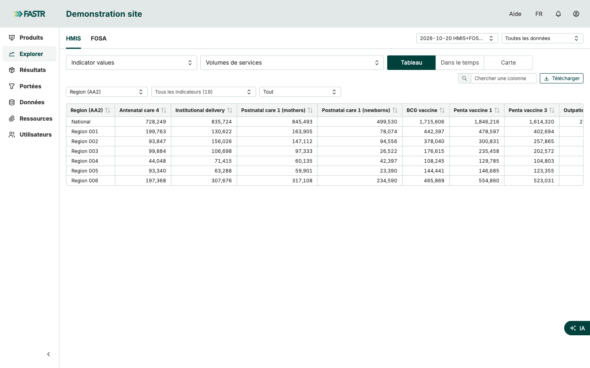
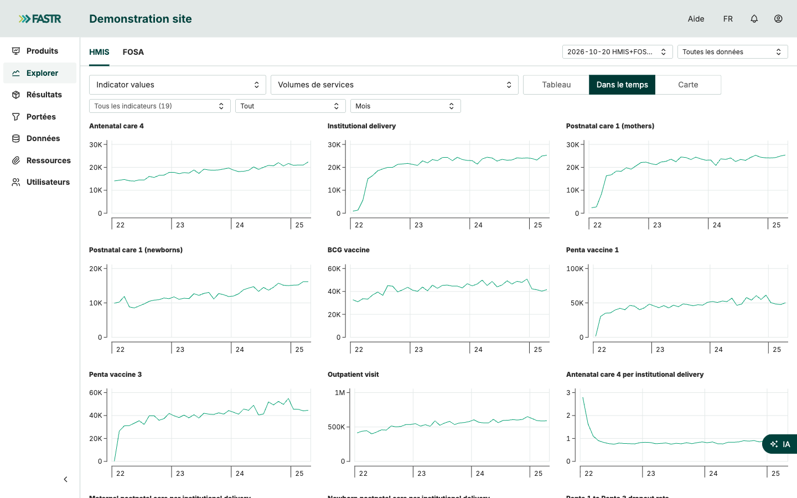
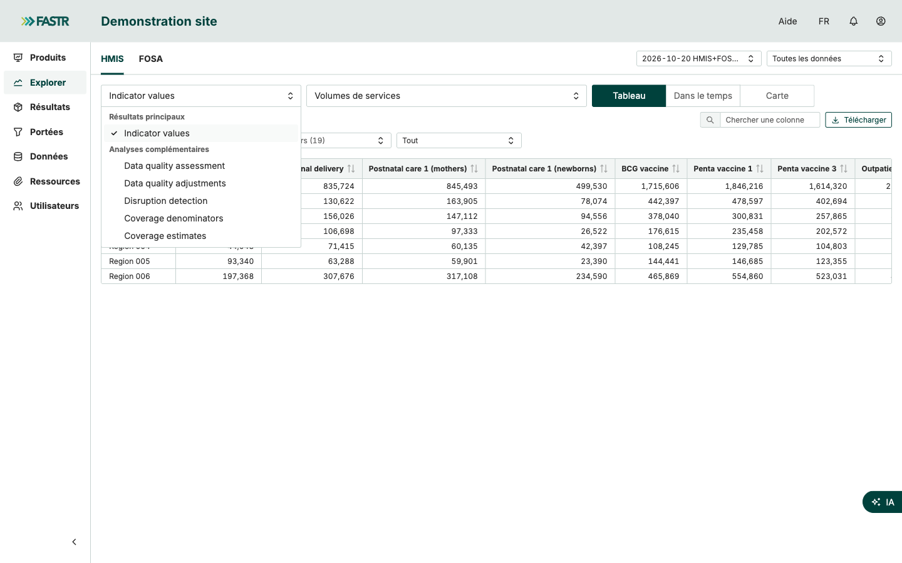
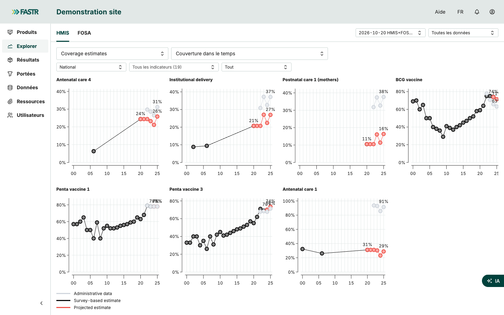

Connexion → Votre dossier → Explorer

# Jeter un premier regard avec Explorer

<strong>Activité</strong> · <strong>Prise en main</strong> · <strong>~15 min</strong>

<aside class="p1-sidebar">

Avant de commencer

- ☐ Vous avez complété **Connexion à la plateforme**
- ☐ La navigation latérale est dépliée (la flèche en bas de la barre)

Pourquoi c'est important

Explorer montre toutes les analyses que la plateforme a déjà calculées, sous forme de tableau, de série de graphiques ou de carte, sans rien à créer et sans rien à casser. C'est la façon la plus rapide de voir ce que disent les données avant de construire quoi que ce soit.

</aside>

## Ce que vous allez faire

Ouvrir Explorer, lire un service dans un tableau, le suivre dans le temps, passer à un autre module d'analyse, et noter trois chiffres à rapporter à la salle.

<h2 class="step-h">1Ouvrir Explorer</h2>

Cliquez sur **Explorer** dans la navigation latérale. Quatre contrôles se trouvent en haut :

- **HMIS / FOSA** : la famille de données. Restez sur HMIS.
- Le **paquet de résultats**, en haut à droite. Celui qui est épinglé est sélectionné ; laissez-le.
- La **portée**, juste à côté. **Toutes les données** signifie tout le pays.
- Le **module** et sa **métrique**, à gauche. La page s'ouvre sur **Utilisation des services → Volumes de services** : le volume mensuel de chaque indicateur.

---

<h2 class="step-h">2Lire le tableau</h2>

La vue **Tableau** affiche une ligne par zone et une colonne par indicateur. Trois filtres au-dessus :

- **Niveau** : Région, District ou Sous-district (les libellés sont ceux de votre pays).
- **Indicateurs** : tous, ou une sélection.
- **Période** : **12 derniers mois**, **Dernier trimestre**, **Dernière année**, ou **Tout**.

Réglez le niveau sur celui juste en dessous du national et la période sur **12 derniers mois**. Cliquez sur un en-tête de colonne pour trier. **Rechercher une colonne** vous amène à un indicateur quand il y en a beaucoup. **Télécharger** enregistre le tableau dans un fichier.

**Notez :** le total national d'**CPN1** (la CPN1) sur les 12 derniers mois, et la zone avec la valeur la plus basse.

<h2 class="step-h">3Le suivre dans le temps</h2>

Cliquez sur **Dans le temps**. Chaque indicateur reçoit un petit graphique de son volume mensuel. Les filtres deviennent l'indicateur, le niveau et le pas de temps (**Mois**, **Trimestre**, **Année**). Choisissez **CPN1** seul, au niveau national.

**Notez :** le mois avec la valeur la plus élevée sur les deux dernières années.

---

<h2 class="step-h">4Essayer la carte</h2>

Cliquez sur **Carte**. Un indicateur, un niveau, une période, coloré par zone. Si votre instance n'a pas encore de fichiers de limites administratives, la page le dit au lieu de dessiner une carte ; c'est un élément de configuration pour votre administrateur, pas une erreur de votre côté.

<h2 class="step-h">5Changer de module</h2>

Ouvrez le menu déroulant du **module** à gauche. **Résultats principaux** contient Utilisation des services (les volumes). **Analyses complémentaires** liste les autres modules : Évaluation de la qualité des données, Ajustements de la qualité des données, Détection des perturbations, Dénominateurs de couverture, Estimations de couverture. Chaque module apporte ses propres métriques et sa propre vue.

Choisissez **Estimations de couverture**. La vue devient **Couverture dans le temps** : un graphique par indicateur, avec des points gris pour la couverture calculée à partir des données de routine, noirs pour les estimations d'enquête, rouges pour la projection qui prolonge la dernière enquête.

**Notez :** la dernière couverture projetée de **Penta 3**.

---

<h2 class="step-h">6Partager vos trois chiffres</h2>

Comparez avec votre voisin : même paquet, mêmes filtres, mêmes chiffres ? Sinon, trouvez quel filtre diffère. Gardez ensuite la question qui vous intéresse le plus : c'est celle pour laquelle vous construirez un graphique au module suivant.

## Vérification

Vous savez :

- Ouvrir Explorer et nommer ses quatre contrôles du haut (famille de données, paquet, portée, module et métrique)
- Passer entre **Tableau**, **Dans le temps** et **Carte**
- Changer le niveau et la période d'un tableau
- Trouver un module sous **Analyses complémentaires**

## Explorer ou une visualisation ?

Explorer sert à **regarder** : rapide, complet, rien n'est enregistré. Une **visualisation** sert à **garder et partager** : vous choisissez la métrique, les filtres et la forme, elle a une ligne sur la page Produits, et vous pouvez la copier dans une présentation ou un rapport. Quand une vue d'Explorer répond à votre question, construisez-la ensuite comme visualisation.

## Que faire si ça ne marche pas

- **Le tableau est vide.** Le paquet n'a pas de données pour la période choisie. Réglez la période sur **Tout**.
- **Les chiffres diffèrent de ceux d'un collègue.** Vérifiez le paquet (en haut à droite), la portée, le niveau et la période. Quatre filtres, quatre façons de différer.
- **Pas de carte.** Aucun fichier de limites administratives n'a été téléversé pour ce niveau. Utilisez le tableau ou les graphiques.
- **Les noms des modules sont en anglais** même dans l'interface française. C'est un problème d'affichage connu ; le contenu est le même.

## Étape suivante

Configuration terminée. Le module suivant, **Visualisations**, commence par construire le graphique que vous venez de regarder, et l'enregistrer dans votre dossier.
