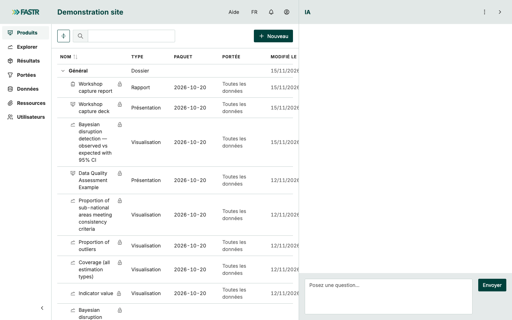
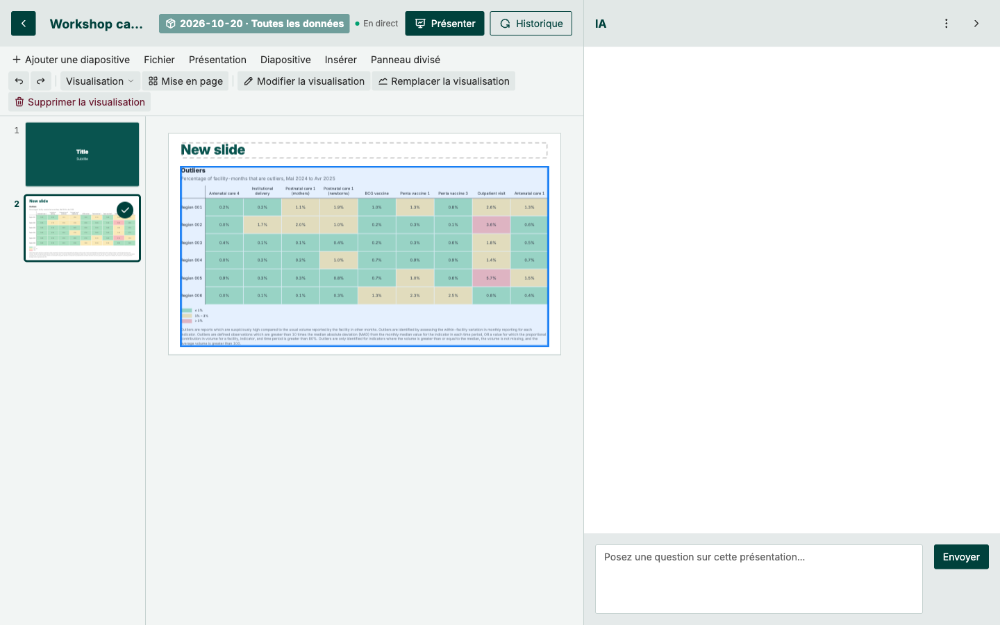
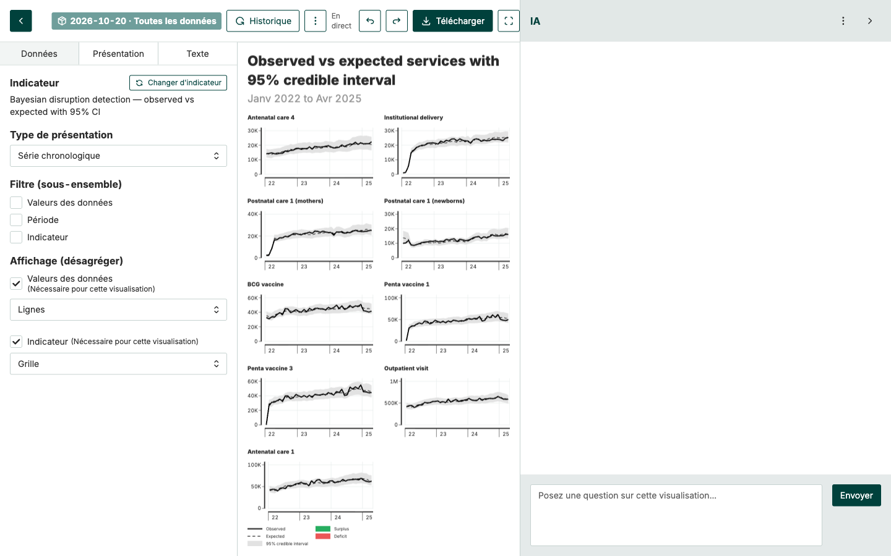

# Guide du facilitateur — Prise en main

<strong>Guide du facilitateur</strong> · <strong>Prise en main</strong> · <strong>3 activités · ~30 min + démo</strong>

## Objectif

Prise en main permet à chaque participant d'accéder à la plateforme et de s'organiser pour garder son travail en ordre. C'est un module court, une démo animée par le facilitateur et trois activités rapides, mais c'est un point de passage : un participant qui n'est pas connecté, avec un dossier à lui, sera bloqué pour le reste de l'atelier. Les obstacles ici sont les comptes et les accès, pas les compétences.

À la fin, chaque participant devrait être connecté, disposer d'un dossier à son nom sur la page Produits, et avoir lu un tableau et un graphique dans Explorer.

## La session en bref

| # | Activité | Durée | Format |
|---|----------|-------|--------|
| — | Démo de la plateforme FASTR | ~10 min | Animée par le facilitateur (annexe) |
| 1 | Connexion à la plateforme | ~10 min | Pratique, individuel |
| 2 | Créer un dossier pour votre travail | ~5 min | Pratique, individuel |
| 3 | Jeter un premier regard avec Explorer | ~15 min | Pratique, en binôme |

---

## Animer la session

**Préparation.** Réglez les comptes *avant* la session si possible. La perte de temps récurrente vient des e-mails de vérification et des comptes non approuvés, que le participant ne peut pas corriger lui-même et qui bloquent la salle. Approuvez chaque compte sur la page **Utilisateurs** la veille. Décidez si les dossiers des participants doivent se trouver dans un dossier pays ; si oui, créez-le d'abord. Ayez la démo de la plateforme chargée (annexe) et le document *Connexion à la plateforme* prêt.

**Comment démontrer.** Commencez par la démo de la plateforme : un tour rapide de l'écran d'accueil avant que quiconque ne touche un clavier. Restez à un niveau général ; la configuration est une session ultérieure. Ensuite, laissez les participants se connecter et créer leur dossier à partir des documents.

**Regroupement.** Les activités 1 et 2 sont individuelles ; mettez les participants en binôme pour s'entraider si quelqu'un bloque sur un accès. L'activité 3 se fait en binôme pour que les trois chiffres soient comparés.

**Rythme.** Ne déclarez pas le module fini trop tôt. Vérifiez que chaque participant a franchi le point de passage (connecté, dossier créé) avant Explorer, et servez-vous d'Explorer pour occuper le temps pendant que les comptes lents sont réglés. Un problème d'accès non résolu ne fait que coûter plus cher plus tard.

**Le message à faire passer.** Une seule liste pour tout le pays, des dossiers pour la garder lisible, un dossier par personne. C'est cette habitude qui garde une page Produits partagée navigable après une semaine de travail.

> **Si des participants ont déjà utilisé FASTR.** Dites-le clairement : les projets ont disparu. Tout se trouve sur une seule page Produits, organisée en dossiers ; chaque présentation, rapport ou visualisation est rattaché à un paquet de résultats et à une portée, indiqués dans sa ligne. Les tableaux de bord n'existent plus ; la page Explorer et les visualisations enregistrées les remplacent.

---

## Les activités

### 1. Connexion à la plateforme · ~10 min · pratique

**Le déroulé.** Les participants ouvrent l'URL de leur pays, s'inscrivent ou se connectent, vérifient leur e-mail s'ils sont nouveaux, et se repèrent sur l'écran d'accueil : la liste Produits, la navigation latérale, le bouton IA.

**Démontrer.** Couvert par la démo de la plateforme. Après elle, distribuez *Connexion à la plateforme* et laissez-les travailler.

**Formulez-le ainsi.** *« Si votre e-mail de vérification n'arrive pas en deux minutes, regardez dans les spams. Si vous vous connectez et voyez une liste vide, dites-le-moi : votre compte doit être approuvé, c'est mon travail, pas le vôtre. »*

**À quoi ressemble un bon résultat.** Chaque participant sur la page Produits, la navigation latérale dépliée, capable d'ouvrir un produit et de revenir.

**À surveiller.**
- Les e-mails de vérification qui arrivent dans les spams.
- « Compte non approuvé » ou une liste vide : approuvez le compte sur la page **Utilisateurs**.
- La navigation latérale repliée qui déroute les participants : montrez la flèche en bas de la barre.

### 2. Créer un dossier pour votre travail · ~5 min · pratique

**Le déroulé.** Chaque participant crée un dossier à son nom : **Nouveau → Nouveau dossier**, nom, couleur, Sauvegarder.

**Démontrer.** Créez un dossier à l'écran. Montrez le menu ⋮ sur sa ligne (Déplacer dans, Renommer, Définir l'accès, Supprimer), et le champ **Dossier** dans la boîte de dialogue Nouvelle présentation pour qu'ils voient pourquoi le dossier compte.

**Formulez-le ainsi.** *« Utilisez votre propre nom. Le dossier "test" de tout le monde se télescope, et vous ne retrouverez plus jamais votre travail. Quand vous créez une présentation ou un graphique, la boîte de dialogue demande quel dossier : choisissez le vôtre. »*

**À quoi ressemble un bon résultat.** Un dossier par participant, à son nom, vide, à l'endroit convenu.

**À surveiller.**
- **Nouveau dossier** absent du menu : le compte n'a pas l'accès aux données nécessaire pour gérer les dossiers. Corrigez le rôle sur la page Utilisateurs.
- Des dossiers créés au premier niveau alors que vous les vouliez dans un dossier pays : utilisez **Déplacer dans**.

---

### 3. Jeter un premier regard avec Explorer · ~15 min · pratique, en binôme

**Le déroulé.** Les participants ouvrent **Explorer**, lisent la CPN1 dans le **Tableau** (niveau en dessous du national, 12 derniers mois), le suivent **Dans le temps**, essaient la **Carte**, passent le module sur **Estimations de couverture**, et notent trois chiffres à comparer avec un voisin.

**Démontrer.** Nommez à l'écran les quatre contrôles du haut (HMIS/FOSA, paquet, portée, module et métrique), passez une fois de Tableau à Dans le temps puis à Carte, et ouvrez le menu des modules pour montrer **Analyses complémentaires**.

**Formulez-le ainsi.** *« Rien ici n'est enregistré et rien ne peut casser. Explorer sert à regarder. Quand une vue répond à votre question, c'est le graphique que vous construirez demain. »*

**À quoi ressemble un bon résultat.** Des binômes d'accord sur les mêmes trois chiffres, ou capables de dire quel filtre les a fait différer.

**À surveiller.**
- Des chiffres qui diffèrent entre voisins : paquet, portée, niveau ou période. Faites-leur trouver lequel.
- « La carte est cassée » : pas de fichiers de limites administratives sur l'instance. Dites-le dès le départ.

## Pour conclure

Chaque participant doit terminer connecté, avec son propre dossier, et avec une question tirée d'Explorer à laquelle il veut répondre par un graphique. Quiconque ne l'est pas sera bloqué pour le reste de l'atelier. Vérifiez avant de continuer.

---

## Annexe — Script de démo de la plateforme FASTR

Un tour d'orientation rapide de la Plateforme analytique FASTR, juste assez pour que les participants reconnaissent l'écran quand ils se connecteront. C'est **avant** qu'ils touchent leur propre clavier. Restez à un niveau général ; les activités pratiques apportent les détails.

### Liste de préparation

- ☐ Navigateur connecté à l'instance de votre pays, dans la langue des participants, Explorer ouvert une fois pour qu'il se charge vite
- ☐ Un dossier contenant une présentation terminée et une visualisation enregistrée, prêts à ouvrir
- ☐ Navigation latérale dépliée (cliquez sur la flèche en bas de la barre)
- ☐ Partage d'écran qui fonctionne si en distanciel
- ☐ Le document *Connexion à la plateforme* prêt à être distribué après la démo

### Étape 1 : L'écran d'accueil

- **Faites :** Montrez la page **Produits** telle qu'elle s'ouvre après connexion. Dépliez un dossier, pointez les colonnes Type, Paquet et Portée.
- **Dites :** *« Ceci est l'instance FASTR de votre pays. Tout se trouve sur cette seule page : chaque présentation, rapport et graphique que l'équipe a créé, rangés en dossiers. Rien à installer. »*

- **Surveillez :** « C'est la même chose que DHIS2 ? » Réponse : *« Non. FASTR lit depuis DHIS2 et ajoute l'analyse, les graphiques et le reporting par-dessus. »*

### Étape 2 : La navigation latérale

- **Faites :** Cliquez une fois sur chaque entrée. **Explorer** : un graphique déjà prêt pour un module. **Résultats** : la liste des paquets, pointez celui qui est épinglé. **Portées** : la liste des vues nommées. Arrêtez-vous à **Données** : dites que c'est de l'administration.
- **Dites :** *« Produits, c'est là que vous travaillez. Explorer sert à jeter un coup d'œil sans rien créer. Résultats et Portées expliquent d'où viennent les chiffres ; nous y reviendrons. Données, Ressources et Utilisateurs sont pour les administrateurs. »*

---

### Étape 3 : Ouvrir une présentation

- **Faites :** Ouvrez la présentation préparée. Cliquez sur une diapositive de contenu avec un graphique. Montrez le bouton **Présenter**, le menu **Fichier** et l'indicateur **En direct** à côté du nom du paquet.
- **Dites :** *« C'est ce que vous construirez pour les décideurs : des diapositives avec un graphique et une interprétation. Tout s'enregistre tout seul et toute l'équipe voit les changements en direct. Le graphique reste lié aux données. »*

### Étape 4 : Ouvrir une visualisation enregistrée

- **Faites :** Revenez en arrière et ouvrez la visualisation enregistrée. Montrez l'onglet **Données** à gauche : indicateur, type de présentation, Filtre, Affichage.
- **Dites :** *« Un graphique est un produit aussi. Vous le construisez une fois, vous l'enregistrez dans votre dossier, et vous en placez des copies dans des présentations et des rapports. »*

### Étape 5 : Le bouton IA

- **Faites :** Dans la visualisation, pointez le panneau IA à droite sans rien saisir.
- **Dites :** *« Il y a un assistant IA sur chaque produit. Il lit les données du produit que vous avez ouvert, donc il peut construire et modifier des graphiques et rédiger du texte. Une session entière lui est consacrée plus tard. »*

- **Surveillez :** N'exécutez pas de prompt ici. Gardez la curiosité pour la session IA.

---

### Questions fréquentes

> **Q : Ai-je besoin d'un mot de passe DHIS2 pour me connecter ?**
> R : Non. FASTR a ses propres comptes. Les identifiants DHIS2 ne servent qu'une fois, à un administrateur, pour connecter l'instance.

> **Q : Mon travail est-il privé ?**
> R : Tout ce qui se trouve sur la page Produits est visible par l'équipe par défaut. L'accès peut être restreint par produit ou par dossier avec **Gérer l'accès** ; votre facilitateur décide de la règle pour l'atelier.

> **Q : Puis-je l'utiliser sur mon téléphone ?**
> R : Cela fonctionne, mais c'est conçu pour un ordinateur portable : les graphiques ont besoin d'espace.

### Plan de secours

> Si la plateforme est indisponible pendant votre démo, utilisez les captures d'écran du document *Connexion à la plateforme* pour parcourir l'écran d'accueil, puis passez à l'activité participant dès qu'elle est revenue.
