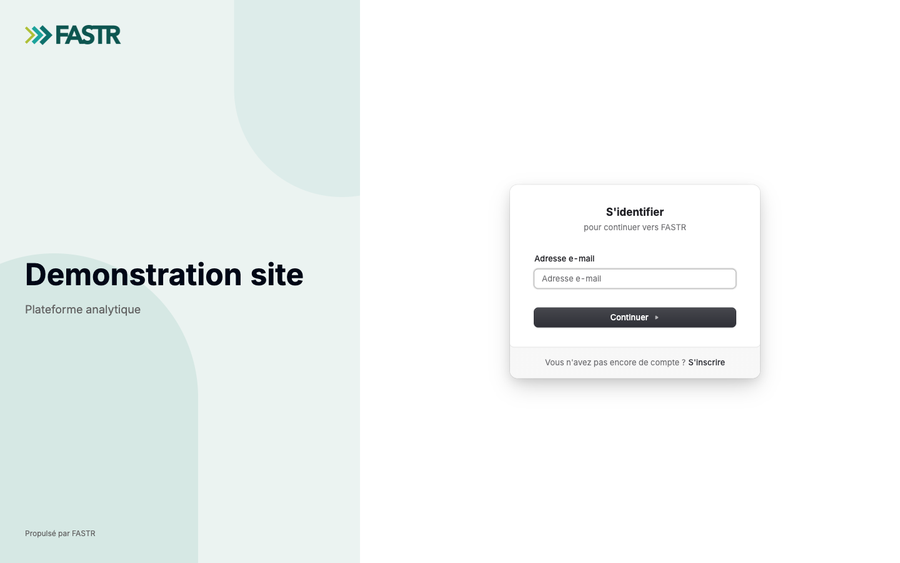
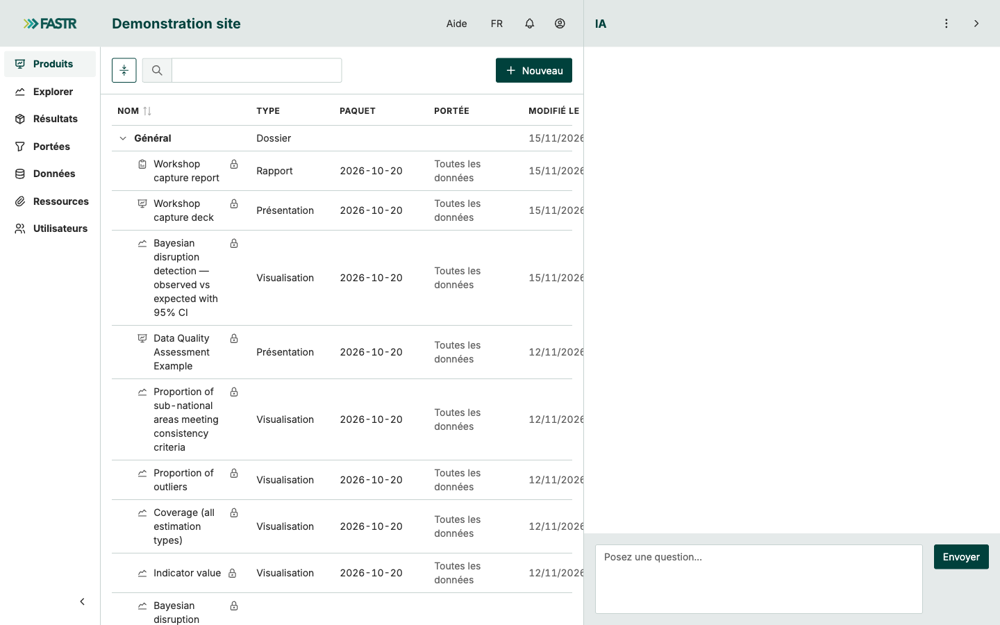

Connexion → Votre dossier → Explorer

# Connexion à la plateforme

<strong>Activité</strong> · <strong>Prise en main</strong> · <strong>~10 min</strong>

<aside class="p1-sidebar">

Avant de commencer

- ☐ Vous avez assisté à la démo de la plateforme par le facilitateur
- ☐ Vous avez l'**URL de la plateforme de votre pays** (votre facilitateur la partagera)
- ☐ Vous avez une adresse e-mail valide que vous pouvez consulter pendant l'activité

</aside>

## Ce que vous allez faire

Créer un compte FASTR si vous êtes nouveau, vous connecter, et vous repérer sur l'écran d'accueil. Pas encore de travail sur les données.

<h2 class="step-h">1Ouvrir l'URL de la plateforme</h2>

Allez à l'URL de la plateforme de votre pays dans un navigateur (le format est généralement `https://<pays>.fastr-analytics.org`). Vous arrivez sur l'écran de connexion.

---

<h2 class="step-h">2S'inscrire ou s'identifier</h2>

- **Première fois :** cliquez sur **S'inscrire** sous le formulaire, saisissez votre **Adresse e-mail** et un **Mot de passe**, puis créez le compte. Consultez votre boîte de réception pour l'e-mail de vérification et cliquez sur son lien. Si rien n'arrive dans les deux minutes, regardez dans le dossier spam.
- **Vous avez déjà un compte :** saisissez votre adresse e-mail et votre mot de passe, puis cliquez sur **Continuer**.

<h2 class="step-h">3Se repérer sur l'écran d'accueil</h2>

Après connexion, vous arrivez sur **Produits** : une seule liste de tout ce que les utilisateurs de cette instance ont créé, organisée en **dossiers**. Chaque ligne est une **Présentation**, un **Rapport** ou une **Visualisation**, avec le paquet de résultats et la portée dont elle lit les données, et la date de dernière modification.

---

La **navigation latérale** à gauche est la même partout. Cliquez sur la petite flèche en bas pour afficher les libellés :

| Entrée | À quoi elle sert |
|---|---|
| **Produits** | Vos présentations, rapports et visualisations, rangés en dossiers. C'est là que vous passerez le plus de temps. |
| **Explorer** | Des tableaux, graphiques et cartes déjà prêts pour chaque module d'analyse, sans rien avoir à créer. Pratique pour un coup d'œil rapide. |
| **Résultats** | Les paquets de résultats : les analyses calculées dont les produits lisent les données. |
| **Portées** | Des vues nommées des données (une zone, une période) auxquelles les produits et les utilisateurs peuvent être limités. |
| **Données**, **Ressources**, **Utilisateurs** | Administration : imports, indicateurs, fichiers partagés, comptes. Vous ne les verrez pas forcément toutes. |

La barre du haut comporte **Aide** (visites guidées, documentation, commentaires), le changement de langue, les notifications et **Votre compte**. Le bouton **IA** se trouve en bas à droite de chaque écran.

<h2 class="step-h">4Ouvrir quelque chose</h2>

Cliquez sur un dossier pour le déplier, puis cliquez sur n'importe quel produit qu'il contient. Il s'ouvre dans son propre éditeur ; la flèche de retour en haut à gauche vous ramène à la liste. Ouvrez aussi **Explorer** une fois, pour voir ce qui s'y trouve.

> **Il n'y a plus de projets.** Si vous avez déjà utilisé FASTR, c'est le changement principal : tout ce qui concerne le pays vit dans une seule liste, et les dossiers remplacent les projets. Une présentation ou un rapport est rattaché à un paquet de résultats et à une portée, indiqués dans sa ligne.

## Vérification

Vous devriez être capable de :

- Voir la liste **Produits** avec au moins un dossier dedans
- Nommer les entrées de la navigation latérale
- Ouvrir un produit et revenir à la liste

Si oui, passez à l'activité suivante.

---

## Que faire si ça ne marche pas

- **« Compte non approuvé »** ou une liste Produits vide. Votre compte doit être approuvé par un administrateur de l'instance avant que vous ne voyiez quoi que ce soit. Demandez à votre facilitateur.
- **L'e-mail de vérification n'arrive jamais.** Vérifiez les spams. Après cinq minutes, demandez à votre facilitateur de le redéclencher.
- **« E-mail ou mot de passe invalide » après l'inscription.** Revérifiez l'adresse e-mail saisie. Les fautes de frappe sont fréquentes. Utilisez le lien de réinitialisation du mot de passe.
- **La navigation latérale n'affiche que des icônes.** C'est l'état replié. Cliquez sur la flèche en bas de la barre pour la déplier, ou survolez une icône pour lire son libellé.
- **L'interface est dans la mauvaise langue.** Cliquez sur le bouton de langue dans la barre du haut (EN ou FR) et choisissez.

## Étape suivante

Passez à **Créer un dossier pour votre travail** : un dossier à votre nom sur la page Produits, pour que l'équipe retrouve ce que vous construisez.
