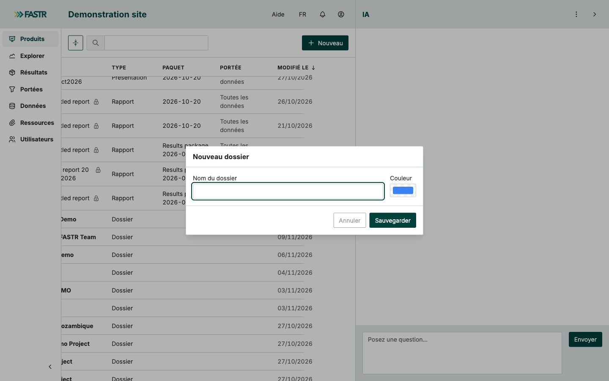
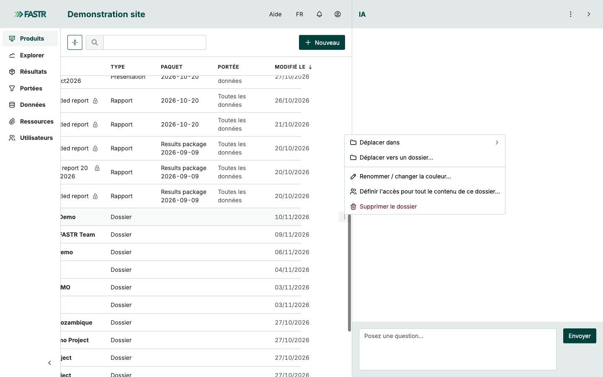

Connexion → Votre dossier → Explorer

# Créer un dossier pour votre travail

<strong>Activité</strong> · <strong>Prise en main</strong> · <strong>~5 min</strong>

<aside class="p1-sidebar">

Avant de commencer

- ☐ Vous avez complété **Connexion à la plateforme**
- ☐ Vous êtes sur la page **Produits**

Pourquoi c'est important

Toute l'équipe pays travaille dans la même liste Produits. Une dizaine de personnes qui enregistrent graphiques et présentations sans système signifie que personne ne retrouve rien plus tard. **Un dossier par personne** est la règle la plus simple qui fonctionne.

</aside>

## Ce que vous allez faire

Créer un dossier à votre nom sur la page Produits. Chaque présentation, rapport ou visualisation que vous créerez pendant l'atelier y sera rangé.

<h2 class="step-h">1Créer le dossier</h2>

1. Sur la page **Produits**, cliquez sur **Nouveau** (en haut à droite), puis sur **Nouveau dossier**.
2. Saisissez votre nom comme **Nom du dossier** (par exemple `Aïcha N.` ou `Jean S.`). Choisissez une **Couleur** si vous le souhaitez.
3. Cliquez sur **Sauvegarder**.

---

<h2 class="step-h">2Le retrouver dans la liste</h2>

Votre dossier apparaît dans la liste avec le type **Dossier**. Cliquez dessus pour le déplier : il est vide pour le moment. Utilisez le champ de recherche en haut de la liste si la liste est longue.

<h2 class="step-h">3Connaître le menu du dossier</h2>

Survolez la ligne de votre dossier et cliquez sur le menu **⋮** à son extrémité droite. Vous utiliserez ces entrées plus tard :

- **Déplacer dans** / **Déplacer vers un dossier…** : un dossier peut se trouver dans un autre dossier, par exemple un dossier pays avec un sous-dossier par personne.
- **Renommer / changer la couleur…**
- **Définir l'accès pour tout le contenu de ce dossier…** : qui peut consulter ou modifier tous les produits qu'il contient.
- **Supprimer le dossier**

> **Quand vous créez un produit,** la boîte de dialogue demande son **Dossier**. Choisissez le vôtre. Un produit rangé dans le mauvais dossier se déplace avec **Déplacer vers un dossier…** dans son propre menu ⋮.

## Vérification

Vous devriez maintenant avoir un dossier à votre nom sur la page Produits, vide. Les prochaines activités le rempliront.

---

## Conventions de nommage

- Utilisez votre nom, pas « mon dossier » ni « test ». Vos collègues créent aussi des dossiers, et « test » entrera en conflit.
- Les accents et les espaces sont autorisés dans les noms de dossier.
- Si l'équipe a déjà un dossier pays, créez le vôtre à l'intérieur : créez-le, puis utilisez **Déplacer dans** vers le dossier pays.

## Que faire si ça ne marche pas

- **Pas d'entrée « Nouveau dossier » dans le menu Nouveau.** Créer des dossiers demande un accès aux données plus large que la simple consultation. Demandez à votre facilitateur de vérifier votre rôle.
- **Le dossier ne s'enregistre pas.** Le réseau a peut-être coupé. Rafraîchissez la page ; si le dossier existe déjà à votre nom, il est dans la liste.
- **Vous voyez les dossiers de tout le monde.** C'est attendu. Toute l'équipe partage une seule liste ; le vôtre n'est qu'une ligne dedans.

## Étape suivante

Passez à **Jeter un premier regard avec Explorer** : les analyses déjà calculées, en tableaux et en graphiques, sans rien à créer pour l'instant.
