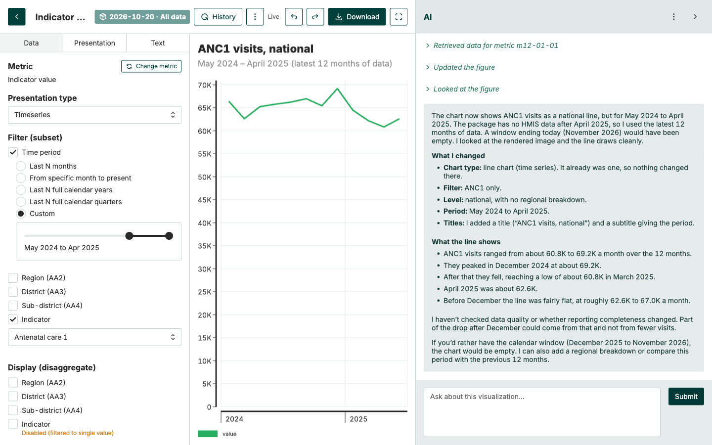

Lire une viz → Construire manuellement → Construire avec l'IA → Écrire l'interprétation → Interprétation IA → Repérer une perturbation

# Construire une visualisation avec l'assistant IA

<strong>Activité</strong> · <strong>Visualisations et interprétation</strong> · <strong>~15 min</strong>

<aside class="p1-sidebar">

Avant de commencer

- ☐ Vous avez construit au moins un graphique manuellement (document précédent)
- ☐ Vous êtes connecté·e, sur la page **Produits**
- ☐ Vous savez quel indicateur vous voulez (CPN1, Penta3, …)

Une règle

L'IA travaille **à l'intérieur d'un produit**. Sur la page Produits, elle peut seulement vous dire ce qui existe ; ouvrez une visualisation, une présentation ou un rapport et elle peut lire les données et dessiner.

</aside>

## Ce que vous allez faire

Demander à l'assistant IA de construire le même type de graphique que vous venez de construire manuellement, en tapant une requête en langage courant. Même résultat, autre chemin.

<h2 class="step-h">1Partir d'une visualisation vierge</h2>

Sur la page **Produits**, cliquez sur **Nouveau → Nouvelle visualisation**, gardez le paquet épinglé et **Toutes les données**, puis cliquez sur **Suivant**. Choisissez n'importe quelle métrique et n'importe quel préréglage pour ouvrir un éditeur (par exemple **Indicator values → Indicator value → Scorecard table → Insérer**). Ce que vous choisissez n'a pas d'importance : l'IA le changera.

Renommez-la tout de suite (cliquez sur le titre) pour la reconnaître dans la liste : *Test IA, CPN1*.

---

<h2 class="step-h">2Demander</h2>

Le panneau IA se trouve à droite de l'éditeur, avec la boîte **Posez une question sur cette visualisation…**. Tapez une requête courte et cliquez sur **Envoyer** :

> *« Transforme ceci en graphique linéaire de la CPN1 seule, au niveau national, sur les 12 derniers mois de données. »*

L'IA lit l'éditeur de la figure, recherche les métriques, récupère les données, met la figure à jour, regarde le résultat, puis vous écrit ce qu'elle a changé et ce que la courbe montre. Le graphique à gauche se met à jour pendant qu'elle travaille ; les étapes qu'elle a suivies sont listées au-dessus de sa réponse.

> **L'IA modifie la visualisation que vous avez ouverte, et les modifications s'enregistrent en direct.** C'est pour cela que vous partez d'une visualisation vierge. Si vous lui demandez de modifier le graphique d'un collègue, vous modifiez le graphique du collègue. Utilisez d'abord **⋮ → Dupliquer** sur la page Produits quand vous voulez garder l'original.

<h2 class="step-h">3Vérifier ce qu'elle a fait</h2>

Relisez sa réponse à la lumière de ce que vous avez demandé :

- Bon indicateur ? Bon niveau ? Bonne période ? L'IA le dit quand elle a ajusté la fenêtre, par exemple parce que le paquet n'a pas de données pour les mois récents.
- Graphique linéaire pour une tendance, ou autre chose ?
- Quelles **valeurs des données** a-t-elle utilisées ? La métrique propose non ajustée, ajustée pour les valeurs aberrantes, ajustée pour la complétude, et les deux. Si la réponse ne le dit pas, demandez-le.

Ouvrez l'onglet **Données** à gauche : les filtres et les réglages d'affichage qu'elle a définis s'y trouvent, exactement comme si vous les aviez cliqués.

---

<h2 class="step-h">4Itérer</h2>

La première réponse cadre rarement le graphique exact que vous voulez. Affinez par courts allers-retours, dans la même conversation :

- *« Désagrège par région. »*
- *« Ajoute Penta1 sur le même graphique. »*
- *« Utilise plutôt les décomptes non ajustés. »*
- *« Donne-lui un titre qui énonce le constat. »*

Chaque instruction est un petit pas. L'IA propose aussi des actions suivantes à la fin de chaque réponse ; utilisez-les ou ignorez-les.

<h2 class="step-h">5La garder</h2>

Rien à enregistrer : la visualisation est déjà à jour et se trouve dans la liste Produits. Cliquez sur la flèche de retour et vérifiez qu'elle est dans votre dossier (**⋮ → Déplacer vers un dossier…** sinon). Si vous changez d'avis, **Historique** en haut de l'éditeur liste chaque version, avec **Restaurer**.

## Essayez avec trois indicateurs

Refaites le même flux pour trois indicateurs de programmes différents (soins prénatals, vaccination, accouchements). Vous comprendrez comment l'IA interprète les requêtes courtes, et ce que vous devez préciser.

---

## Manuel vs IA : quand utiliser lequel

- **Manuel** quand vous savez exactement ce que vous voulez et que cliquer est plus rapide que taper.
- **IA** quand vous voulez explorer (*« montre-moi quelque chose d'utile sur la CPN »*), quand vous ne vous souvenez pas des noms des filtres, ou quand vous voulez un premier jet du titre et du sous-titre.

> L'IA est un accélérateur, pas un remplacement. C'est vous qui décidez si le graphique répond à la question. Et comme elle modifie en direct, c'est aussi vous qui décidez quel graphique elle a le droit de toucher.

## Que faire si ça ne marche pas

- **« Aucun paquet de résultats n'est ouvert ici. »** Vous avez posé la question depuis la page Produits. Ouvrez d'abord une visualisation, une présentation ou un rapport.
- **Le graphique est devenu vide.** La fenêtre que vous avez demandée n'a pas de données (le paquet s'arrête plus tôt). Demandez *« les 12 derniers mois de données »* plutôt que des dates de calendrier.
- **Elle a modifié la mauvaise chose.** Dites-le dans la conversation, ou ouvrez **Historique** et restaurez la version précédente.

## Étape suivante

Le document suivant porte sur **l'écriture de l'interprétation** : le texte qui accompagne votre graphique sur une diapositive. Utilisez le cadre en six étapes du document de référence *Lire une viz*.
