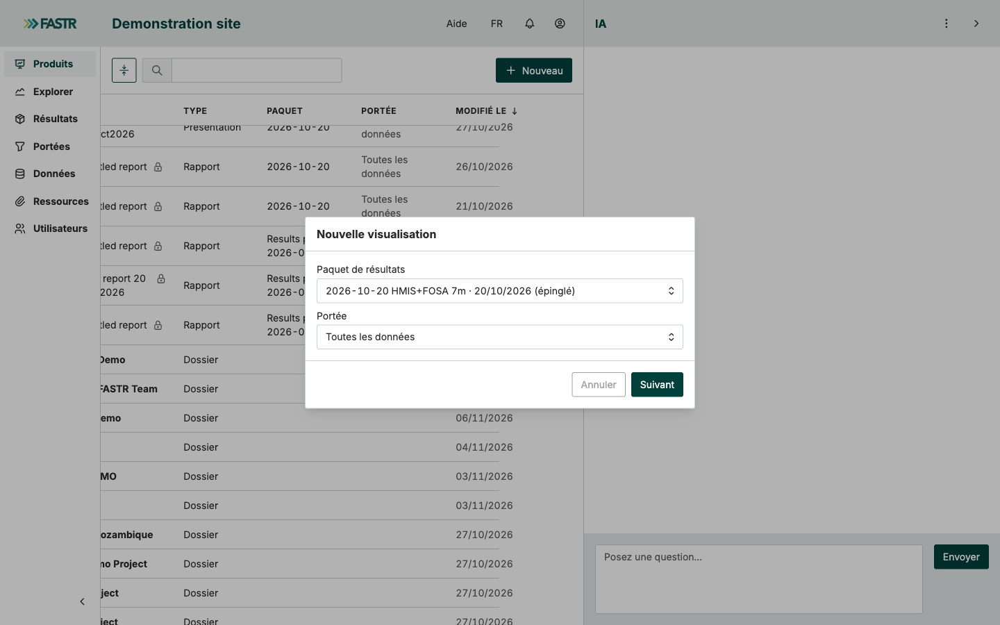
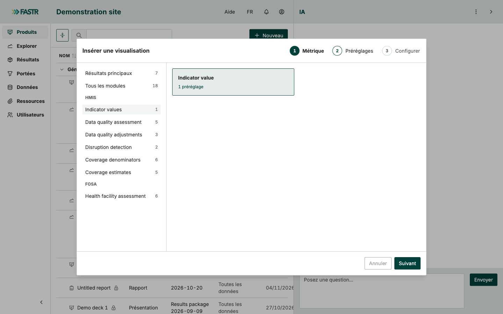
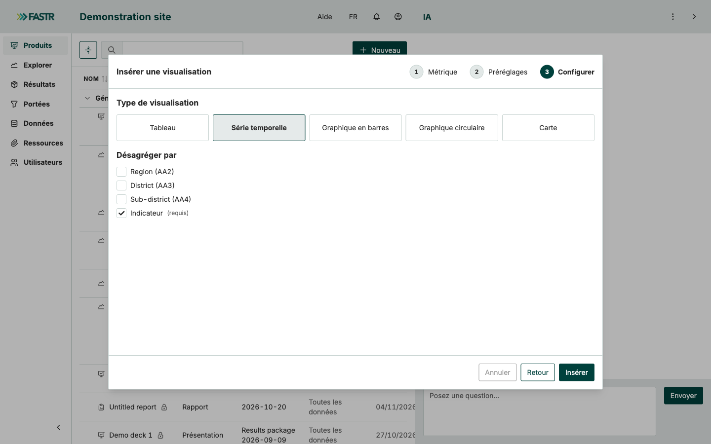
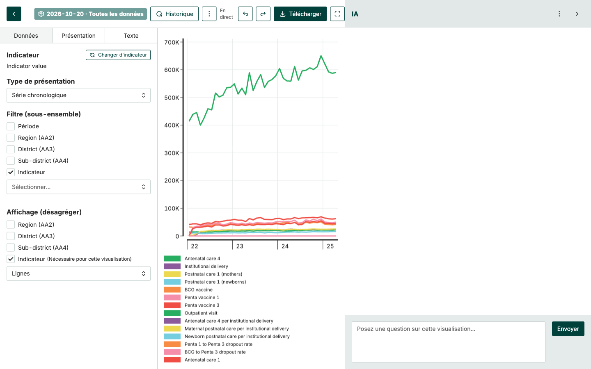
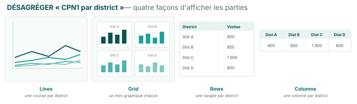

Lire une viz → Construire manuellement → Construire avec l'IA → Écrire l'interprétation → Interprétation IA → Repérer une perturbation

# Créez votre première visualisation

<strong>Activité</strong> · <strong>Visualisations et interprétation</strong> · <strong>~15 min</strong>

<aside class="p1-sidebar">

Avant de commencer

- ☐ Vous êtes connecté·e et sur la page **Produits**
- ☐ Vous avez un dossier à vous (voir *Créer un dossier pour votre travail*)

</aside>

## Ce que vous allez faire

Construire trois graphiques linéaires, chacun enregistré comme visualisation dans votre dossier : d'abord **CPN1**, puis **BCG**, puis **un indicateur de votre choix**. L'activité suivante fait la même chose avec l'assistant IA.

Une visualisation est un produit, comme une présentation ou un rapport. Elle a sa propre ligne sur la page Produits, s'enregistre toute seule, et peut être copiée plus tard dans n'importe quelle présentation ou rapport.

<h2 class="step-h">1Démarrer une nouvelle visualisation</h2>

Sur la page **Produits**, cliquez sur **Nouveau**, puis sur **Nouvelle visualisation**. La première boîte de dialogue demande le **Paquet de résultats** et la **Portée**. Gardez le paquet épinglé et **Toutes les données**, puis cliquez sur **Suivant**.

---

<h2 class="step-h">2Choisir l'indicateur</h2>

La boîte de dialogue **Insérer une visualisation** comporte trois étapes : **Métrique**, **Préréglages**, **Configurer**. La colonne de gauche liste les modules d'analyse par leur nom. Cliquez sur **Indicator values** (Valeurs des indicateurs), puis sur la carte de métrique **Indicator value**, et choisissez le niveau géographique **National** sur la carte. Cliquez sur **Suivant**.

> Une **métrique**, c'est *ce qui est mesuré*. La métrique Indicator value contient le décompte mensuel de chaque indicateur de l'instance. Un **préréglage**, c'est une façon prête à l'emploi de dessiner une métrique. Chaque module regroupe les métriques qu'il produit ; **Résultats principaux** montre les plus utilisées, tous modules confondus.

<h2 class="step-h">3Choisir comment la dessiner</h2>

La métrique Indicator value propose un seul préréglage, **Scorecard table**, qui n'est pas ce que vous voulez ici. Cliquez sur **Personnalisé**, puis sur **Suivant**. À l'étape **Configurer**, choisissez **Série temporelle** et cliquez sur **Insérer**.

Le graphique s'ouvre dans l'éditeur, avec tous les indicateurs tracés sur toute la période.

---

<h2 class="step-h">4Filtrer sur CPN1, 12 derniers mois</h2>

L'éditeur a un onglet **Données** à gauche et le graphique à droite. Dans **Filtre (sous-ensemble)** :

- Cochez **Indicateur**. Une rangée de pastilles apparaît (ANC1, ANC4, BCG, …). Cliquez sur **ANC1** (la CPN1). Seules les pastilles que vous sélectionnez sont tracées.
- Cochez **Période**. La valeur par défaut est *12 derniers mois* ; ajustez le curseur si vous voulez une autre fenêtre.

Le graphique se redessine après chaque changement.

> **Valeurs des données.** La métrique propose aussi quatre pastilles de valeurs des données : non ajustée, ajustée pour les valeurs aberrantes, ajustée pour la complétude, les deux. La valeur par défaut est le décompte entièrement ajusté, la version la plus propre des données de votre pays. Laissez-la telle quelle sauf si vous voulez explicitement un autre ajustement.

<h2 class="step-h">5La nommer et vérifier le dossier</h2>

Il n'y a pas de bouton d'enregistrement : les changements sont sauvegardés automatiquement et partagés en direct (le libellé **En direct** à côté du nom du paquet). Cliquez sur le titre en haut de l'éditeur pour le renommer, par exemple *CPN1, mensuel, 12 derniers mois*. Cliquez sur la flèche de retour pour revenir à la page Produits et vérifiez que le graphique se trouve dans votre dossier ; sinon, utilisez **⋮ → Déplacer vers un dossier…** sur sa ligne.

## Refaites-le deux fois de plus

Refaites les cinq étapes pour **BCG**, puis pour **un indicateur de votre choix** (Penta1, CPN4, consultations externes…). Vous devriez avoir au final **trois visualisations dans votre dossier**.

---

## Filtrer vs désagréger : quelle différence ?

Ces deux mots reviennent souvent. Ils ne veulent pas dire la même chose :

- **Filtrer = choisir ce qu'on affiche.** Choisissez les indicateurs, les lieux ou les mois que vous voulez ; seuls ceux-là apparaissent. *Afficher seulement CPN1*, ou *seulement la région Nord*. Comme un projecteur : vous le pointez sur ce que vous voulez voir.
- **Désagréger = décomposer.** Diviser un total en ses parties pour pouvoir les comparer : *une ligne par indicateur*, ou *une barre par district*. Rien n'est caché ; le total est montré en morceaux.

> **Exemple.** Partez du *total des visites CPN1, au niveau national*. **Filtrez** sur « région Nord » : vous ne voyez plus que la CPN1 du Nord. **Désagrégez** « par district » : le même total divisé en une ligne par district.

---

## Où le faire dans l'éditeur

L'onglet **Données** de l'éditeur contient les deux sections, l'une sous l'autre :

- **Filtre (sous-ensemble)** : cochez **Période**, **Indicateur** ou un niveau administratif, puis choisissez les éléments à garder.
- **Affichage (désagréger)** : cochez la dimension à décomposer, puis choisissez comment montrer les parties : **Lignes** (toutes sur un seul graphique), **Grille** (un petit graphique par partie), **Rangées** ou **Colonnes** (un tableau), **Graphiques différents (réplicats)** (un graphique en taille réelle par partie).

Deux autres onglets se trouvent à côté de Données : **Présentation** (couleurs, axes, libellés) et **Texte** (titre, sous-titre, note de bas de page).

> **Le piège quand vous utilisez les deux.** Vous décomposez un graphique par district pour comparer les districts, puis vous le filtrez sur un seul district. Vous regardez maintenant un district tout seul, sans rien à comparer. Utilisez le filtre pour choisir les données, la désagrégation pour les diviser, et ne filtrez pas jusqu'à une seule des choses que vous vouliez comparer.

---

## Exercice : décomposez votre graphique CPN1 par région

Votre graphique CPN1 montre une seule ligne nationale. Transformez-le en une ligne par région.

<h2 class="step-h">1Dupliquez d'abord</h2>

Sur la page Produits, ouvrez le menu **⋮** de votre visualisation CPN1 et cliquez sur **Dupliquer**. Renommez la copie *CPN1, mensuel, par région*. Les modifications s'enregistrent toutes seules, donc dupliquer d'abord est la façon de garder le graphique national intact.

<h2 class="step-h">2Désagrégez</h2>

Ouvrez la copie. Dans **Affichage (désagréger)**, cochez le niveau administratif que vous voulez comparer. Dans FASTR, les niveaux ont un nom générique : **Zone administrative 2** correspond généralement à la région, **Zone administrative 3** au district. Laissez l'affichage sur **Lignes** : une ligne par région.

<h2 class="step-h">3Essayez les autres styles d'affichage</h2>

Mêmes données, formes différentes. **Grille** quand il y a beaucoup de régions et que les lignes se chevauchent. **Rangées** ou **Colonnes** quand vous voulez les valeurs exactes. **Graphiques différents (réplicats)** quand chaque région mérite une lecture complète. Choisissez celui qui se lit le mieux.

### Refaites-le pour BCG

Dupliquez votre graphique BCG et décomposez-le de la même façon. Vous devriez avoir au final deux graphiques régionaux dans votre dossier.

---

## Essayez quelques options de plus

Une fois vos graphiques enregistrés, démarrez une autre **Nouvelle visualisation** et regardez les autres modules à l'étape Métrique :

- **Coverage estimates** (estimations de couverture) : une courbe de couverture plutôt qu'une tendance de volume.
- **Disruption detection** (détection des perturbations) : l'observé face à l'attendu, avec la bande de crédibilité (la dernière activité de cette série l'utilise).
- **Explorer**, dans la navigation latérale, montre un graphique déjà prêt pour chaque module sans rien créer. Utile pour voir ce qu'un module produit avant de construire avec lui.

> **Astuce :** une série temporelle convient mieux à une tendance. Un graphique en barres compare des périodes ou des lieux. Le document de référence *Comment lire une visualisation FASTR* approfondit.

## Vérification

Vous devriez maintenant avoir :

- **Trois visualisations dans votre dossier** : CPN1, BCG, et un indicateur de votre choix, plus deux copies régionales.
- Le chemin mémorisé : **Nouveau → Nouvelle visualisation → paquet et portée → module → métrique → préréglage ou Personnalisé → Insérer**, puis **Filtre** et **Affichage** dans l'onglet Données.
- L'habitude de **dupliquer avant de modifier** un graphique que vous voulez garder.

## Étape suivante

L'activité suivante fait la même chose avec l'assistant IA, depuis l'intérieur de la visualisation : en tapant la demande au lieu de cliquer. Même résultat, autre chemin.
