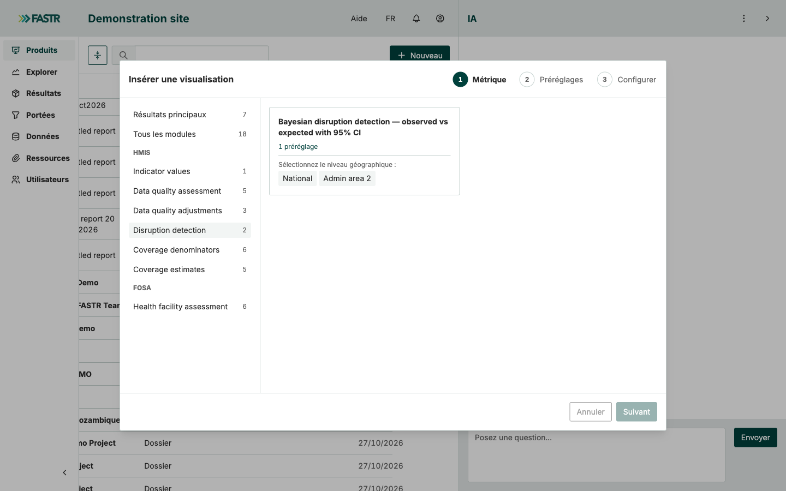
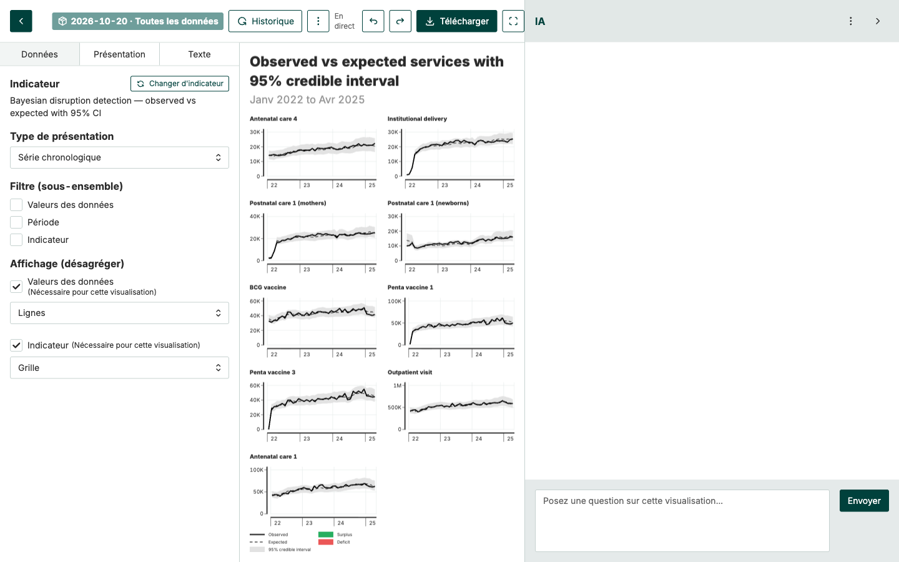

Lire une viz → Construire à la main → Construire avec l'IA → Rédiger l'interprétation → Interprétation IA → Repérer une perturbation

# Application — repérer une perturbation

<strong>Activité</strong> · <strong>Visualisations & Interprétation</strong> · <strong>~25 min</strong>

<aside class="p1-sidebar">

Avant de commencer

- ☐ Vous avez terminé les 5 documents précédents
- ☐ Vous êtes connecté·e et sur la page **Produits**
- ☐ Vous avez un dossier à vous

Pourquoi c'est important

Les cinq premiers documents enseignaient la technique. C'est ici que vous l'utilisez : ouvrir un vrai graphique de perturbations pour votre pays, appliquer le cadre en six étapes, et produire un constat qu'un décideur pourrait réellement utiliser.

</aside>

## Ce que vous allez faire

Créer le graphique national des perturbations à partir du module Disruption detection, le réduire à un indicateur et à une période d'intérêt, parcourir le cadre en six étapes, puis rédiger un constat en trois parties à partager avec la salle.

---

<h2 class="step-h">1Créer le graphique de perturbation</h2>

Sur la page **Produits**, cliquez sur **Nouveau → Nouvelle visualisation**, gardez le paquet épinglé et **Toutes les données**, puis cliquez sur **Suivant**. À l'étape Métrique, cliquez sur le module **Disruption detection** (détection des perturbations), puis sur la carte **Bayesian disruption detection — observed vs expected with 95% CI**, choisissez le niveau **National**, et cliquez sur **Suivant**. Choisissez le préréglage **Graphique des perturbations avec bande de crédibilité à 95%** et cliquez sur **Insérer**.

> Déjà construit par un collègue ? La page Produits en contient peut-être un. Ouvrez-le, puis **⋮ → Dupliquer** pour que vos filtres ne changent pas les siens : les modifications s'enregistrent en direct.

<h2 class="step-h">2Lire la vue par défaut</h2>

Le graphique s'ouvre avec chaque indicateur principal sous forme de petit graphique dans une grille. Deux courbes noires traversent chacun d'eux : une courbe **pleine** pour le volume mensuel **observé**, et une courbe **pointillée** pour le volume **attendu**, modélisé à partir des formations sanitaires qui ont déclaré ce mois-là. Une **bande grise** autour de la courbe attendue est l'intervalle de crédibilité à 95%. Là où la courbe observée descend **sous la bande**, l'écart est rempli en **rouge** (un déficit) ; là où elle monte **au-dessus**, il est rempli en **vert** (un surplus). À l'intérieur de la bande, c'est de la variation normale.

---

<h2 class="step-h">3Filtrer à un indicateur</h2>

Dans l'onglet **Données** à gauche, sous **Filtre (sous-ensemble)**, cochez **Indicateur**. Une liste de pastilles d'indicateurs apparaît (ANC1, ANC4, BCG, delivery, Penta1…). Cliquez sur une pastille pour ne garder que cet indicateur ; cliquez sur d'autres pour en ajouter.

Quand un seul indicateur est sélectionné, la grille se réduit à un graphique en taille réelle. Cochez **Période** pour réduire encore la fenêtre.

---

<h2 class="step-h">4Appliquer les six étapes</h2>

Sur votre graphique filtré, parcourez le cadre en six étapes du document *Lire une viz* :

| Étape | Sur ce graphique |
|-------|------------------|
| 1. Quel indicateur ? | Celui que vous avez filtré |
| 2. Quel niveau et quelle période ? | National. La période que vous avez choisie. |
| 3. Que compare-t-on ? | Volume mensuel observé (courbe pleine) vs **attendu** (courbe pointillée, modélisé à partir des mêmes formations sanitaires qui ont déclaré), avec la bande grise à 95% |
| 4. Lire les valeurs | Où l'écart se remplit-il en rouge (observé sous la bande) ? De combien ? |
| 5. Qu'est-ce qui ressort ? | Une baisse soutenue, trois mois ou plus ? Un pic unique ? Un motif ? |
| 6. Et alors ? | Quelle action cela appelle-t-il ? |

---

<h2 class="step-h">5Ajouter le contexte que le graphique ne montre pas</h2>

Le graphique montre le *quoi*. Votre équipe pays apporte le *pourquoi*. Une fois un motif identifié, ajoutez ce que vous savez :

- Y a-t-il eu un **changement de financement ou de personnel** sur cette période ?
- Y a-t-il des **manques connus en intrants ou en ressources humaines** (médicaments, équipements, personnel) ?
- Même si les **chiffres semblent bons**, la qualité des soins a-t-elle baissé ?

<h2 class="step-h">6Rédiger votre constat</h2>

Utilisez la structure en trois parties du document *Rédiger une interprétation* :

1. **Titre** — le message en une phrase
2. **Ce que vous voyez** — les faits visibles sur le graphique
3. **Ce que cela signifie** — le « et alors », rattaché à une prochaine étape concrète

<h2 class="step-h">7Partager avec la salle</h2>

Quand chaque équipe pays a terminé, une personne partage le constat. Écoutez :

- Le constat est-il **précis** ? Un indicateur, une période, une action.
- Le « et alors » est-il **rattaché à un vrai décideur** ?
- L'équipe a-t-elle **apporté le contexte local** que le graphique seul ne pouvait pas donner ?

## À surveiller

- **Une baisse d'un seul mois est en général du bruit.** Cherchez une baisse soutenue, trois mois ou plus.
- **Un remplissage vert n'est pas « bon », un remplissage rouge n'est pas « mauvais ».** Ils indiquent le sens : vert = observé au-dessus de la bande, rouge = observé en dessous. À l'intérieur de la bande, rien n'est coloré, et c'est le cas normal. C'est un rouge soutenu sur plusieurs mois qu'il faut creuser.
- **Les lacunes de déclaration sont déjà prises en compte.** La courbe attendue est construite à partir des formations sanitaires qui ont déclaré ce mois-là, donc une formation qui cesse de déclarer n'apparaît pas comme une perturbation. Une plage rouge est un vrai changement parmi les formations qui déclarent.

## Et ensuite

Ceci clôt la série *Visualisations & Interprétation*. Le module suivant traite de la construction de rapports : assembler vos graphiques, interprétations et constats dans un document partageable.
