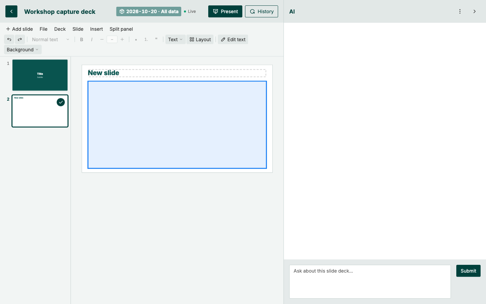
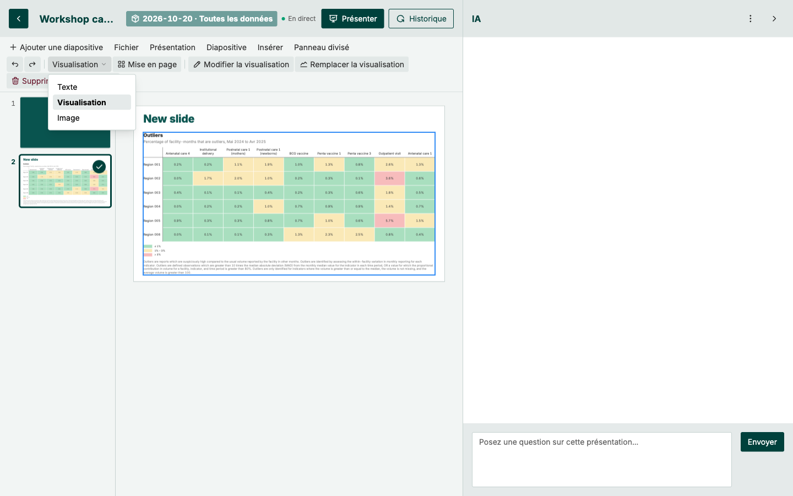
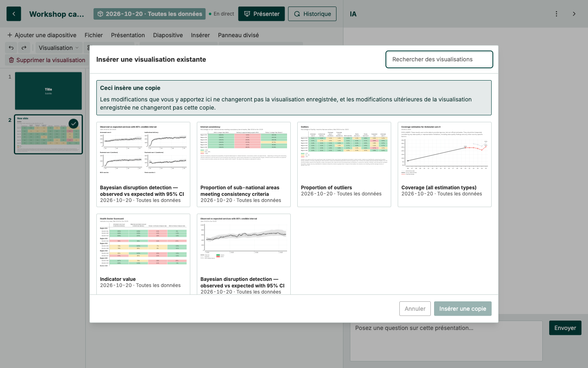
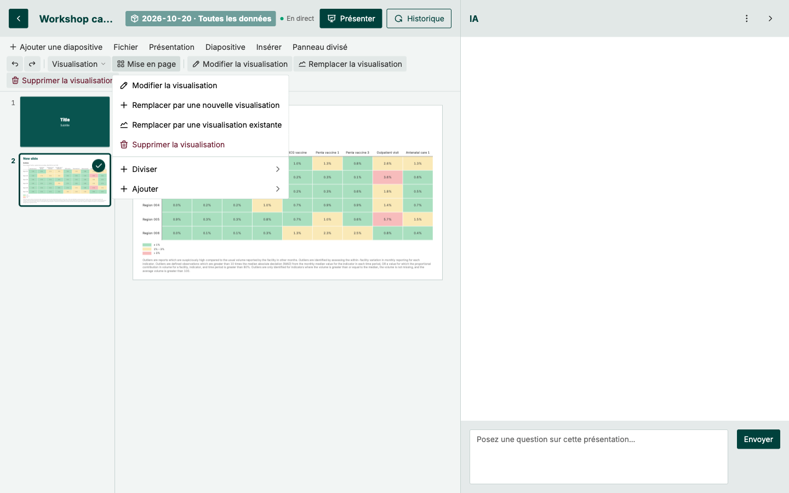

Créer la présentation → Ajouter manuellement → Ajouter avec l'IA → Éditer et finaliser

# Ajouter une visualisation (manuellement)

<strong>Activité</strong> · <strong>Présentations</strong> · <strong>~15 min</strong>

<aside class="p1-sidebar">

Avant de commencer

- ☐ Vous avez créé votre présentation avec une diapositive de contenu (voir *Créez votre première présentation*)
- ☐ Vous avez une visualisation enregistrée que vous souhaitez inclure
- ☐ La présentation est ouverte sur la diapositive de contenu

</aside>

## Ce que vous allez faire

Placer une copie d'une visualisation enregistrée sur la diapositive de contenu, puis diviser la diapositive pour que le graphique ait du texte à côté de lui. Trois gestes la première fois ; rapide ensuite.

<h2 class="step-h">1Sélectionner le bloc</h2>

Cliquez sur la diapositive de contenu dans la liste de gauche, puis cliquez sur le bloc vide au milieu de la diapositive. Un contour bleu apparaît autour de lui et une barre d'outils de bloc apparaît au-dessus de la diapositive : un menu déroulant **Texte**, **Mise en page**, **Modifier le texte**, **Fond**.

---

<h2 class="step-h">2En faire un bloc de visualisation</h2>

Ouvrez le menu déroulant **Texte** et choisissez **Visualisation**. Le bloc est maintenant un bloc de visualisation et la barre d'outils propose **Insérer une visualisation**.

<h2 class="step-h">3Insérer le graphique enregistré</h2>

Cliquez sur **Insérer une visualisation**, puis sur **Visualisation existante…**. Un sélecteur liste les visualisations enregistrées de l'instance avec une vignette pour chacune ; le champ **Rechercher des visualisations** filtre par nom. Cliquez sur la vôtre, puis sur **Insérer une copie**. Le graphique apparaît sur la diapositive.

> **C'est une copie.** Les changements que vous faites sur le graphique de la diapositive ne changent pas la visualisation enregistrée, et les changements ultérieurs sur celle-ci n'arrivent pas jusqu'à la diapositive. Pour mettre la diapositive à jour après avoir amélioré l'original, sélectionnez le bloc et utilisez **Remplacer la visualisation → Remplacer par une visualisation existante**.

---

<h2 class="step-h">4Donner au graphique un bloc de texte à côté</h2>

Le bloc du graphique étant sélectionné, cliquez sur **Mise en page**, puis sur **Ajouter**, puis sur une colonne à droite. Un nouveau bloc vide apparaît à côté du graphique ; son type est **Texte**. Cliquez dedans et tapez un message à retenir en une ligne. Faites glisser le séparateur entre les deux blocs pour donner plus de place au graphique.

<h2 class="step-h">5Titrer la diapositive</h2>

Cliquez sur l'en-tête de la diapositive (« Nouvelle diapositive ») et tapez un titre qui énonce le constat. Rien à enregistrer : la présentation s'enregistre en direct.

## Vérification

Votre diapositive de contenu doit montrer l'un de vos graphiques enregistrés, avec un texte court à côté et un titre qui dit ce que le graphique montre.

---

## Astuces

> **Réutilisez, ne recréez pas.** Si vous avez déjà construit le graphique, insérez l'existant. **Nouvelle visualisation…** dans le même menu ouvre la boîte de dialogue métrique et préréglage pour en construire un de zéro, sur la diapositive.

- Vous ne trouvez pas votre graphique dans le sélecteur : ce n'est pas encore une visualisation enregistrée, ou il se trouve dans un dossier que vous ne voyez pas. Tapez une partie de son nom dans le champ de recherche du sélecteur.
- Le graphique paraît à l'étroit : c'est normal à ce stade. *Éditer et finaliser* couvre le redimensionnement et la simplification.
- Un bloc peut aussi contenir une **Image** (le même menu déroulant) pour un logo ou une photo.
- **Panneau divisé**, dans la barre du haut, ajoute un panneau latéral à la diapositive : une deuxième zone pour du texte ou un deuxième graphique.

## Étape suivante

Passez à **Ajouter une visualisation (avec l'assistant IA)** : la même tâche, en une seule demande dans le panneau IA.
