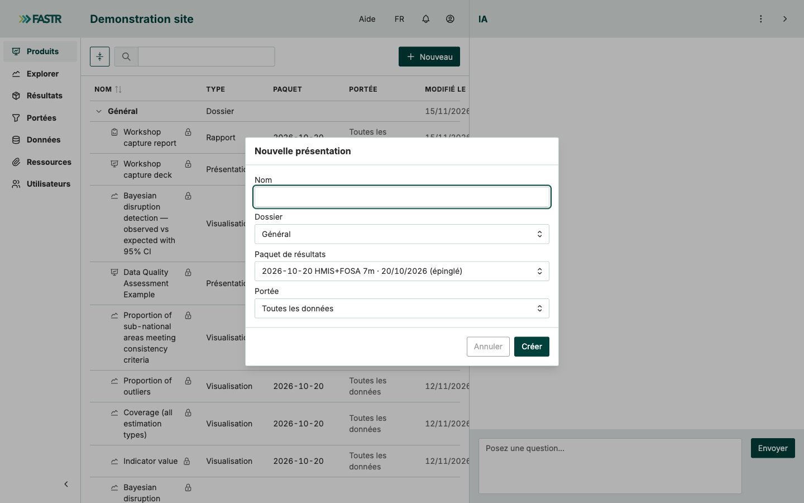
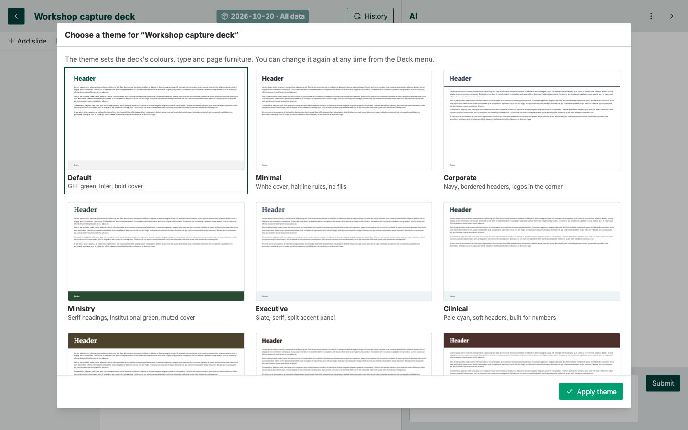
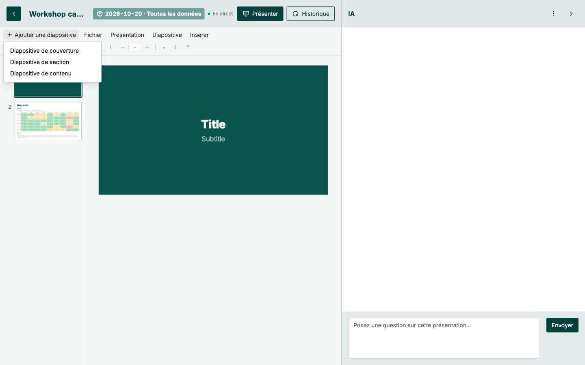

Créer la présentation → Ajouter manuellement → Ajouter avec l'IA → Éditer et finaliser

# Créez votre première présentation

<strong>Activité</strong> · <strong>Présentations</strong> · <strong>~10 min</strong>

<aside class="p1-sidebar">

Avant de commencer

- ☐ Vous êtes connecté·e, sur la page **Produits**
- ☐ Vous avez un dossier à vous (voir *Créer un dossier pour votre travail*)
- ☐ Vous avez au moins une visualisation enregistrée que vous souhaitez utiliser

</aside>

## Ce que vous allez faire

Créer une présentation, choisir son apparence, et ajouter une diapositive de contenu. C'est le conteneur ; les prochaines activités la rempliront de graphiques et d'interprétation.

<h2 class="step-h">1Créer la présentation</h2>

Sur la page **Produits**, cliquez sur **Nouveau**, puis sur **Nouvelle présentation**. La boîte de dialogue demande un **Nom** et un **Dossier** : donnez-lui un nom (par exemple *Revue T1 2026*, ou votre sujet), choisissez votre dossier, puis cliquez sur **Suivant**. La deuxième étape demande le **Paquet de résultats** et la **Portée** ; gardez le paquet épinglé et **Toutes les données**, puis cliquez sur **Créer**.

---

<h2 class="step-h">2Choisir un thème</h2>

Une nouvelle présentation s'ouvre sur un sélecteur de thème : le thème définit les couleurs, la typographie et les éléments de page de chaque diapositive. Gardez **Default** (le vert GFF) pour l'atelier et cliquez sur **Appliquer le thème**. Vous pourrez le changer plus tard depuis le menu **Présentation**.

<h2 class="step-h">3Regarder l'éditeur</h2>

La présentation s'ouvre avec une diapositive de couverture déjà en place. La liste des diapositives est à gauche, la diapositive courante au milieu, le panneau IA à droite. Au-dessus de la diapositive : **Ajouter une diapositive**, et les menus **Fichier**, **Présentation**, **Diapositive**, **Insérer**. Le titre en haut à gauche renomme la présentation quand vous cliquez dessus. À côté du nom du paquet, **En direct** signifie que les changements sont enregistrés automatiquement et partagés avec toute autre personne qui a la présentation ouverte.

---

<h2 class="step-h">4Ajouter une diapositive de contenu</h2>

Cliquez sur **Ajouter une diapositive**. Trois types de diapositives apparaissent :

- **Diapositive de couverture** : la page de titre (nom de la présentation, date, votre nom). Une par présentation, déjà en place.
- **Diapositive de section** : un séparateur entre les parties de la présentation. À utiliser avec parcimonie.
- **Diapositive de contenu** : là où vivent un graphique et son interprétation. La majorité de votre présentation.

Choisissez **Diapositive de contenu**. Une deuxième diapositive apparaît avec un en-tête et un bloc vide.

## Vérification

Vous devriez avoir :

- Une présentation avec un nom clair, dans votre dossier (vérifiez sa ligne sur la page Produits)
- Une diapositive de couverture et une diapositive de contenu vide

## Étape suivante

Votre facilitateur va démontrer comment placer un graphique sur la diapositive et la diviser en graphique et texte. Vous le referez ensuite dans **Ajouter une visualisation (manuellement)**.
