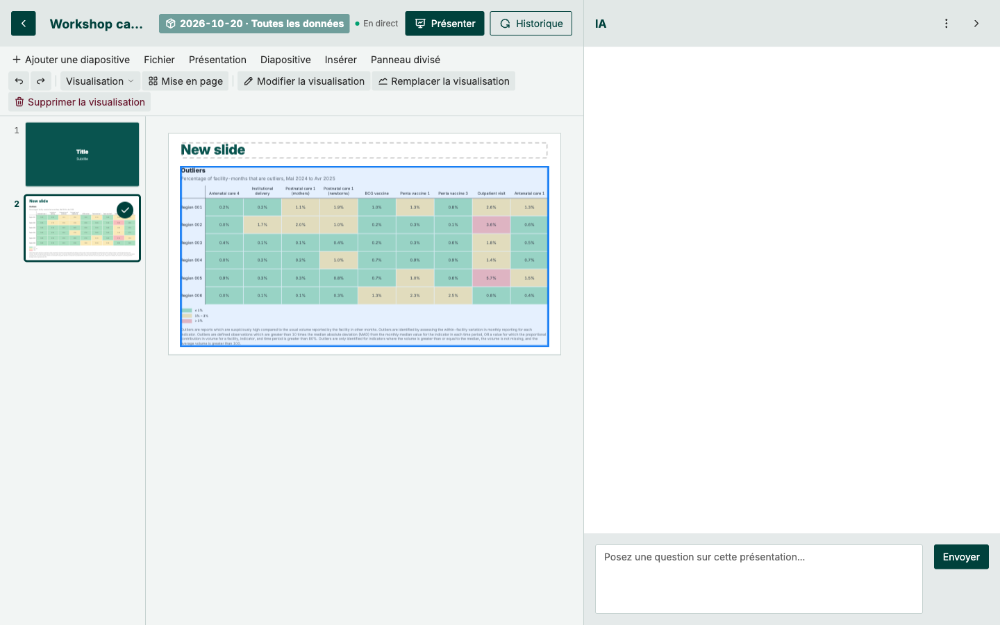
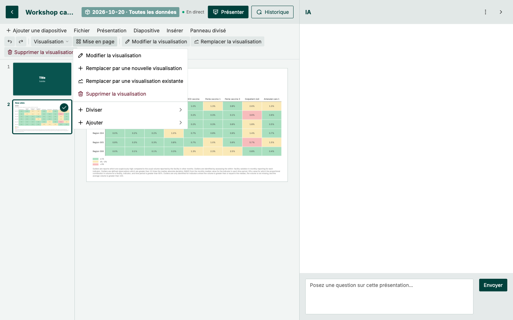

Créer présentation → Ajouter manuel → Ajouter IA → Éditer & finaliser

# Éditer et finaliser vos diapositives

<strong>Activité</strong> · <strong>Présentations</strong> · <strong>~20 min</strong>

<aside class="p1-sidebar">

Avant de commencer

- ☐ Votre présentation a au moins une diapositive de contenu avec un graphique et du texte
- ☐ Le facilitateur a fait la démo de l'éditeur à l'écran

Pourquoi c'est important

L'IA génère le contenu. La mise en page demande presque toujours un ajustement : du texte tassé, un graphique qui a besoin de plus de place, une diapositive encombrée de trop de blocs. L'éditeur sert à corriger cela, une diapositive à la fois.

</aside>

## Les trois endroits où vous éditez

Une diapositive est un en-tête plus des **blocs**. Tout ce que vous changez se passe dans l'un de ces trois endroits :

- **La barre d'outils du bloc**, qui apparaît au-dessus de la diapositive quand vous cliquez sur un bloc : son type (**Texte**, **Visualisation**, **Image**), **Mise en page**, et les actions propres à ce type (**Modifier le texte** ; **Modifier**, **Remplacer** ou **Supprimer la visualisation**).
- **Le menu Diapositive** dans la barre du haut : le type de diapositive (Couverture, Section, Contenu) et les logos de couverture.
- **Le menu Insérer** : de nouvelles diapositives, et les éléments de texte de la diapositive courante (titre, sous-titre, date, pied de page).

---

## Mise en page : diviser, ajouter, déplacer, supprimer

Sélectionnez un bloc et cliquez sur **Mise en page**. Pour un bloc de visualisation, le menu est le suivant :

| Action | Ce qu'elle fait |
|--------|----------------|
| **Modifier la visualisation** | Ouvre le graphique dans l'éditeur de visualisation, sur la diapositive. |
| **Remplacer par une nouvelle visualisation** | Construit un autre graphique depuis la boîte de dialogue métrique et préréglage, dans ce bloc. |
| **Remplacer par une visualisation existante** | Met à la place une copie d'un autre graphique enregistré. |
| **Supprimer la visualisation** | Vide le bloc, garde le bloc. |
| **Diviser ▸** | Divise ce bloc en deux, côte à côte ou l'un au-dessus de l'autre. |
| **Ajouter ▸** | Ajoute un nouveau bloc à côté de celui-ci : à gauche, à droite, au-dessus, en dessous. |

Un bloc de texte a les mêmes **Diviser** et **Ajouter**, avec **Modifier le texte** à la place des actions de visualisation.

Deux blocs côte à côte, graphique et texte, c'est le modèle FASTR. Si vous avez besoin de plus, cela fait une autre diapositive.

---

## Les quatre passes par diapositive

<h2 class="step-h">1Vérifier l'exactitude</h2>

Lisez la diapositive comme si vous ne l'aviez jamais vue. Le titre correspond-il à ce que montre le graphique ? Le texte est-il correct ? Notez tout ce qui demande une réécriture, par vous ou par le panneau IA à droite.

<h2 class="step-h">2Redimensionner et reflouer</h2>

Faites glisser le séparateur entre deux blocs pour donner plus de place au graphique ou plus de place au texte. L'autre bloc suit. Utilisez les boutons de taille de texte de la barre d'outils (**–** et **+**) avant de couper des mots.

<h2 class="step-h">3Restructurer si besoin</h2>

Trop à l'étroit : **Mise en page → Ajouter** un bloc, ou déplacez le contenu en trop vers une nouvelle diapositive (**Ajouter une diapositive → Diapositive de contenu**). Un bloc qui ne gagne pas sa place : **Supprimer la visualisation**, ou supprimez son texte. Un graphique trop détaillé : **Modifier la visualisation** et simplifiez-le là.

<h2 class="step-h">4Finaliser l'en-tête et le pied de page</h2>

**Insérer** liste les éléments de texte de la diapositive : titre, sous-titre, date, pied de page. Ajoutez ceux que vous voulez et cliquez dessus sur la diapositive pour les modifier. Le pied de page et les numéros de page de toute la présentation se trouvent dans le menu **Présentation** (voir *Paramètres de la présentation*).

---

## Point de contrôle

Chaque diapositive doit :

- Avoir un titre clair qui correspond au graphique
- Afficher le graphique à une taille lisible, aligné avec son texte
- Avoir un texte entièrement visible et édité
- Porter les éléments d'en-tête que vous voulez

## Ce qui peut mal se passer

- **Pas de barre d'outils de bloc.** Vous n'avez pas sélectionné de bloc. Cliquez à l'intérieur du bloc sur la diapositive, pas sur la vignette.
- **Séparateur invisible.** Il apparaît dès qu'un bloc est sélectionné ; le curseur change quand vous survolez la ligne entre deux blocs.
- **Graphique encore tassé après redimensionnement.** Le graphique lui-même est trop détaillé. **Mise en page → Modifier la visualisation** et simplifiez (moins d'indicateurs, affichage Grille, période plus courte).
- **Annuler.** Les flèches à gauche de la barre d'outils, ou Ctrl/Cmd+Z. Les modifications s'enregistrent en direct, donc **Historique** en haut est le chemin de retour vers une version antérieure de toute la présentation.
- **Ordre des diapositives.** Faites glisser les vignettes dans la liste de gauche.

## Et ensuite

Le document suivant couvre les paramètres globaux de la présentation : thème, logos, pied de page et numéros de page, avant le partage.
