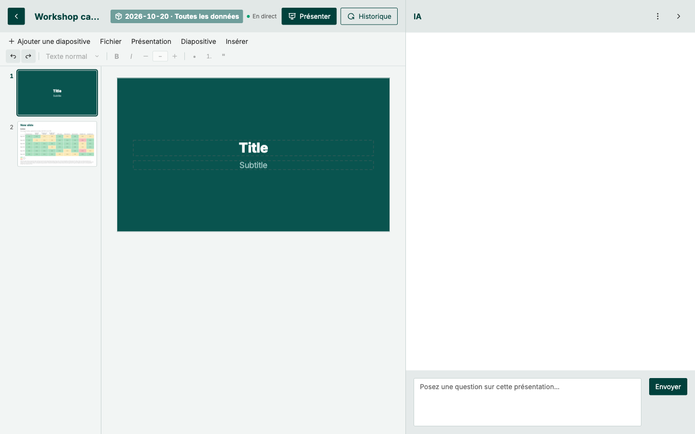
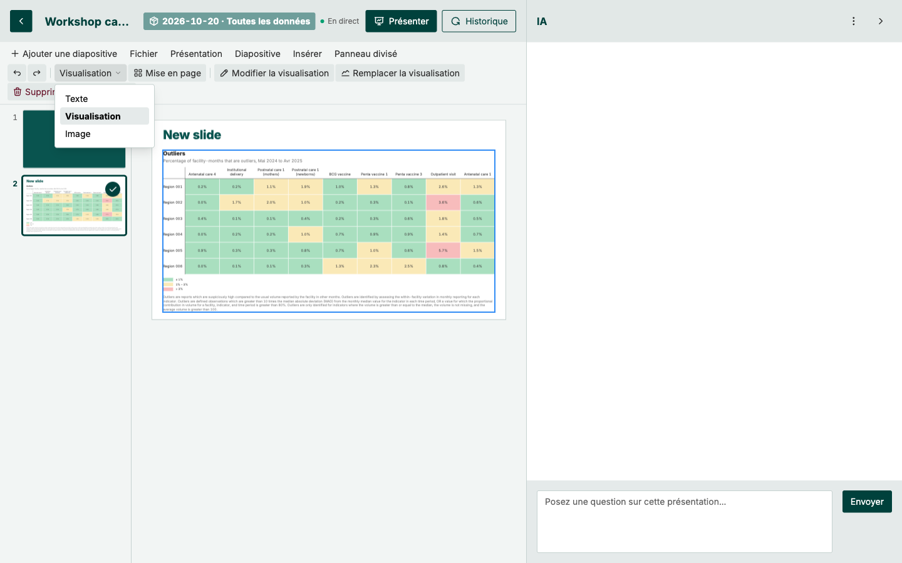
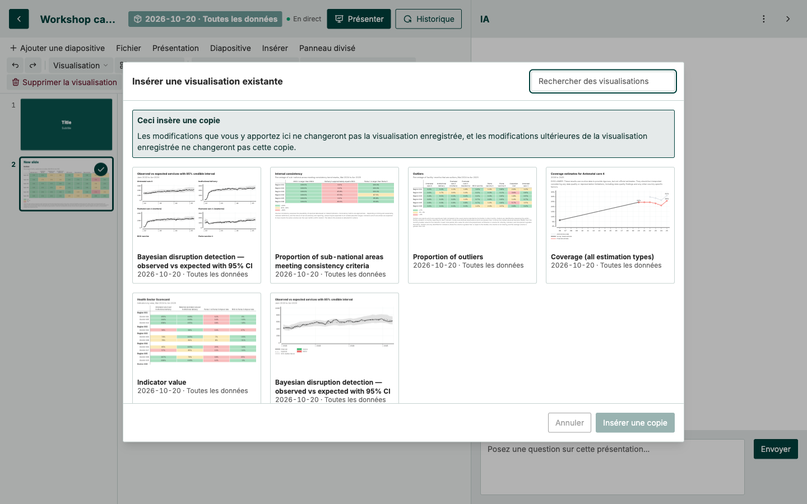
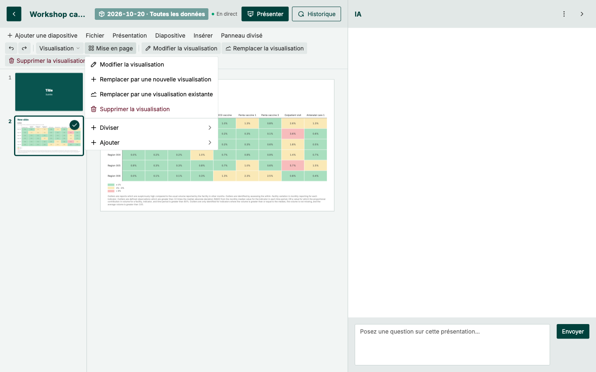

# Guide du facilitateur — Présentations

<strong>Guide du facilitateur</strong> · <strong>Présentations</strong> · <strong>4 activités · ~60 min + démo</strong>

## Objectif

Présentations apprend aux participants à assembler ce qu'ils ont déjà construit, graphiques et interprétations, en une présentation. Le module suit un parcours construire-puis-peaufiner : créer la présentation, voir la démo de l'éditeur, ajouter des graphiques de deux façons (manuellement et avec l'IA), puis finaliser. La sortie est l'objet que les participants montreront aux décideurs, donc le critère à tenir est « prêt à présenter », pas seulement « terminé ».

À la fin, chaque participant devrait avoir une présentation de deux diapositives soignée, construite à partir de ses propres graphiques, qu'il serait prêt à montrer à un Directeur.

## La session en bref

| # | Activité | Durée | Format |
|---|----------|-------|--------|
| — | Démo de visite de l'éditeur | ~5 min | Animée par le facilitateur (annexe) |
| 1 | Créez votre première présentation | ~10 min | Pratique, individuel |
| 2 | Ajouter une visualisation (manuellement) | ~15 min | Pratique, individuel |
| 3 | Ajouter une visualisation (avec l'IA) | ~15 min | Pratique, individuel |
| 4 | Éditer et finaliser vos diapositives | ~20 min | Pratique, individuel |

---

## Animer la session

**Préparation.** Ayez une présentation avec une diapositive de contenu vide et au moins une visualisation enregistrée prêtes dans un dossier de démo, pour que la démo de l'éditeur se déroule sans accroc. Réglez le zoom du navigateur à environ 100 % pour que l'interface soit lisible à l'écran partagé. Rappelez-vous que les présentations s'enregistrent en direct et sont partagées : démontrez sur votre propre présentation, pas sur celle d'un participant.

**Comment démontrer.** La séquence est **conteneur → démo → faire (manuellement) → faire (IA) → peaufiner.** L'activité 1 crée la présentation ; vous animez ensuite la visite de l'éditeur (annexe) en direct *avant* que les participants ne touchent l'éditeur. Cette démo conditionne les activités 2 et 3 : sans elle, les participants ne trouveront pas la barre d'outils du bloc. Animez le script de l'annexe tel quel ; les documents réexpliquent ce que vous avez montré, ce ne sont pas des scripts d'auto-apprentissage.

**Regroupement.** Les quatre activités sont individuelles. Mettez les participants en binôme seulement pour s'entraider en cas de blocage.

**Rythme.** Protégez la démo et l'activité 4. Si le temps presse, laissez l'activité 3 (la voie IA vers le même résultat que l'activité 2) être celle qui glisse.

**Le message à faire passer.** Réutilisez, ne recréez pas : les graphiques se construisent une fois comme visualisations sur la page Produits et s'insèrent dans les diapositives sous forme de copies. L'éditeur de diapositives sert à l'assemblage et au peaufinage.

---

## Les activités

### 1. Créez votre première présentation · ~10 min · pratique

**Le déroulé.** Les participants créent la présentation depuis la page Produits (**Nouveau → Nouvelle présentation** : nom, dossier, puis paquet et portée), appliquent le thème Default dans le sélecteur qui s'ouvre, et ajoutent une **Diapositive de contenu** avec **Ajouter une diapositive**.

**Démontrer.** Montrez le champ **Dossier** dans la boîte de dialogue et le sélecteur de thème, ainsi que les trois types de diapositives dans **Ajouter une diapositive**, en signalant que seule **Contenu** accueille un graphique et du texte.

**Formulez-le ainsi.** *« Placez la présentation dans votre propre dossier, gardez le thème Default, et choisissez Contenu : une diapositive Couverture ou Section n'a nulle part où mettre votre graphique. »*

**À quoi ressemble un bon résultat.** Une présentation nommée dans le dossier du participant, une diapositive de couverture, et une diapositive de contenu vide.

**À surveiller.**
- La présentation créée dans le mauvais dossier (à corriger avec **Fichier → Nom et dossier…**).
- Le sélecteur de thème pris pour un obstacle : dites que c'est un seul clic.

> **Animez la démo de la visite de l'éditeur maintenant**, avant l'activité 2.

### 2. Ajouter une visualisation (manuellement) · ~15 min · pratique

**Le déroulé.** Les participants sélectionnent le bloc vide, changent son type de **Texte** à **Visualisation**, cliquent sur **Insérer une visualisation → Visualisation existante…**, choisissent leur graphique et **Insérer une copie**, puis ajoutent un bloc de texte à côté avec **Mise en page → Ajouter**.

**Démontrer.** Couvert dans l'annexe (étapes 2 et 3). Renvoyez les participants à ce qu'ils ont vu.

**Formulez-le ainsi.** *« Vous ne construisez pas un graphique ici. Vous en choisissez un que vous avez déjà enregistré, et la diapositive en reçoit une copie. »*

**À quoi ressemble un bon résultat.** Une diapositive de contenu avec un des graphiques du participant et une ligne de texte à côté.

**À surveiller.**
- Cliquer sur la vignette au lieu du bloc : la barre d'outils n'apparaît que quand un bloc de la diapositive est sélectionné.
- Un graphique absent du sélecteur : il n'a pas été enregistré comme visualisation, ou il se trouve dans un dossier qu'ils ne voient pas.
- S'attendre à ce que le graphique enregistré mette la diapositive à jour plus tard : c'est une copie ; **Remplacer par une visualisation existante** la rafraîchit.

---

### 3. Ajouter une visualisation (avec l'IA) · ~15 min · pratique

**Le déroulé.** La même tâche par une autre voie : la présentation ouverte, les participants demandent au panneau IA d'ajouter une diapositive avec un graphique nommé, vérifient la diapositive, et la corrigent dans la conversation.

**Démontrer.** Une demande en direct, pour que les participants voient l'IA lister ses étapes et la diapositive apparaître. Montrez **Historique** une fois comme chemin de retour.

**Formulez-le ainsi.** *« L'IA travaille sur la présentation que vous avez ouverte, et ce qu'elle fait est enregistré au fur et à mesure. Nommez le graphique, vérifiez la diapositive, et corrigez-la dans la conversation si besoin. »*

**À quoi ressemble un bon résultat.** Une présentation de deux diapositives, la seconde ajoutée par l'IA.

**À surveiller.**
- Poser la question depuis la page Produits : l'IA répond qu'elle ne peut pas modifier de là.
- Une demande vague qui renvoie un graphique proche mais faux : nommez-le.

### 4. Éditer et finaliser vos diapositives · ~20 min · pratique

**Le déroulé.** Une passe de peaufinage : quatre revues par diapositive (exactitude, redimensionner, restructurer, en-tête et pied de page), avec la barre d'outils du bloc et le menu **Mise en page**.

**Démontrer.** Montrez le séparateur entre deux blocs et un **Mise en page → Ajouter** ; puis une petite correction de texte par rapport à une réécriture confiée au panneau IA.

**Formulez-le ainsi.** *« Les petites corrections, vous les faites ici ; les réécritures structurelles vont à l'IA. Le critère : pourriez-vous montrer cette diapositive à un Directeur sans vous excuser ? »*

**À quoi ressemble un bon résultat.** Chaque diapositive revue, graphiques et texte dimensionnés pour tenir, un titre qui énonce le constat.

**À surveiller.**
- Un graphique encore à l'étroit après redimensionnement : simplifiez-le avec **Mise en page → Modifier la visualisation**, pas en rétrécissant le texte.
- Des participants qui cherchent un bouton d'enregistrement : il n'y en a pas. **Historique** est le filet de sécurité.

## Pour conclure

À la fin, chaque participant a une présentation de deux diapositives soignée, construite à partir de ses propres graphiques. Tenez-les à un seul critère : chaque diapositive pourrait être montrée à un Directeur sans s'excuser.

---

## Annexe — Script de démo de la visite de l'éditeur

Une visite en direct de cinq minutes de l'éditeur de présentation. Les participants viennent de créer une diapositive de contenu vide ; cette démo leur montre comment y placer un graphique et du texte avant qu'ils ne le refassent à l'activité 2. Gardez le rythme.

### Liste de préparation

- ☐ Votre propre présentation ouverte sur une **diapositive de contenu vide**
- ☐ Au moins une visualisation enregistrée dans un dossier de démo
- ☐ Zoom du navigateur à environ 100 %
- ☐ Partage d'écran fonctionnel si en distanciel

### Étape 1 : l'éditeur

- **Faites :** Pointez la liste des diapositives (à gauche), la diapositive (au milieu), le panneau IA (à droite), et la barre du haut : **Ajouter une diapositive**, **Fichier**, **Présentation**, **Diapositive**, **Insérer**, **Présenter**, **Historique**, et le libellé **En direct**.
- **Dites :** *« Tout s'enregistre pendant que vous travaillez ; En direct veut dire que vos collègues le voient aussi. Il n'y a pas de bouton d'enregistrement ; Historique ramène les versions antérieures. »*

### Étape 2 : le bloc

- **Faites :** Cliquez à l'intérieur du bloc vide. Montrez la barre d'outils qui apparaît : le menu déroulant **Texte**, **Mise en page**, **Modifier le texte**. Ouvrez le menu déroulant et choisissez **Visualisation**.
- **Dites :** *« Une diapositive est faite de blocs. Cliquez sur l'un d'eux et sa barre d'outils apparaît. Ce menu déroulant dit ce que le bloc contient : du texte, une visualisation, ou une image. »*

---

### Étape 3 : insérer un graphique enregistré

- **Faites :** **Insérer une visualisation → Visualisation existante…**, choisissez un graphique, **Insérer une copie**.
- **Dites :** *« Voilà comment un graphique enregistré arrive sur une diapositive, sous forme de copie. Vous l'avez construit une fois sur la page Produits ; ici, vous le placez. »*

### Étape 4 : graphique et texte côte à côte

- **Faites :** Le bloc du graphique étant sélectionné, **Mise en page → Ajouter → à droite**. Cliquez sur le nouveau bloc de texte, tapez un message à retenir en une ligne. Faites glisser le séparateur.
- **Dites :** *« Deux blocs, graphique et message à retenir, c'est le modèle FASTR. Au-delà, cela va sur la diapositive suivante. »*

### Étape 5 : titre et c'est fini

- **Faites :** Cliquez sur l'en-tête de la diapositive et tapez un titre qui énonce le constat. Ouvrez **Insérer** pour montrer le sous-titre, la date et le pied de page facultatifs.
- **Dites :** *« Le titre est le message. Et vous avez terminé : rien à enregistrer. »*

---

### Questions fréquentes

> **Q : Puis-je annuler ?**
> R : Oui : les flèches à gauche de la barre d'outils, ou Ctrl/Cmd+Z. **Historique** en haut restaure une version antérieure complète.

> **Q : Où est Enregistrer ?**
> R : Il n'y en a pas. Les changements sont enregistrés au fur et à mesure et partagés en direct.

> **Q : Puis-je changer l'ordre des diapositives ?**
> R : Faites glisser les vignettes dans la liste de gauche.

### Plan de secours

> Si la plateforme est indisponible, parcourez les captures de cette annexe et décrivez le schéma : sélectionner le bloc, le régler sur Visualisation, insérer un graphique existant, ajouter un bloc de texte à côté.
