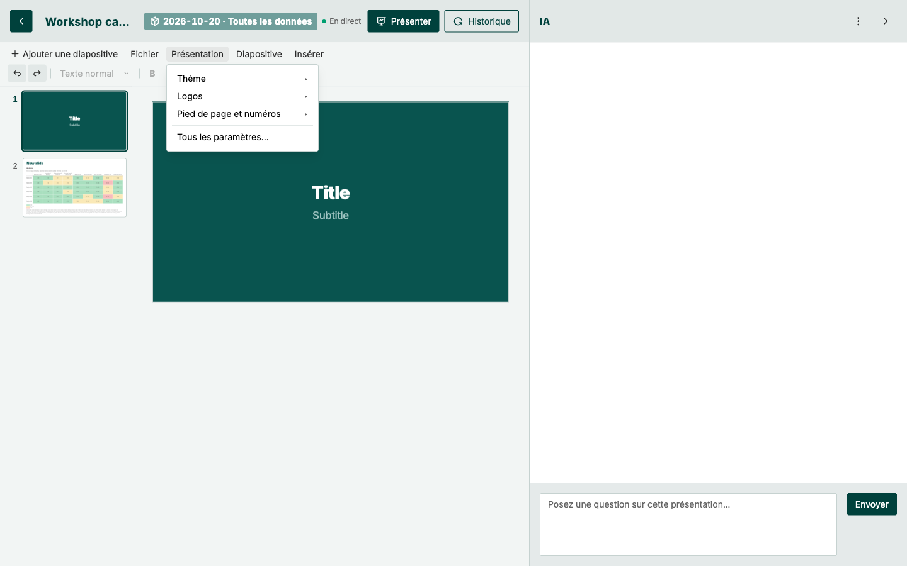
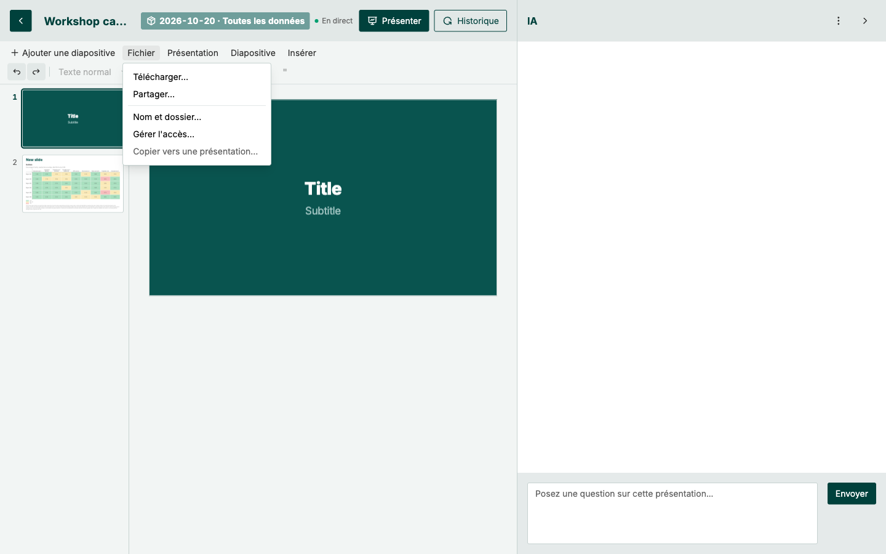

Créer présentation → Ajouter manuel → Ajouter IA → Éditer & finaliser → Formater texte → Paramètres

# Paramètres de la présentation : thème, logos, pied de page, partage

<strong>Activité</strong> · <strong>Présentations</strong> · <strong>~10 min</strong>

<aside class="p1-sidebar">

Avant de commencer

- ☐ Votre présentation contient au moins une diapositive de contenu finalisée
- ☐ Le logo personnalisé que vous voulez est déjà dans **Ressources** (voir Pré-étape)

Pourquoi c'est important

Ces paramètres transforment un brouillon de travail en quelque chose de partageable : une apparence cohérente, les bons logos, un pied de page et des numéros de page sur chaque diapositive de contenu, un nom que les gens retrouvent, et les bonnes personnes capables de l'ouvrir.

</aside>

## Pré-étape : les logos personnalisés vivent dans Ressources

Les logos personnalisés ne se téléversent pas dans une présentation. Ils vivent dans **Ressources**, une bibliothèque au niveau de l'instance que chaque présentation et chaque rapport peut utiliser.

> **Le téléversement dans Ressources est réservé aux administrateurs.** Si vous n'en êtes pas un, demandez à votre facilitateur de téléverser vos fichiers de logo (PNG ou JPEG) avant de commencer. Une fois dans Ressources, ils apparaissent dans le sélecteur de logos de la présentation.

Les administrateurs y accèdent depuis la navigation latérale : **Ressources → Téléverser des ressources**. Ressources contient aussi d'autres fichiers partagés (fichiers de cartes GeoJSON, fichiers CSV téléversés).

---

## Deux menus font tout cela

La présentation ouverte, le menu **Présentation** contient l'apparence ; le menu **Fichier** contient le nom, le dossier, l'accès et l'export.

<h2 class="step-h">1Présentation → Thème</h2>

Le thème définit les couleurs, la typographie et les éléments de page de chaque diapositive : Default (le vert GFF), Minimal, Corporate, Ministry, Executive, et d'autres. C'est le même sélecteur que vous avez vu à la création de la présentation. Choisissez-en un et gardez-le pour toute la présentation.

<h2 class="step-h">2Présentation → Logos</h2>

Trois emplacements, chacun indépendant : la **couverture**, l'**en-tête des diapositives de contenu**, le **pied de page des diapositives de contenu**. Chacun propose les logos FASTR intégrés (en couleur et en blanc) et les logos personnalisés téléversés dans Ressources. Diapositive par diapositive, le menu **Diapositive** peut afficher ou masquer les logos de couverture.

<h2 class="step-h">3Présentation → Pied de page et numéros</h2>

Une courte ligne de pied de page (pays, période, auteur) affichée sur chaque diapositive de contenu, et un interrupteur pour les numéros de page. Les diapositives de couverture et de section ignorent les deux.

**Présentation → Tous les paramètres…** ouvre le panneau de paramètres complet si vous voulez tout sur un seul écran.

---

<h2 class="step-h">4Fichier → Nom et dossier…</h2>

Renommez la présentation et déplacez-la dans un autre dossier. Cliquer sur le titre de la présentation en haut à gauche la renomme aussi. Utilisez la convention convenue par votre équipe (pays, période, sujet, votre nom).

<h2 class="step-h">5Fichier → Gérer l'accès…</h2>

Qui peut ouvrir et modifier cette présentation : **Propriétaire**, **Éditeur** ou **Lecteur** par personne. Une présentation est visible par l'équipe par défaut ; la ligne sur la page Produits affiche **Restreint** quand l'accès a été limité. Pour définir l'accès à tout un dossier d'un coup, utilisez le **⋮ → Définir l'accès pour tout le contenu de ce dossier…** du dossier sur la page Produits.

<h2 class="step-h">6Fichier → Télécharger… et Partager…</h2>

**Télécharger…** exporte la présentation (PDF, ou PPTX avec les graphiques sous forme d'images). **Partager…** donne un lien. **Copier vers une présentation…** copie les diapositives sélectionnées dans une autre présentation.

Rien à enregistrer : chaque paramètre s'applique immédiatement et est stocké en direct.

---

## Point de contrôle

Votre présentation doit :

- Utiliser un seul thème sur toutes les diapositives
- Afficher les logos que vous voulez à chaque emplacement
- Porter le pied de page et les numéros de page sur les diapositives de contenu
- Avoir un nom que votre équipe peut retrouver, dans votre dossier
- Être ouverte aux personnes qui en ont besoin, et à elles seules

## Ce qui peut mal se passer

- **Logo personnalisé absent du sélecteur.** Le fichier n'est pas encore dans Ressources. Demandez à un administrateur de le téléverser, puis rouvrez le sélecteur de logos.
- **Pied de page sur la couverture.** Il ne devrait pas y être ; les diapositives de couverture et de section ignorent le pied de page. S'il apparaît, vérifiez le type de la diapositive dans le menu **Diapositive**.
- **Un collègue ne peut pas ouvrir la présentation.** Il n'est pas dans **Gérer l'accès**, ou le dossier est restreint. Ajoutez-le, ou demandez au propriétaire du dossier.
- **La présentation affiche d'anciens chiffres.** Elle est rattachée à un paquet de résultats plus ancien. Sur la page Produits, **⋮ → Paquet de résultats et portée…** la déplace vers le paquet épinglé.

## Et ensuite

La présentation est prête à être partagée. Téléchargez-la, ou envoyez le lien.
