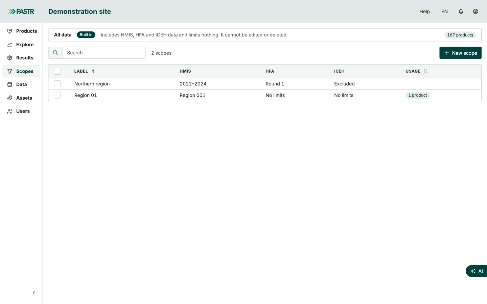
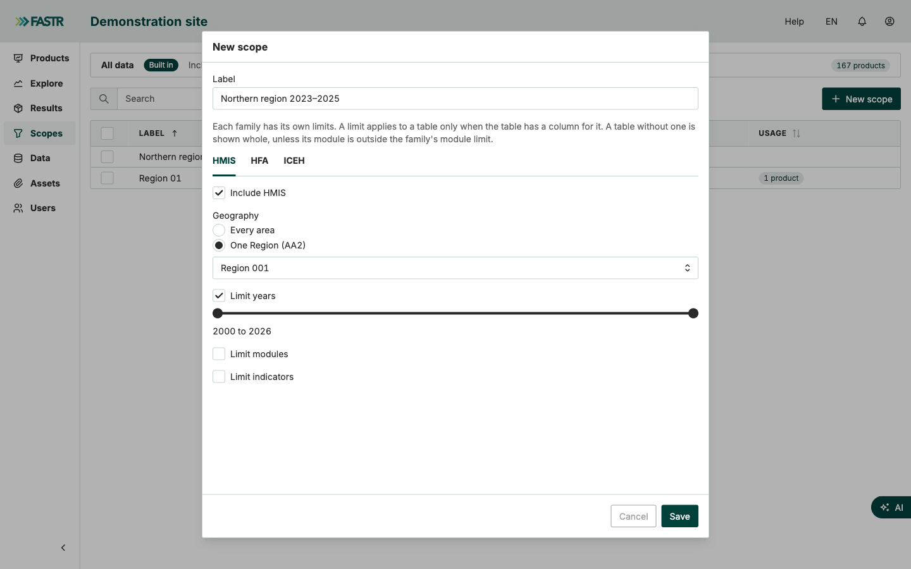
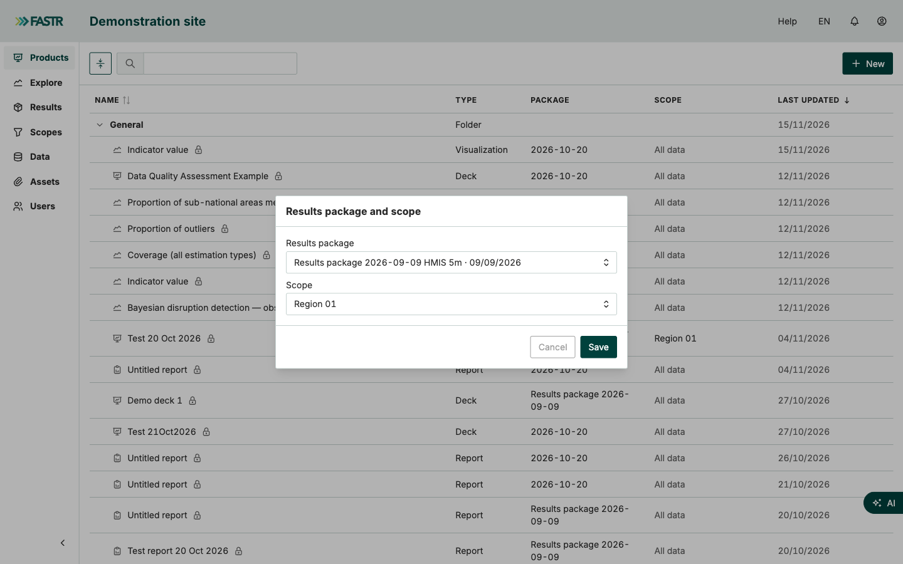

Estrutura das unidades → Indicadores → Dados → Verificar → Âmbitos

# Criar um âmbito e associá-lo a um produto

<strong>Configuração da instância</strong> · <strong>~15 min</strong>

<aside class="p1-sidebar">

Antes de começar

- ☐ Existe um pacote de resultados (página Resultados)
- ☐ A sua conta tem acesso não restrito aos dados: administrador, ou utilizador com todos os âmbitos. Sem isso, o botão **Novo âmbito** não aparece

Porque é importante

Um projeto transportava antes a sua própria restrição: uma região, alguns anos. Essa restrição é agora um **âmbito**, uma vista nomeada numa única lista partilhada. Cada apresentação, relatório e visualização lê um âmbito, e o Explorar usa a mesma lista. Crie os âmbitos uma vez, dê-lhes bons nomes, e toda a equipa filtra da mesma maneira.

</aside>

## O que vai fazer

Criar um âmbito para uma região e um intervalo de anos, relê-lo na tabela de âmbitos, associá-lo a um produto e verificá-lo no Explorar.

<h2 class="step-h">1Abrir a página Âmbitos</h2>

Clique em **Âmbitos** na navegação lateral. No topo, o âmbito integrado **Todos os dados**: inclui HMIS, HFA e ICEH, não limita nada e não pode ser editado nem eliminado. O seu selo conta os produtos que o usam. Abaixo, uma tabela com uma linha por âmbito e uma coluna por família de dados, mais **Utilização**.

---

<h2 class="step-h">2Criar um âmbito</h2>

1. Clique em **Novo âmbito** (canto superior direito).
2. **Rótulo**: dê-lhe o nome do conteúdo, por exemplo `Região Norte 2023–2025`. «Todos os dados» está reservado e um rótulo já em uso é recusado.
3. Um separador por família: **HMIS**, **HFA**, **ICEH**. Deixe **Incluir** marcado para as famílias que o âmbito deve cobrir; desmarque-o para deixar uma família totalmente de fora.
4. No separador HMIS, em **Geografia**, escolha **Uma Região (AA2)** e selecione a região. Marque **Limitar anos** e ajuste o intervalo. **Limitar módulos** e **Limitar indicadores** restringem ainda mais; deixe-os desligados por agora.
5. Clique em **Guardar**.

<h2 class="step-h">3Relê-lo na tabela</h2>

O seu âmbito tem a sua própria linha. Cada coluna de família diz **Excluído**, **Sem limites**, ou o limite em poucas palavras (a região, os anos). **Utilização** fica vazia até um produto usar o âmbito. Clique na linha para a reabrir; marque linhas e use **Eliminar** para remover âmbitos que ninguém usa.

---

<h2 class="step-h">4Associá-lo a um produto</h2>

1. Vá a **Produtos** e encontre uma apresentação, um relatório ou uma visualização que possa editar (de preferência um de teste).
2. Passe o rato sobre a linha, clique em **⋮** e depois em **Pacote de resultados e âmbito…**.
3. Deixe o **Pacote de resultados** como está, defina **Âmbito** para o seu novo âmbito e clique em **Guardar**.

A linha mostra agora o âmbito. Abra o produto: todas as figuras voltaram a filtrar-se para a região e os anos. Títulos escritos para o país inteiro podem precisar de atualização.

<h2 class="step-h">5Verificá-lo no Explorar</h2>

Abra o **Explorar**. O seletor de **âmbito** fica no canto superior direito, ao lado do pacote. Escolha o seu âmbito: a tabela e os gráficos mostram só a região e os anos definidos. Os números coincidem com os do produto, porque ambos leem o mesmo pacote através do mesmo âmbito.

<h2 class="step-h">6Arrumar</h2>

Se o produto era um teste, volte a pô-lo em **Todos os dados** da mesma forma. Um âmbito que um produto ainda usa não pode ser eliminado; mova primeiro o produto.

---

## Ponto de verificação

Deve ter agora:

- ✓ Um âmbito com um rótulo claro, limitado a uma região e a um intervalo de anos
- ✓ Um produto cuja linha mostra esse âmbito, com as figuras filtradas de novo
- ✓ A mesma vista no Explorar sob o seletor de âmbito

## Âmbito, filtro ou acesso?

- **Âmbito**: o que um produto inteiro mostra. Um por produto, da lista partilhada. Também o seletor do Explorar.
- **Filtro**: o que uma visualização mostra. Definido no separador **Dados**, vive só nesse gráfico.
- **Acesso**: quem pode abrir um produto ou uma pasta. **Gerir acesso** no menu ⋮. Um âmbito esconde dados, o acesso esconde o produto.

Um administrador pode também atribuir um âmbito a um utilizador restrito na página **Utilizadores**; ele passa a delimitar tudo o que esse utilizador vê na plataforma.

## O que pode correr mal

- **Não há botão Novo âmbito.** A sua conta é restrita. Peça a um administrador acesso não restrito aos dados, ou que crie o âmbito.
- **O rótulo é recusado.** É «Todos os dados» nalguma língua, ou outro âmbito já o tem. Escolha outro.
- **A eliminação é recusada.** Um produto ainda usa o âmbito. Mude primeiro o âmbito desse produto.
- **Os números de um colega são diferentes.** O produto ou o Explorar dele está noutro âmbito ou noutro pacote. Compare os dois seletores.
- **Um âmbito tem o selo «Migrado».** Foi criado a partir de um projeto antigo. Mantenha-o ou mude-lhe o nome; funciona como os outros.

## A seguir

Configuração concluída. Passe a **Primeiros passos** para a vista do participante de Produtos, Explorar e âmbitos.
