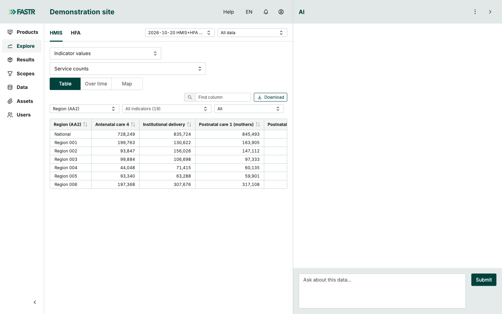
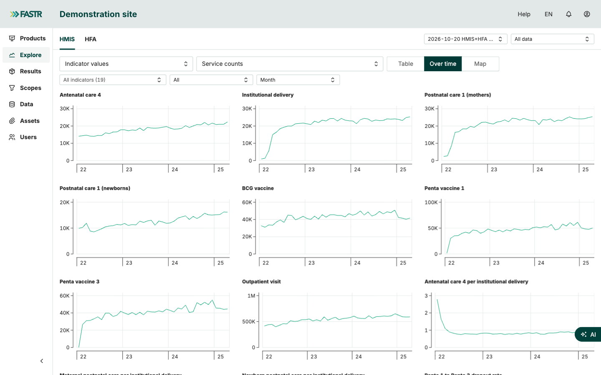
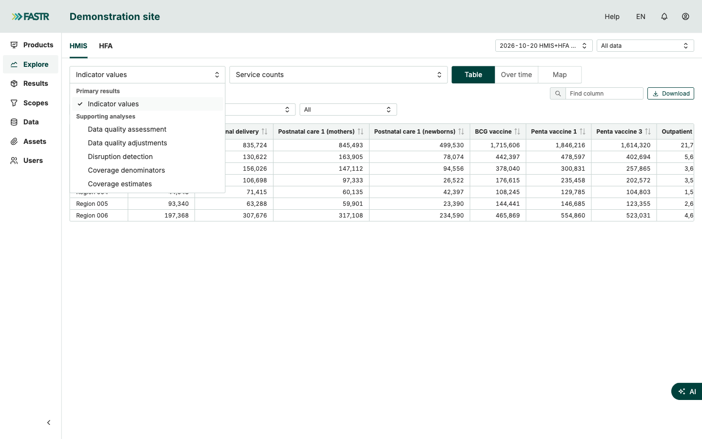
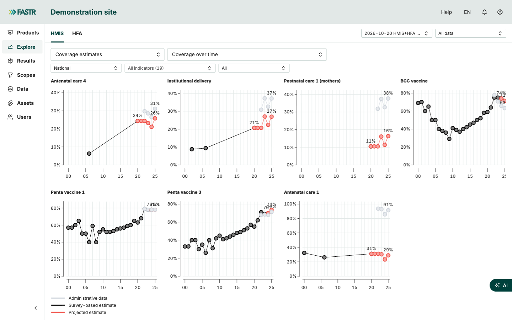

Iniciar sessão → A sua pasta → Explorar

# Dar uma primeira olhada com o Explorar

<strong>Atividade</strong> · <strong>Primeiros passos</strong> · <strong>~15 min</strong>

<aside class="p1-sidebar">

Antes de começar

- ☐ Concluiu **Iniciar sessão na plataforma**
- ☐ A navegação lateral está expandida (seta no fundo da barra)

Porque é importante

O Explorar mostra todas as análises que a plataforma já calculou, como tabela, como conjunto de gráficos ou como mapa, sem nada para criar e sem nada que se possa estragar. É a forma mais rápida de ver o que os dados dizem antes de construir qualquer coisa.

</aside>

## O que vai fazer

Abrir o Explorar, ler um serviço numa tabela, observá-lo ao longo do tempo, mudar para outro módulo de análise, e anotar três números para levar de volta à sala.

<h2 class="step-h">1Abrir o Explorar</h2>

Clique em **Explorar** na navegação lateral. Há quatro controlos no topo:

- **HMIS / HFA**: a família de dados. Fique em HMIS.
- O **pacote de resultados**, no canto superior direito. O pacote fixado está selecionado; deixe-o.
- O **âmbito**, ao lado. **Todos os dados** significa o país inteiro.
- O **módulo** e a sua **métrica**, à esquerda. Abre em **Indicator values** (valores dos indicadores) **→ Service counts** (volumes de serviços): o volume mensal de todos os indicadores.

---

<h2 class="step-h">2Ler a tabela</h2>

A vista **Tabela** mostra uma linha por área e uma coluna por indicador. Três filtros acima dela:

- **Nível**: Região, Distrito ou Subdistrito (os nomes são os do seu país).
- **Indicadores**: todos, ou uma seleção.
- **Período**: **Últimos 12 meses**, **Último trimestre**, **Último ano** ou **Tudo**.

Defina o nível para o que fica abaixo do nacional e o período para **Últimos 12 meses**. Clique no cabeçalho de uma coluna para a ordenar. **Localizar coluna** salta para um indicador quando há muitos. **Transferir** guarda a tabela num ficheiro.

**Anote:** o total nacional de **Antenatal care 1** (consulta pré-natal 1) dos últimos 12 meses, e a área com o valor mais baixo.

<h2 class="step-h">3Observá-lo ao longo do tempo</h2>

Clique em **Ao longo do tempo**. Cada indicador recebe um pequeno gráfico do seu volume mensal. Os filtros passam a ser o indicador, o nível e o passo temporal (**Mês**, **Trimestre**, **Ano**). Escolha apenas **Antenatal care 1**, ao nível nacional.

**Anote:** o mês com o valor mais alto dos últimos dois anos.

---

<h2 class="step-h">4Experimentar o mapa</h2>

Clique em **Mapa**. Um indicador, um nível, um período, com as áreas coloridas. Se a sua instância ainda não tiver ficheiros de limites administrativos, a página diz isso em vez de desenhar um mapa; é um item de configuração para o seu administrador, não um erro seu.

<h2 class="step-h">5Mudar de módulo</h2>

Abra a lista pendente do **módulo** à esquerda. **Resultados principais** contém os Indicator values. **Análises complementares** lista os outros módulos: Data quality assessment, Data quality adjustments, Disruption detection, Coverage denominators, Coverage estimates. Cada módulo traz as suas próprias métricas e a sua própria vista.

Escolha **Coverage estimates** (estimativas de cobertura). A vista passa a ser **Coverage over time**: um gráfico por indicador, com pontos cinzentos para a cobertura calculada a partir dos dados de rotina, pretos para as estimativas dos inquéritos, e vermelhos para a projeção que prolonga o último inquérito.

**Anote:** a última cobertura projetada de **Penta 3**.

---

<h2 class="step-h">6Partilhar os seus três números</h2>

Compare com o seu colega ao lado: o mesmo pacote, os mesmos filtros, os mesmos números? Se não, descubra qual é o filtro que difere. Depois guarde a pergunta que mais lhe interessa: é para ela que vai construir um gráfico no próximo módulo.

## Ponto de verificação

Consegue:

- Abrir o Explorar e nomear os seus quatro controlos do topo (família de dados, pacote, âmbito, módulo e métrica)
- Alternar entre **Tabela**, **Ao longo do tempo** e **Mapa**
- Mudar o nível e o período de uma tabela
- Encontrar um módulo em **Análises complementares**

## Explorar ou uma visualização?

O Explorar serve para **olhar**: rápido, completo, nada guardado. Uma **visualização** serve para **guardar e partilhar**: escolhe a métrica, os filtros e a forma, ela tem uma linha na página Produtos, e pode copiá-la para uma apresentação ou um relatório. Quando uma vista do Explorar responde à sua pergunta, construa-a a seguir como visualização.

## O que pode correr mal

- **A tabela está vazia.** O pacote não tem dados para o período escolhido. Defina o período para **Tudo**.
- **Os números diferem dos de um colega.** Verifique o pacote (canto superior direito), o âmbito, o nível e o período. Quatro filtros, quatro formas de diferir.
- **Não há mapa.** Não foram carregados ficheiros de limites administrativos para esse nível. Use a tabela ou os gráficos.

## A seguir

Configuração concluída. O próximo módulo, **Visualizações**, começa por construir o gráfico que acabou de ver, e por guardá-lo na sua pasta.
