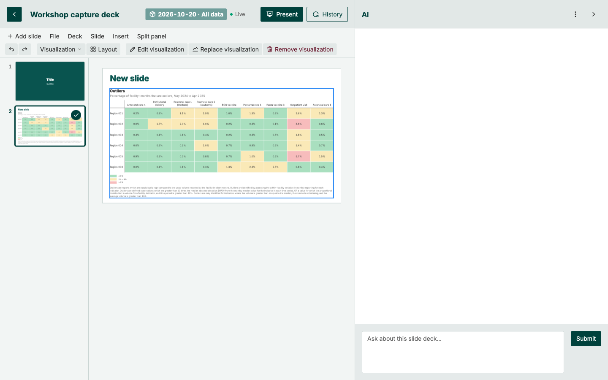
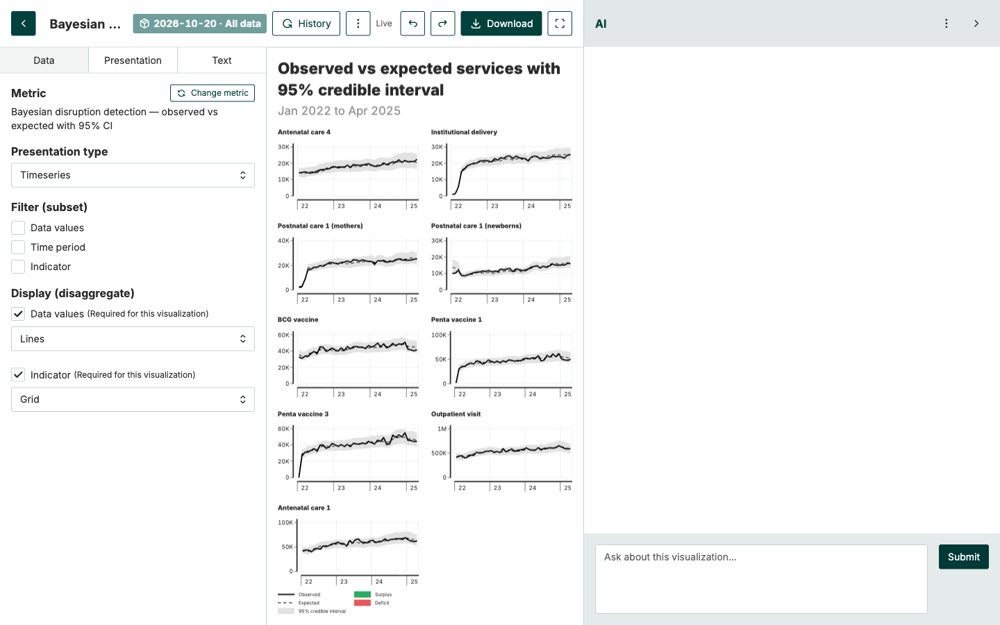

# Guia do facilitador — Primeiros passos

<strong>Guia do facilitador</strong> · <strong>Primeiros passos</strong> · <strong>3 atividades · ~30 min + demonstração</strong>

## Objetivo

Os Primeiros passos põem cada participante na plataforma e preparados para manter o seu trabalho organizado. É um módulo curto, uma demonstração conduzida pelo facilitador e três atividades rápidas, mas é um ponto de passagem: um participante que não esteja com sessão iniciada, com uma pasta própria, ficará bloqueado o resto da formação. Os obstáculos aqui são contas e acessos, não competências.

No final, cada participante deve estar com sessão iniciada, ter uma pasta com o seu nome na página Produtos, e ter lido uma tabela e um gráfico no Explorar.

## A sessão num relance

| # | Atividade | Duração | Formato |
|---|-----------|---------|---------|
| — | Demonstração da plataforma FASTR | ~10 min | Conduzida pelo facilitador (apêndice) |
| 1 | Iniciar sessão na plataforma | ~10 min | Prática, individual |
| 2 | Criar uma pasta para o seu trabalho | ~5 min | Prática, individual |
| 3 | Dar uma primeira olhada com o Explorar | ~15 min | Prática, em pares |

---

## Conduzir a sessão

**Preparação.** Resolva as contas *antes* da sessão, se de alguma forma for possível. O sorvedouro de tempo recorrente são os emails de verificação e as contas por aprovar, que o participante não pode corrigir e que bloqueiam a sala. Aprove todas as contas na página **Utilizadores** no dia anterior. Decida se as pastas dos participantes ficam dentro de uma pasta de país; se sim, crie-a primeiro. Tenha a demonstração da plataforma carregada (apêndice) e a ficha *Iniciar sessão* pronta.

**Como demonstrar.** Comece pela demonstração da plataforma: uma visita breve ao ecrã inicial antes de alguém tocar num teclado. Mantenha-a de alto nível; a configuração é uma sessão posterior. Depois deixe os participantes iniciar sessão e criar a sua pasta a partir das fichas.

**Agrupamento.** As atividades 1 e 2 são individuais; junte os participantes em pares para se entreajudarem se alguém ficar preso num acesso. A atividade 3 faz-se em pares, para que os três números sejam comparados.

**Ritmo.** Não dê o módulo por terminado cedo demais. Verifique que cada participante passou o ponto de passagem (sessão iniciada, pasta criada) antes do Explorar, e use o Explorar para absorver o tempo enquanto as contas atrasadas são resolvidas. Um problema de acesso por resolver só fica mais caro depois.

**A mensagem a transmitir.** Uma lista única para o país inteiro, pastas para a manter legível, uma pasta por pessoa. É esse hábito que mantém navegável uma página Produtos partilhada depois de uma semana de trabalho.

> **Se os participantes já usaram o FASTR antes.** Diga-o com clareza: os projetos desapareceram. Tudo está numa só página Produtos, organizada em pastas; cada apresentação, relatório ou visualização está ligada a um pacote de resultados e a um âmbito, indicados na sua linha. Os painéis já não existem; a página Explorar e as visualizações guardadas substituem-nos.

---

## As atividades

### 1. Iniciar sessão na plataforma · ~10 min · prática

**O que acontece.** Os participantes abrem o URL do seu país, registam-se ou iniciam sessão, verificam o email se forem novos, e exploram o ecrã inicial: a lista Produtos, a navegação lateral, o botão IA.

**Demonstrar.** Coberto pela demonstração da plataforma. Depois dela, distribua a ficha *Iniciar sessão na plataforma* e deixe-os trabalhar.

**Diga algo como.** *«Se o email de verificação não chegar em dois minutos, vejam no spam. Se iniciarem sessão e virem uma lista vazia, digam-me: a conta precisa de aprovação, e isso é tarefa minha, não vossa.»*

**Como é um bom resultado.** Cada participante na página Produtos, com a navegação lateral expandida, capaz de abrir um produto e voltar atrás.

**Atenção a.**
- Emails de verificação a cair no spam.
- «Conta não aprovada» ou uma lista vazia: aprove a conta na página **Utilizadores**.
- A navegação lateral recolhida a confundir as pessoas: mostre a seta no fundo da barra.

### 2. Criar uma pasta para o seu trabalho · ~5 min · prática

**O que acontece.** Cada participante cria uma pasta com o seu nome: **Novo → Nova pasta**, nome, cor, Guardar.

**Demonstrar.** Crie uma pasta no ecrã. Mostre o menu ⋮ na sua linha (Mover para dentro, Mudar o nome, Definir o acesso, Eliminar), e o campo **Pasta** na caixa de diálogo de nova apresentação, para que vejam por que razão a pasta importa.

**Diga algo como.** *«Usem o vosso próprio nome. A pasta "teste" de toda a gente colide, e nunca mais encontram o vosso trabalho. Quando criarem uma apresentação ou um gráfico, a caixa de diálogo pergunta a pasta: escolham a vossa.»*

**Como é um bom resultado.** Uma pasta por participante, com o nome dessa pessoa, vazia, no local que combinou.

**Atenção a.**
- **Nova pasta** ausente do menu: a conta não tem o acesso aos dados necessário para gerir pastas. Corrija o papel na página Utilizadores.
- Pastas criadas no nível superior quando as queria dentro de uma pasta de país: use **Mover para dentro**.

---

### 3. Dar uma primeira olhada com o Explorar · ~15 min · prática, em pares

**O que acontece.** Os participantes abrem o **Explorar**, leem o Antenatal care 1 na **Tabela** (um nível abaixo do nacional, últimos 12 meses), observam-no **Ao longo do tempo**, experimentam o **Mapa**, mudam o módulo para **Coverage estimates**, e anotam três números para comparar com o colega ao lado.

**Demonstrar.** Nomeie no ecrã os quatro controlos do topo (HMIS/HFA, pacote, âmbito, módulo e métrica), alterne uma vez Tabela → Ao longo do tempo → Mapa, e abra a lista pendente do módulo para mostrar as **Análises complementares**.

**Diga algo como.** *«Aqui nada é guardado e nada se pode estragar. O Explorar serve para olhar. Quando uma vista responde à vossa pergunta, é esse o gráfico que vão construir amanhã.»*

**Como é um bom resultado.** Pares que chegam aos mesmos três números, ou que conseguem dizer qual o filtro que os fez diferir.

**Atenção a.**
- Números diferentes entre vizinhos: pacote, âmbito, nível ou período. Faça-os descobrir qual.
- «O mapa está avariado»: não há ficheiros de limites administrativos na instância. Diga-o de antemão.

## Para encerrar

Cada participante deve terminar com sessão iniciada, com a sua própria pasta, e com uma pergunta do Explorar que queira responder com um gráfico. Quem não estiver ficará bloqueado o resto da formação. Verifique antes de avançar.

---

## Apêndice — guião da demonstração da plataforma FASTR

Uma orientação curta à Plataforma de Análise FASTR, o suficiente para que os participantes reconheçam o ecrã quando iniciarem sessão. Isto é **antes** de tocarem nos próprios teclados. Mantenha-a de alto nível; as atividades práticas trazem o detalhe.

### Lista de preparação

- ☐ Navegador com sessão iniciada na instância do seu país, no idioma dos participantes, com o Explorar aberto uma vez para carregar depressa
- ☐ Uma pasta com uma apresentação terminada e uma visualização guardada dentro, prontas a abrir
- ☐ Navegação lateral expandida (clique na seta no fundo da barra)
- ☐ Partilha de ecrã a funcionar, se à distância
- ☐ A ficha *Iniciar sessão* pronta a distribuir depois da demonstração

### Passo 1: O ecrã inicial

- **Fazer:** Mostre a página **Produtos** tal como abre depois do início de sessão. Expanda uma pasta e aponte para as colunas Tipo, Pacote e Âmbito.
- **Dizer:** *«Esta é a instância FASTR do seu país. Está tudo nesta única página: todas as apresentações, relatórios e gráficos que a equipa criou, em pastas. Não há nada para instalar.»*

- **Atenção a:** «Isto é o mesmo que o DHIS2?» Resposta: *«Não. O FASTR lê a partir do DHIS2 e acrescenta a análise, os gráficos e os relatórios por cima.»*

### Passo 2: A navegação lateral

- **Fazer:** Clique uma vez em cada entrada. **Explorar**: um gráfico já pronto de um módulo. **Resultados**: a lista de pacotes, aponte para o que está fixado. **Âmbitos**: a lista de vistas nomeadas. Pare em **Dados**: diga que é administração.
- **Dizer:** *«Produtos é onde trabalha. Explorar serve para uma consulta rápida sem criar nada. Resultados e Âmbitos explicam de onde vêm os números; voltaremos a isso. Dados, Recursos e Utilizadores são para administradores.»*

---

### Passo 3: Abrir uma apresentação

- **Fazer:** Abra a apresentação preparada. Clique num diapositivo de conteúdo com um gráfico. Mostre o botão **Apresentar**, o menu **Ficheiro** e o indicador **Em direto** ao lado do nome do pacote.
- **Dizer:** *«É isto que vai construir para os decisores: diapositivos com um gráfico e uma interpretação. Tudo se guarda sozinho e a equipa inteira vê as alterações em direto. O gráfico mantém-se ligado aos dados.»*

### Passo 4: Abrir uma visualização guardada

- **Fazer:** Volte atrás e abra a visualização guardada. Mostre o separador **Dados** à esquerda: métrica, tipo de apresentação, Filtro, Apresentação.
- **Dizer:** *«Um gráfico também é um produto. Constrói-o uma vez, guarda-o na sua pasta, e coloca cópias dele em apresentações e relatórios.»*

### Passo 5: O botão IA

- **Fazer:** Dentro da visualização, aponte para o painel de IA à direita e não escreva nada.
- **Dizer:** *«Existe um assistente de IA em todos os produtos. Ele lê os dados do produto que tem aberto, por isso pode construir e alterar gráficos e redigir texto. Há uma sessão inteira sobre isto mais tarde.»*

- **Atenção a:** Não execute um prompt aqui. Guarde a curiosidade para a sessão de IA.

---

### Perguntas comuns

> **P: Preciso de uma palavra-passe do DHIS2 para iniciar sessão?**
> R: Não. O FASTR tem as suas próprias contas. As credenciais do DHIS2 são usadas uma vez, por um administrador, para ligar a instância.

> **P: O meu trabalho é privado?**
> R: Tudo o que está na página Produtos é visível para a equipa por predefinição. O acesso pode ser restringido por produto ou por pasta com **Gerir acesso**; o facilitador decide a regra para a formação.

> **P: Posso usar isto no telemóvel?**
> R: Funciona, mas foi concebido para um portátil: os gráficos precisam do espaço.

### Plano de recurso

> Se a plataforma estiver indisponível durante a demonstração, use as capturas de ecrã da ficha *Iniciar sessão* para percorrer o ecrã inicial, e passe à atividade do participante assim que voltar.
