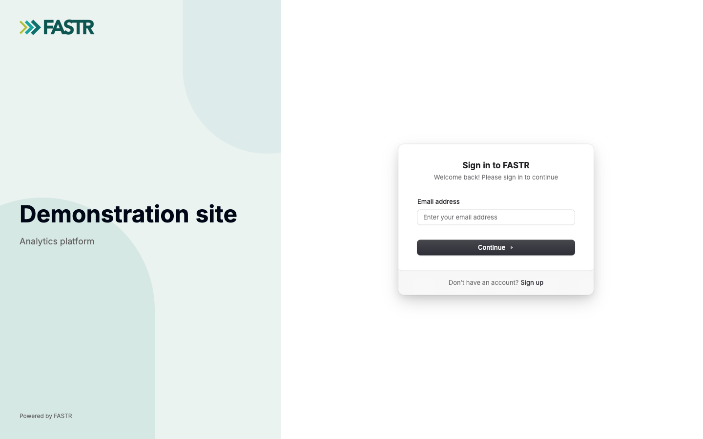

Iniciar sessão → A sua pasta → Explorar

# Iniciar sessão na plataforma

<strong>Atividade</strong> · <strong>Primeiros passos</strong> · <strong>~10 min</strong>

<aside class="p1-sidebar">

Antes de começar

- ☐ Assistiu à demonstração da plataforma feita pelo facilitador
- ☐ Tem o **URL da plataforma do seu país** (o facilitador irá partilhá-lo)
- ☐ Tem um endereço de email funcional que pode consultar durante a atividade

</aside>

## O que vai fazer

Criar uma conta FASTR se for novo, iniciar sessão e aprender a orientar-se no ecrã inicial. Ainda sem trabalho com dados.

<h2 class="step-h">1Abrir o URL da plataforma</h2>

Vá ao URL da plataforma do seu país num navegador (o formato é geralmente `https://<país>.fastr-analytics.org`). Chega ao ecrã de início de sessão.

---

<h2 class="step-h">2Registar-se ou iniciar sessão</h2>

- **Primeira vez:** clique em **Registar-se** abaixo do formulário, introduza o seu **Endereço de e-mail** e uma **Palavra-passe**, e crie a conta. Procure na sua caixa de entrada o email de verificação e clique na ligação que ele contém. Se não chegar nada em dois minutos, verifique a pasta de spam.
- **Já tem conta:** escreva o seu endereço de e-mail e a palavra-passe e clique em **Continuar**.

<h2 class="step-h">3Conhecer o ecrã inicial</h2>

Depois de iniciar sessão, chega a **Produtos**: uma lista única de tudo o que as pessoas desta instância criaram, organizada em **pastas**. Cada linha é uma **Apresentação**, um **Relatório** ou uma **Visualização**, com o pacote de resultados e o âmbito de onde lê os dados, e a data da última atualização.

---

A **navegação lateral** à esquerda é a mesma em todos os ecrãs. Clique na pequena seta no fundo para mostrar as etiquetas:

| Entrada | Para que serve |
|---|---|
| **Produtos** | As suas apresentações, relatórios e visualizações, em pastas. É onde vai passar a maior parte do tempo. |
| **Explorar** | Tabelas, gráficos e mapas já prontos para cada módulo de análise, sem ter de criar um produto. Útil para uma consulta rápida. |
| **Resultados** | Os pacotes de resultados: as análises calculadas de onde os produtos leem os dados. |
| **Âmbitos** | Vistas nomeadas dos dados (uma área, um período) às quais os produtos e os utilizadores podem ser limitados. |
| **Dados**, **Recursos**, **Utilizadores** | Administração: importações, indicadores, ficheiros partilhados, contas. Pode não ver todas estas entradas. |

A barra superior tem a **Ajuda** (visitas guiadas, documentação, comentários), a troca de idioma, as notificações e a **sua conta**. O botão **IA** fica no canto inferior direito de todos os ecrãs.

<h2 class="step-h">4Abrir um produto</h2>

Clique numa pasta para a expandir, e depois clique em qualquer produto dentro dela. Abre no seu próprio editor; a seta de retorno no canto superior esquerdo leva-o de volta à lista. Abra também **Explorar** uma vez, para ver o que existe lá.

> **Já não existem projetos.** Se usou o FASTR anteriormente, esta é a principal mudança: tudo o que pertence ao país está numa só lista, e as pastas substituem os projetos. Cada apresentação ou relatório está ligado a um pacote de resultados e a um âmbito, indicados na sua linha.

## Ponto de verificação

Deverá conseguir:

- Ver a lista **Produtos** com pelo menos uma pasta
- Nomear as entradas da navegação lateral
- Abrir um produto e voltar à lista

Se sim, passe à atividade seguinte.

---

## O que pode correr mal

- **«Conta não aprovada»** ou uma lista de Produtos vazia. A sua conta tem de ser aprovada por um administrador da instância antes de ver qualquer coisa. Peça ao facilitador.
- **O email de verificação nunca chega.** Verifique o spam. Depois de cinco minutos, peça ao facilitador para o reenviar.
- **«Email ou palavra-passe inválidos» após o registo.** Confira o email que introduziu. Os erros de escrita são comuns. Use a ligação de reposição da palavra-passe.
- **A navegação lateral mostra apenas ícones.** É o estado recolhido. Clique na seta no fundo da barra para a expandir, ou passe o rato sobre um ícone para ler a sua etiqueta.
- **A interface está no idioma errado.** Clique no botão de idioma na barra superior (EN ou FR) e escolha.

## A seguir

Avance para **Criar uma pasta para o seu trabalho**: uma pasta com o seu nome na página Produtos, para que a equipa encontre aquilo que criar.
