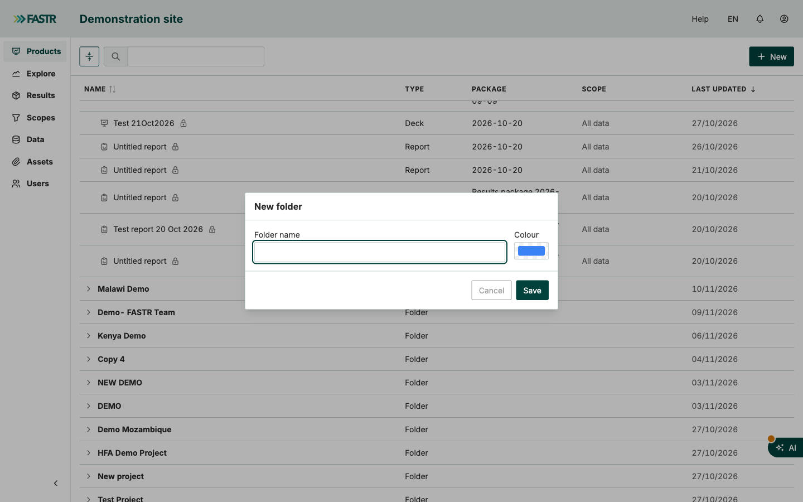
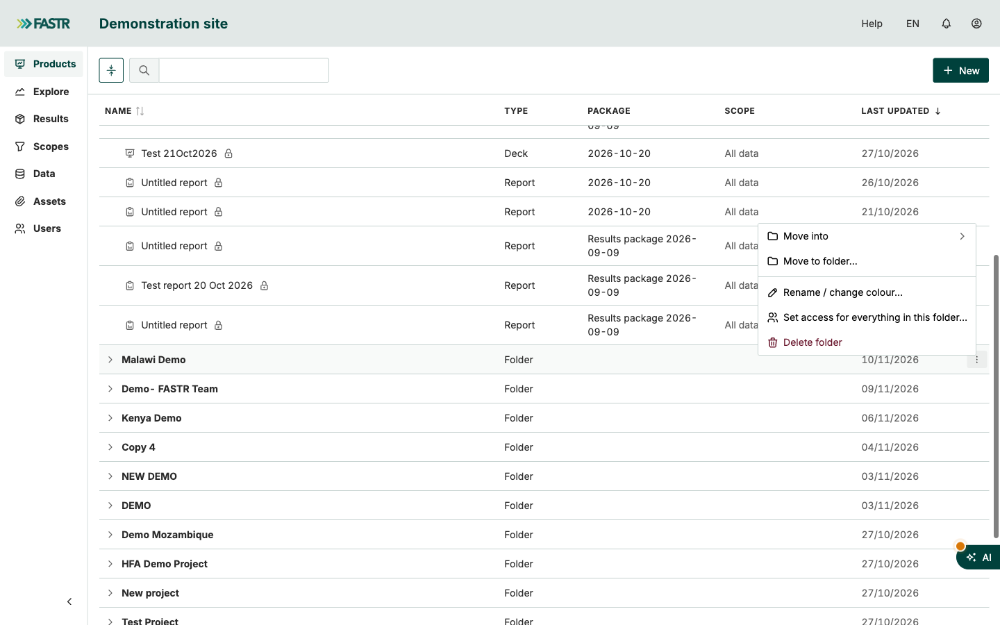

Iniciar sessão → A sua pasta → Explorar

# Criar uma pasta para o seu trabalho

<strong>Atividade</strong> · <strong>Primeiros passos</strong> · <strong>~5 min</strong>

<aside class="p1-sidebar">

Antes de começar

- ☐ Concluiu **Iniciar sessão na plataforma**
- ☐ Está na página **Produtos**

Porque é importante

A equipa de país inteira trabalha na mesma lista de Produtos. Uma dúzia de pessoas a guardar gráficos e apresentações sem sistema significa que ninguém consegue encontrar nada mais tarde. **Uma pasta por pessoa** é a regra mais simples que funciona.

</aside>

## O que vai fazer

Criar uma pasta com o seu nome na página Produtos. Todas as apresentações, relatórios ou visualizações que criar durante o workshop vão para dentro dela.

<h2 class="step-h">1Criar a pasta</h2>

1. Na página **Produtos**, clique em **Novo** (canto superior direito) e depois em **Nova pasta**.
2. Escreva o seu nome no campo **Nome da pasta** (por exemplo `Aïcha N.` ou `John S.`). Escolha uma **Cor** se quiser.
3. Clique em **Guardar**.

---

<h2 class="step-h">2Encontrá-la na lista</h2>

A sua pasta aparece na lista com o tipo **Pasta**. Clique nela para a expandir: por agora está vazia. Use a caixa de pesquisa no topo da lista se a lista for longa.

<h2 class="step-h">3Conhecer o menu da pasta</h2>

Passe o rato sobre a linha da sua pasta e clique no menu **⋮** no extremo direito. Vai usar estas opções mais tarde:

- **Mover para dentro** / **Mover para a pasta…**: as pastas podem ficar dentro de outras pastas, por exemplo uma pasta de país com uma subpasta por pessoa.
- **Mudar o nome / alterar a cor…**
- **Definir o acesso a tudo o que está nesta pasta…**: quem pode ver ou editar todos os produtos que ela contém.
- **Eliminar pasta**

> **Quando cria um produto,** a caixa de diálogo pede a **Pasta**. Escolha a sua. Um produto que ficou na pasta errada move-se com **Mover para a pasta…** no seu próprio menu ⋮.

## Ponto de verificação

Deverá agora ter uma pasta com o seu nome na página Produtos, vazia. As próximas atividades vão preenchê-la.

---

## Convenções de nomes

- Use o seu nome, não «a minha pasta» nem «teste». Os seus colegas também criam pastas, e «teste» vai sobrepor-se a outras.
- Acentos e espaços são aceites nos nomes das pastas.
- Se a equipa já tiver uma pasta de país, crie a sua dentro dela: crie-a e depois use **Mover para dentro** da pasta do país.

## O que pode correr mal

- **Não existe a entrada «Nova pasta» no menu Novo.** Criar pastas exige um acesso aos dados mais amplo do que apenas consultar. Peça ao facilitador para verificar o seu papel.
- **A pasta não guarda.** A rede pode ter caído. Atualize a página; se a pasta já existir com o seu nome, está na lista.
- **Vê as pastas de todas as pessoas.** É esperado. A equipa inteira partilha uma só lista; a sua é apenas uma linha nela.

## A seguir

Avance para **Dar uma primeira olhada com o Explorar**: as análises já calculadas, em tabelas e gráficos, sem nada para criar por agora.
