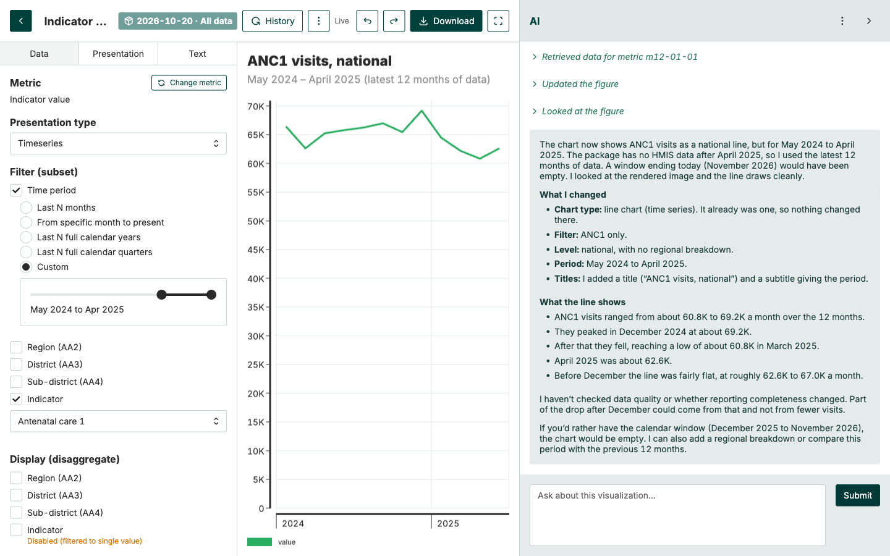

Ler uma visualização → Construir manualmente → Construir com IA → Escrever interpretação → Interpretação com IA → Detetar perturbação

# Construir uma visualização com o assistente de IA

<strong>Atividade</strong> · <strong>Visualizações e interpretação</strong> · <strong>~15 min</strong>

<aside class="p1-sidebar">

Antes de começar

- ☐ Já construiu pelo menos um gráfico manualmente (ficha anterior)
- ☐ Tem sessão iniciada e está na página **Produtos**
- ☐ Sabe que indicador quer representar (ANC1, Penta3, …)

Uma regra

A IA trabalha **dentro de um produto**. Na página Produtos só lhe pode dizer o que existe; abra uma visualização, uma apresentação ou um relatório e ela consegue ler os dados e desenhar.

</aside>

## O que vai fazer

Pedir ao assistente de IA que construa o mesmo tipo de gráfico que acabou de construir manualmente, escrevendo um pedido em linguagem comum. Mesmo resultado, caminho diferente.

<h2 class="step-h">1Começar de uma visualização em branco</h2>

Na página **Produtos**, clique em **Novo → Nova visualização**, mantenha o pacote fixado e **Todos os dados**, e clique em **Seguinte**. Escolha qualquer métrica e predefinição para ter um editor aberto (por exemplo **Indicator values** (valores dos indicadores) **→ Indicator value → Tabela de scorecard → Inserir**). O que escolher não importa: a IA vai alterá-lo.

Mude-lhe o nome logo (clique no título) para a reconhecer na lista: *Teste de IA, ANC1*.

---

<h2 class="step-h">2Pedir</h2>

O painel de IA fica à direita do editor, com a caixa **Pergunte sobre esta visualização…**. Escreva um pedido curto e clique em **Enviar**:

> *«Muda isto para um gráfico de linhas só do ANC1, nacional, para os últimos 12 meses de dados.»*

A IA lê o editor da figura, consulta as métricas, recolhe os dados, atualiza a figura, observa o resultado, e responde dizendo o que alterou e o que a linha mostra. O gráfico à esquerda atualiza-se enquanto ela trabalha; os passos que seguiu ficam listados acima da resposta.

> **A IA edita a visualização que tem aberta, e as edições guardam-se em direto.** É por isso que começa de uma em branco. Se lhe pedir para alterar o gráfico de um colega, altera o gráfico do colega. Use primeiro **⋮ → Duplicar** na página Produtos quando quiser manter o original.

<h2 class="step-h">3Verificar o que ela fez</h2>

Leia a resposta face ao que pediu:

- Indicador certo? Nível certo? Período certo? A IA indica quando ajustou a janela, por exemplo porque o pacote não tem dados dos meses mais recentes.
- Gráfico de linhas para uma tendência, ou outra coisa?
- Que **valores dos dados** usou? A métrica expõe o não ajustado, o ajustado para valores atípicos, o ajustado para a completude e ambos. Se a resposta não o disser, pergunte.

Abra o separador **Dados** à esquerda: os filtros e as opções de apresentação que ela definiu estão lá, exatamente como se os tivesse clicado.

---

<h2 class="step-h">4Iterar</h2>

A primeira resposta raramente entrega o gráfico que quer. Refine em pequenos passos, na mesma conversa:

- *«Desagrega por região.»*
- *«Acrescenta Penta1 no mesmo gráfico.»*
- *«Usa antes as contagens não ajustadas.»*
- *«Dá-lhe um título que enuncie a conclusão.»*

Cada instrução é um pequeno passo. A IA também propõe ações seguintes no fim de cada resposta; use-as ou ignore-as.

<h2 class="step-h">5Manter o resultado</h2>

Não há nada para guardar: a visualização já está atualizada e está na lista de Produtos. Clique na seta de retorno e verifique que está na sua pasta (**⋮ → Mover para a pasta…** se não estiver). Se mudar de ideias, o **Histórico** no topo do editor lista todas as versões, com **Restaurar**.

## Experimente com três indicadores

Repita o mesmo fluxo com três indicadores de programas diferentes (consulta pré-natal, vacinação, partos). Vai ganhar sensibilidade para como a IA lê pedidos curtos, e para o que tem de ser explicitado.

---

## Manual vs IA: quando usar cada um

- **Manual** quando sabe exatamente o que quer e clicar é mais rápido do que escrever.
- **IA** quando quer explorar (*«mostra-me algo útil sobre a consulta pré-natal»*), quando não se lembra dos nomes dos filtros, ou quando quer um primeiro rascunho do título e do subtítulo.

> A IA é um acelerador, não um substituto. É você que decide se o gráfico responde à pergunta. E, como ela edita em direto, é você que decide também que gráfico pode ser tocado.

## O que pode correr mal

- **«Não está aberto nenhum pacote de resultados aqui.»** Fez o pedido a partir da página Produtos. Abra primeiro uma visualização, uma apresentação ou um relatório.
- **O gráfico ficou vazio.** A janela que pediu não tem dados (o pacote termina mais cedo). Peça *«os últimos 12 meses de dados»* em vez de datas de calendário.
- **Alterou a coisa errada.** Diga-o na conversa, ou abra o **Histórico** e restaure a versão anterior.

## A seguir

A próxima ficha é sobre **escrever a interpretação**: o texto que acompanha o gráfico no diapositivo. Use o quadro de seis passos da referência *Ler uma visualização*.
