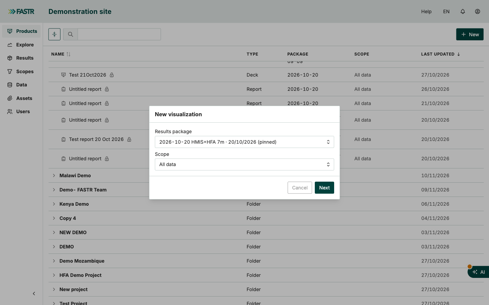
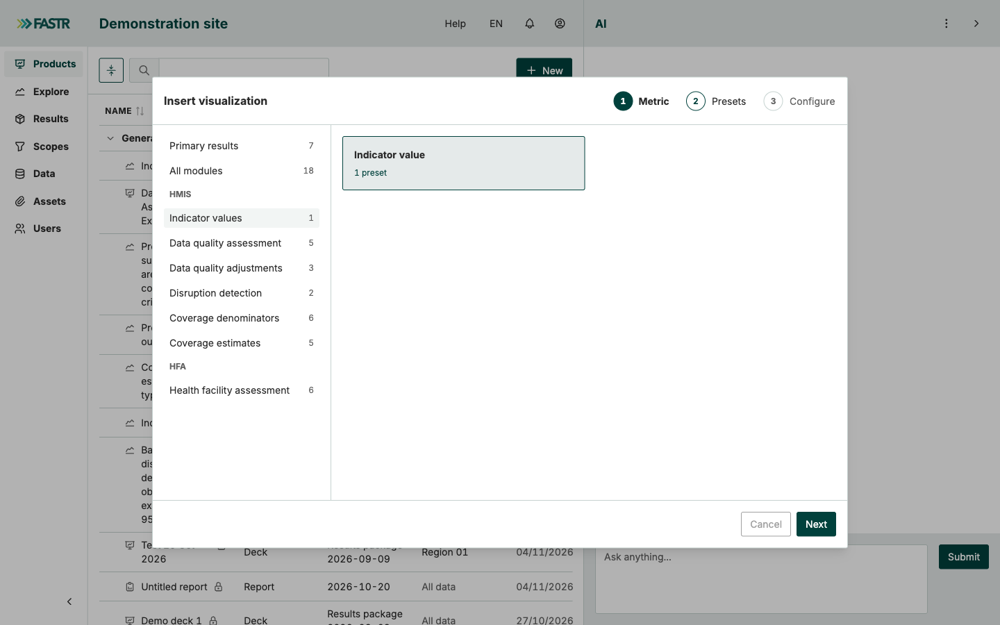
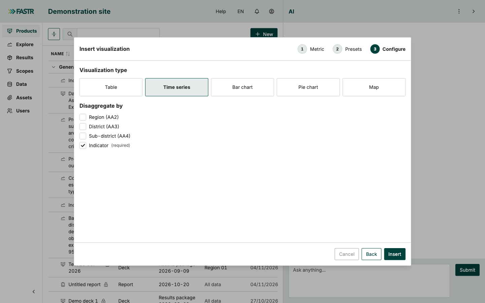
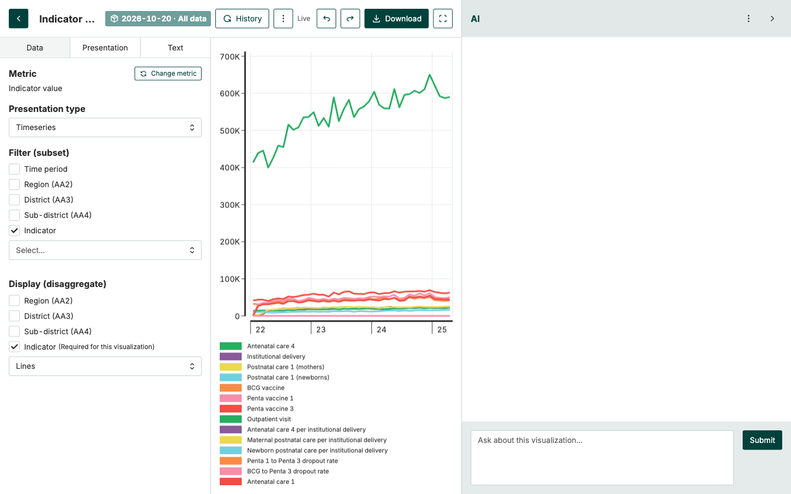
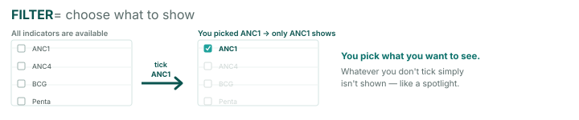
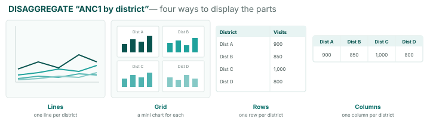

Ler uma visualização → Construir manualmente → Construir com IA → Escrever interpretação → Interpretação com IA → Detetar perturbação

# Criar a sua primeira visualização

<strong>Atividade</strong> · <strong>Visualizações e interpretação</strong> · <strong>~15 min</strong>

<aside class="p1-sidebar">

Antes de começar

- ☐ Tem sessão iniciada e está na página **Produtos**
- ☐ Tem uma pasta sua (ver *Criar uma pasta para o seu trabalho*)

</aside>

## O que vai fazer

Construir três gráficos de linhas, cada um guardado como visualização na sua pasta: primeiro **ANC1**, depois **BCG**, depois **um indicador à sua escolha**. A próxima atividade faz a mesma tarefa com o assistente de IA.

Uma visualização é um produto, como uma apresentação ou um relatório. Tem a sua própria linha na página Produtos, guarda-se sozinha, e pode ser copiada para qualquer apresentação ou relatório mais tarde.

<h2 class="step-h">1Começar uma nova visualização</h2>

Na página **Produtos**, clique em **Novo** e depois em **Nova visualização**. A primeira caixa de diálogo pede o **Pacote de resultados** e o **Âmbito**. Mantenha o pacote fixado e **Todos os dados**, e clique em **Seguinte**.

---

<h2 class="step-h">2Escolher a métrica</h2>

A caixa de diálogo **Inserir visualização** tem três passos: **Métrica**, **Predefinições**, **Configurar**. A coluna da esquerda lista os módulos de análise pelo nome. Clique em **Indicator values** (valores dos indicadores), depois no cartão da métrica **Indicator value**, e escolha o nível geográfico **Nacional** no cartão. Clique em **Seguinte**.

> Uma **métrica** é *o que se mede*. A métrica Indicator value contém a contagem mensal de todos os indicadores da instância. Uma **predefinição** é uma forma já pronta de desenhar uma métrica. Cada módulo agrupa as métricas que produz; **Resultados principais** mostra as mais usadas de todos os módulos.

<h2 class="step-h">3Escolher como a desenhar</h2>

A métrica Indicator value oferece uma predefinição, **Tabela de scorecard**, que não é o que pretende aqui. Clique em **Personalizado** e depois em **Seguinte**. No passo **Configurar**, escolha **Série temporal** e clique em **Inserir**.

O gráfico abre no editor, com todos os indicadores desenhados ao longo do período completo.

---

<h2 class="step-h">4Filtrar para ANC1, últimos 12 meses</h2>

O editor tem um separador **Dados** à esquerda e o gráfico à direita. Em **Filtro (subconjunto)**:

- Marque **Indicador**. Aparece uma fila de etiquetas (ANC1, ANC4, BCG, …). Clique em **ANC1**. Só são desenhadas as etiquetas que selecionar.
- Marque **Período**. A predefinição é *últimos 12 meses*; ajuste o cursor se quiser outra janela.

O gráfico é redesenhado depois de cada alteração.

> **Valores dos dados.** A métrica oferece também quatro etiquetas de valores de dados: não ajustado, ajustado para valores atípicos, ajustado para a completude, ambos. A predefinição é a contagem totalmente ajustada, a versão mais limpa dos dados do seu país. Deixe-a como está, a não ser que queira especificamente outro ajustamento.

<h2 class="step-h">5Dar-lhe um nome e verificar a pasta</h2>

Não existe botão Guardar: as alterações são guardadas automaticamente e partilhadas em direto (a etiqueta **Em direto** ao lado do nome do pacote). Clique no título no topo do editor para mudar o nome, por exemplo *ANC1, mensal, últimos 12 meses*. Clique na seta de retorno para voltar à página Produtos e verifique que o gráfico está na sua pasta; se não estiver, use **⋮ → Mover para a pasta…** na linha dele.

## Agora faça-o mais duas vezes

Repita os cinco passos para **BCG** e depois para **um indicador à sua escolha** (Penta1, ANC4, consultas externas…). Deverá terminar com **três visualizações na sua pasta**.

---

## Filtrar vs desagregar: qual é a diferença?

Estas duas palavras surgem muito. Não são o mesmo:

- **Filtrar = escolher o que mostrar.** Escolha os indicadores, locais ou meses que quer; só esses aparecem. *Mostrar só ANC1*, ou *só a região Norte*. Como um foco de luz: aponta-o para o que quer ver.
- **Desagregar = decompor.** Dividir um total nas suas partes para as poder comparar: *uma linha por indicador*, ou *uma barra por distrito*. Nada é ocultado; o total é mostrado nas suas partes.

> **Exemplo.** Comece com *total de visitas ANC1, a nível nacional*. **Filtre** para a «região Norte»: agora vê só o ANC1 do Norte. **Desagregue** «por distrito»: o mesmo total dividido numa linha por distrito.

---

## Onde faz isto no editor

O separador **Dados** do editor tem as duas secções, uma abaixo da outra:

- **Filtro (subconjunto)**: marque **Período**, **Indicador** ou um nível administrativo, e depois escolha os itens a manter.
- **Apresentação (desagregar)**: marque a dimensão pela qual quer dividir, e depois escolha como mostrar as partes: **Linhas** (todas no mesmo gráfico), **Grelha** (um gráfico pequeno por parte), **Linhas de tabela** ou **Colunas** (uma tabela), **Gráficos diferentes** (um gráfico em tamanho real por parte).

Dois outros separadores ficam ao lado de Dados: **Apresentação** (cores, eixos, etiquetas) e **Texto** (título, subtítulo, nota de rodapé).

> **A armadilha quando usa os dois.** Divide um gráfico por distrito para comparar distritos, e depois filtra-o para um só distrito. Agora está a olhar para um único distrito isolado, sem nada para comparar. Use o filtro para escolher os dados, a desagregação para os dividir, e não filtre até ficar com apenas uma das coisas que queria comparar.

---

## Exercício: dividir o seu gráfico ANC1 por região

O seu gráfico ANC1 mostra uma linha nacional. Transforme-o em uma linha por região.

<h2 class="step-h">1Duplicar primeiro</h2>

Na página Produtos, abra o menu **⋮** da sua visualização ANC1 e clique em **Duplicar**. Mude o nome da cópia para *ANC1, mensal, por região*. As edições guardam-se sozinhas, por isso duplicar primeiro é a forma de manter o gráfico nacional intacto.

<h2 class="step-h">2Desagregar</h2>

Abra a cópia. Em **Apresentação (desagregar)**, marque o nível administrativo que quer comparar. No FASTR os níveis têm nomes genéricos: **Área administrativa 2** é normalmente a região, **Área administrativa 3** o distrito. Deixe a apresentação em **Linhas**: uma linha por região.

<h2 class="step-h">3Experimentar os outros estilos de apresentação</h2>

Os mesmos dados, outra forma. **Grelha** quando há muitas regiões e as linhas se sobrepõem. **Linhas de tabela** ou **Colunas** quando quer os valores exatos. **Gráficos diferentes** quando cada região merece uma leitura completa. Escolha o que se ler melhor.

### Agora faça-o para o BCG

Duplique o seu gráfico BCG e divida-o da mesma forma. Deverá terminar com dois gráficos regionais na sua pasta.

---

## Experimente algumas opções

Depois de guardar os seus gráficos, comece outra **Nova visualização** e veja outros módulos no passo Métrica:

- **Coverage estimates** (estimativas de cobertura): uma curva de cobertura em vez de uma tendência de volume.
- **Disruption detection** (deteção de perturbações): o observado face ao esperado, com a banda credível (a última atividade desta série usa-a).
- **Explorar**, na navegação lateral, mostra um gráfico já pronto para cada módulo sem criar nada. Útil para ver o que um módulo produz antes de construir com ele.

> **Dica:** uma série temporal é melhor para uma tendência. Um gráfico de barras compara períodos ou locais. A ficha de referência *Como ler uma visualização FASTR* aprofunda o tema.

## Verifique-se

Deverá ter agora:

- **Três visualizações na sua pasta**: ANC1, BCG e uma à sua escolha, mais duas cópias regionais.
- O caminho na memória: **Novo → Nova visualização → pacote e âmbito → módulo → métrica → predefinição ou Personalizado → Inserir**, e depois **Filtro** e **Apresentação** no separador Dados.
- O hábito de **duplicar antes de alterar** um gráfico que quer manter.

## A seguir

A próxima atividade faz a mesma coisa com o assistente de IA, de dentro da visualização: escrevendo o pedido em vez de clicar. Mesmo resultado, caminho diferente.
