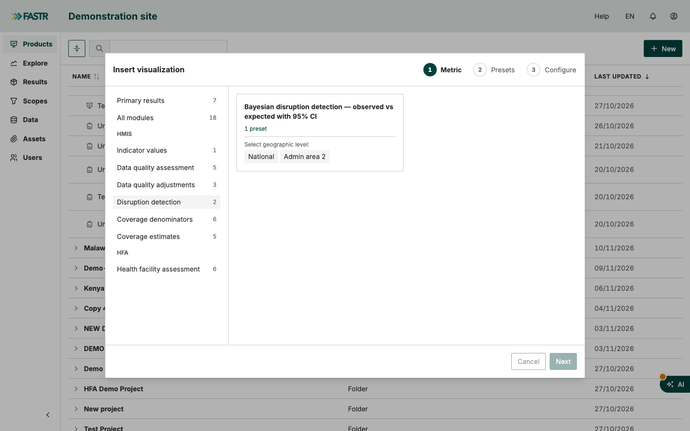
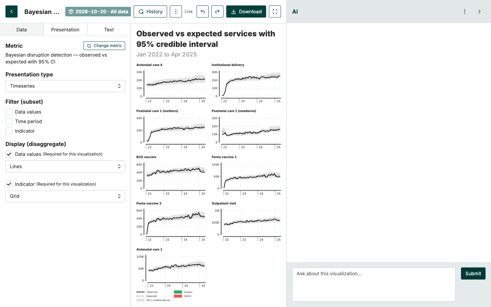

Ler uma viz → Construir manualmente → Construir com IA → Escrever interpretação → Interpretação IA → Identificar perturbação

# Aplicação — identificar uma perturbação

<strong>Atividade</strong> · <strong>Visualizações & Interpretação</strong> · <strong>~25 min</strong>

<aside class="p1-sidebar">

Antes de começar

- ☐ Concluiu os 5 documentos anteriores
- ☐ Está autenticado na plataforma, na página **Produtos**
- ☐ Tem uma pasta sua

Porque é importante

Os primeiros cinco documentos ensinaram a técnica. É aqui que a usa: abrir um gráfico de perturbações real do seu país, aplicar o quadro de seis passos, e produzir um achado que um decisor possa de facto utilizar.

</aside>

## O que vai fazer

Criar o gráfico nacional de perturbações a partir do módulo Disruption detection, restringi-lo a um indicador e a um período de interesse, percorrer o quadro de seis passos, e depois escrever um achado em três partes para partilhar com a sala.

---

<h2 class="step-h">1Criar o gráfico de perturbações</h2>

Na página **Produtos**, clique em **Novo → Nova visualização**, mantenha o pacote fixado e **Todos os dados**, e clique em **Seguinte**. No passo Métrica, clique no módulo **Disruption detection** (deteção de perturbações), depois no cartão **Bayesian disruption detection — observed vs expected with 95% CI**, escolha o nível **Nacional**, e clique em **Seguinte**. Escolha a predefinição **Gráfico de perturbações com banda credível de 95%** e clique em **Inserir**.

> Já foi construído por um colega? A página Produtos pode ter um. Abra-o e faça **⋮ → Duplicar**, para que os seus filtros não alterem os dele: as edições guardam-se em direto.

<h2 class="step-h">2Ler a vista por defeito</h2>

O gráfico abre com cada indicador-base num pequeno gráfico em grelha. Duas linhas pretas atravessam cada um: uma linha **contínua** para o **volume mensal observado**, e uma linha **tracejada** para o volume **esperado**, modelado a partir das unidades sanitárias que reportaram nesse mês. Uma **banda cinzenta** em torno da linha do esperado é o intervalo credível de 95%. Onde a linha observada desce **abaixo da banda**, a diferença é preenchida a **vermelho** (um défice); onde sobe **acima**, é preenchida a **verde** (um excedente). Dentro da banda é variação normal.

---

<h2 class="step-h">3Filtrar a um indicador</h2>

No separador **Dados** à esquerda, em **Filtro (subconjunto)**, marque **Indicador**. Surge uma lista de etiquetas de indicadores (ANC1, ANC4, BCG, parto, Penta1…). Clique numa etiqueta para manter apenas esse indicador; clique em mais para acrescentar outros.

Quando só um indicador está selecionado, a grelha colapsa num gráfico único em tamanho real. Marque **Período** para restringir ainda mais a janela temporal.

---

<h2 class="step-h">4Aplicar os seis passos</h2>

No gráfico filtrado, percorra o quadro de seis passos do documento *Ler uma viz*:

| Passo | Para este gráfico |
|-------|-------------------|
| 1. Que indicador? | O que filtrou |
| 2. Que nível e período? | Nacional. O período que escolheu. |
| 3. O que se compara? | Volume mensal observado (linha contínua) vs **esperado** (linha tracejada, modelado a partir das mesmas unidades sanitárias que reportaram), com a banda cinzenta de 95% |
| 4. Ler os valores | Onde é que a diferença se enche de vermelho (observado abaixo da banda)? Em quanto? |
| 5. O que se destaca? | Uma queda sustentada, três meses ou mais? Um pico isolado? Um padrão? |
| 6. E então? | Que ação isto sugere? |

---

<h2 class="step-h">5Adicionar contexto que o gráfico não mostra</h2>

O gráfico mostra o *quê*. A sua equipa-país traz o *porquê*. Identificado um padrão, junte o que sabe:

- Houve alguma **mudança no financiamento ou nos recursos humanos** nesse período?
- Há **lacunas conhecidas em insumos ou recursos humanos** (medicamentos, equipamento, pessoal)?
- Mesmo que os **números pareçam bons**, a qualidade dos cuidados caiu?

<h2 class="step-h">6Escrever o seu achado</h2>

Use a estrutura em três partes do documento *Escrever uma interpretação*:

1. **Título** — a mensagem numa frase
2. **O que se vê** — os factos visíveis no gráfico
3. **O que significa** — o "e então", ligado a um próximo passo concreto

<h2 class="step-h">7Partilhar com a sala</h2>

Quando cada equipa-país terminar, uma pessoa partilha o achado. Atenção a:

- O achado é **específico**? Um indicador, um período, uma ação.
- O "e então" está **ligado a um decisor real**?
- A equipa **trouxe contexto local** que o gráfico sozinho não mostrava?

## A observar

- **Uma queda de um único mês é, em regra, ruído.** Procure uma queda sustentada, três meses ou mais.
- **Verde não é "bom" nem vermelho é "mau".** Apenas indicam direção: verde = observado acima da banda, vermelho = observado abaixo dela. Dentro da banda nada é colorido, e esse é o caso normal. Uma zona vermelha sustentada ao longo de vários meses é o que importa investigar.
- **As falhas de reporte já estão tratadas.** A linha do esperado é construída a partir das unidades sanitárias que reportaram nesse mês, por isso uma unidade que deixa de reportar não aparece como perturbação. Uma zona vermelha é uma mudança real entre as unidades que reportaram.

## A seguir

Termina aqui a série *Visualizações & Interpretação*. O módulo seguinte trata da construção de relatórios — juntar os gráficos, interpretações e achados num documento partilhável.
